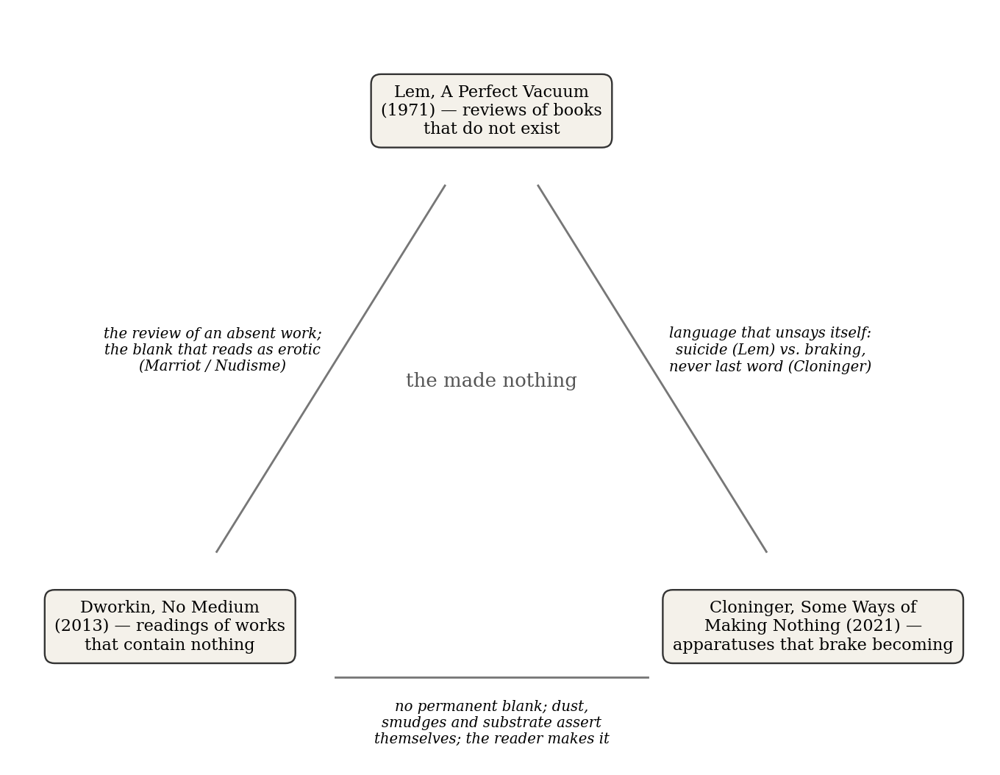
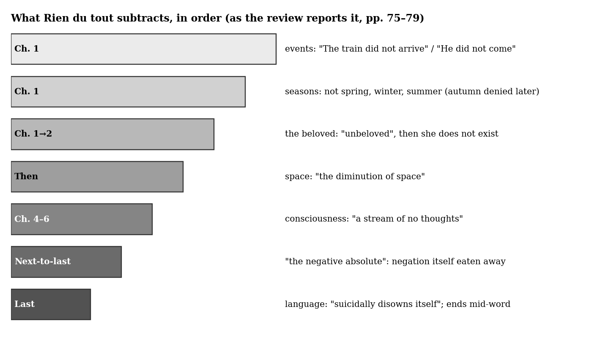
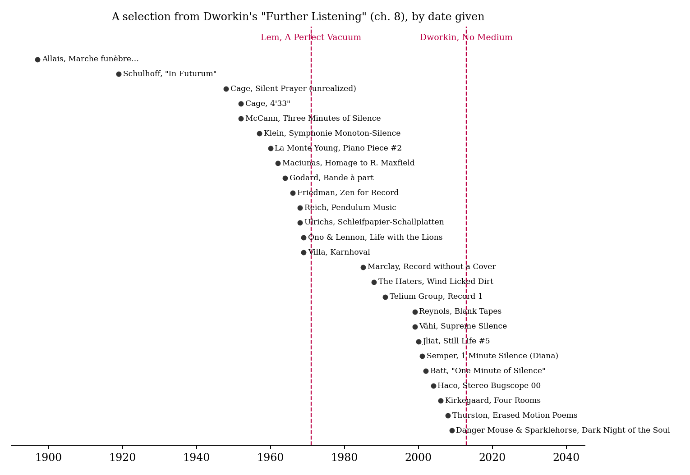
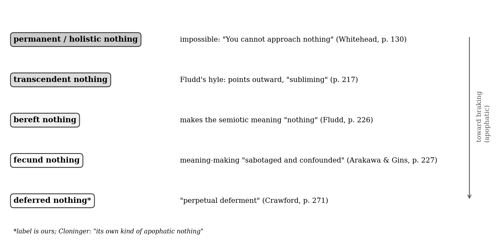

*Triad 24 of 32 · 2026-10-17 · Difficulty 4 · Shared form or method, Shared figure or motif, Conflict*

## The three books

- [[books/7480-a-perfect-vacuum|A Perfect Vacuum]], [[people/stanisaw-lem|Stanisław Lem]], [[people/michael-kandel|Michael Kandel]] (translator); 1971. *Anchor: the impossible blank book, reviewed; the extreme position (nothing reached only by language's self-annihilation)*
- [[books/4416-no-medium|No Medium]], [[people/craig-dworkin|Craig Dworkin]]; 2013. *Empirical counterweight: real blank works read closely; denies any true blank*
- [[books/7214-some-ways-of-making-nothing-apophatic-apparatuses|Some Ways of Making Nothing: Apophatic Apparatuses in Contemporary Art]], [[people/curt-cloninger|Curt Cloninger]]; 2021. *Theory: a taxonomy of nothings and an ethics of making them; argues with both Lem (no permanent nothing) and Dworkin (nothing can be made, as braking)*

---

## The Thread

Three books try to make a work out of nothing, and each ends up writing about a reader who will not stop filling it in. In Stanisław Lem’s *A Perfect Vacuum* (1971), a fictional critic reviews *Rien du tout, ou la consequence*, a novel by the invented Solange Marriot made entirely of negations, “a critique of a book that not only does not exist but also cannot” (p. 4). Craig Dworkin’s *No Medium* (2013) does the reverse: it reads blank books, erased drawings and silent records that really exist, and ends with “Further Listening,” a discography of silences written in a record reviewer’s voice. Curt Cloninger’s *Some Ways of Making Nothing* (2021) supplies the theory the other two dispute. It sorts “a variety of flavors of qualitative nothing” (p. 15) and argues that making nothing is a deliberate braking of becoming, not a matter of abstaining.

The links are exact. Lem’s reviewer and Dworkin both find that the blank turns erotic in the reader’s head. Marriot’s readers imagine a tryst at a railway station, and Cocteau’s blank journal *Nudisme* promises nudity and withholds it. Lem’s language “suicidally disowns itself” (p. 79). Cloninger’s apophasis allows no last word, and Dworkin holds that “there are no real absences, only replacements”. That is a three-way disagreement over whether a nothing can be finished. **Connection kinds:** shared form or method (the review or reading of an absent work), shared figure or motif (the blank that reads as erotic; dust on the void), conflict (whether nothing can be completed). **Difficulty: 4.**

## A Perfect Vacuum — Stanisław Lem (1971; trans. Michael Kandel, 1979)

*PDF (scanned with OCR text layer) · Calibre ID 7480 · Page numbers are the printed pages of the English edition.* → [[books/7480-a-perfect-vacuum|book page]]

**Selection logic.** This is the anchor. Its “Rien du tout” review is the purest thought experiment of the three: a book that consists only of what did not happen, judged by a critic who has to admit the reader supplies everything. It contributes the review form to the set and the most extreme position, a nothing that can be reached only by language destroying itself.

**Overview.** Fifteen reviews of books that do not exist, followed by a lecture. The first review is of *A Perfect Vacuum* itself. The targets run from the nouveau roman to cosmology, and the last item, “The New Cosmogony,” is a Nobel lecture on a universe whose physics is a game played between civilizations. “Rien du tout” (pp. 69–79) is the hinge. Its reviewer argues that literature always lies, that the self-novel and the antinovel both failed to stop lying, and that the only decent book left is one that negates everything, down to its own grammar.

**Excerpt (p. 75).** The reviewer on the novel’s first two sentences and on who is responsible for what follows:

*Figure 1: Constellation: what passes between the three books*

> The first sentence of Rien du tout, ou la consequence reads, “The train did not arrive” ; in the next sentence we find “He did not come.” We meet, then, with negations, but of what exactly? From the standpoint of logic these are total negations, since the text affirms absolutely nothing existentially; […]
>
> *(Shortened for the public edition.)*

**Quotes.**

- “It was necessary, then—and herein is the consequence—to write nothing.” (p. 71)

- “Total freedom is total paralysis in literature.” (p. 72)

- “Instead of a print we obtain an exact negative, that is all. The nature of an innovation must be ontological, and not simply grammatical!” (p. 74)

- “Nonbeing is already known to us in literature, but only as a certain Lack—of Something— for Someone.” (p. 75)

- “How can a thing be in bad taste which is not there at all?!” (p. 76)

- “The novel does not end: it ceases.” (p. 79)

- On Barthes and *Writing Degree Zero*: “but for all its famous wit, his is a shallow intellect” (p. 71). The verdict belongs to Lem’s invented critic, which makes it harder to dismiss and harder to quote.

**Diagram: the order of subtraction.** Taken from the review’s chapter-by-chapter account. Where the review gives no chapter number, the stage is marked “Then.”

*Figure 2: What Rien du tout subtracts*

**Derived list: the imaginary library** (from the contents pages; OCR errors corrected where obvious)

1. *A Perfect Vacuum* — S. Lem (p. 3)

2. *Les Robinsonades* — Marcel Coscat (p. 9)

3. *Gigamesh* — Patrick Hannahan (p. 28)

4. *Sexplosion* — Simon Merrill (p. 41)

5. *Gruppenführer Louis XVI* — Alfred Zellermann (p. 49)

6. *Rien du tout, ou la consequence* — Solange Marriot (p. 69)

7. *Pericalypsis* — Joachim Fersengeld (p. 80)

8. *Idiota* — Gian Carlo Spallanzani (p. 86)

9. *U-Write-It* (p. 96)

10. *Odysseus of Ithaca* — K. Mlatje (p. 102) 11. *Toi* — Raymond Seurat (p. 112) 12. *Being Inc.* — Alastair Waynewright (p. 117) 13. *Die Kultur als Fehler* — Wilhelm Klopper (p. 127) 14. *De Impossibilitate Vitae* and *De Impossibilitate Prognoscendi* — Cezar Kouska (p. 141) 15. *Non Serviam* (p. 167) 16. *The New Cosmogony* (p. 197)

Two of the sixteen (Coscat and Marriot) are, by the self-review’s own account, jokes at the nouveau roman’s expense, and the self-review files Marriot’s under “Parodies, pastiches, gibes” (p. 4). The parody still makes the strongest case of the three books.

## No Medium — Craig Dworkin (2013)

*EPUB · Calibre ID 4416 · Locations by chapter.* → [[books/4416-no-medium|book page]]

**Selection logic.** Dworkin is the empirical counterweight. Where Lem has to invent his blank book, Dworkin finds hundreds of real ones: Cocteau’s *Nudisme*, Aram Saroyan’s unprinted paper, Rauschenberg’s *Erased de Kooning Drawing* and *White Paintings*, Tom Friedman’s erased centerfold, and a long run of silent records. His thesis cuts against both of the others. No work is blank, since the blank is always paper, dust, a groove, a social act of reading.

**Overview.** Eight short chapters. “The Logic of Substrate” opens with Orpheus flipping through *Nudisme* and ends with a definition of media as “analyses of networked objects in specific social settings.” “Cenography” covers erasures. “Textual Prostheses” treats footnotes and books that are all apparatus. The middle chapters include photographs bound as books (“The Dative of Form”), translation (“Tangent”) and recorded sound (“Signal to Noise”). “Further Listening” is an annotated discography of silent and blank records.

**Excerpt (ch. 1, “The Logic of Substrate,” opening).**

> Orpheus glances at the cover—its spare, thinly bordered design and elegant Didot typeface obviously meant to evoke a volume from éditions de Minuit—and then flips quickly through, objecting: “Je ne vois que des pages blanches [I see only blank pages].” His companion—an older writer who is respected, not coincidentally, for maintaining decades of principled poetic silence—explains: […]
>
> *(Shortened for the public edition.)*

Set this beside Lem’s railway station. *Nudisme* works by “first eliciting the shock of the prudish bourgeois reader by announcing a salacious subject and then by denying the prurient (and equally bourgeois) expectation of any titillating material within” (ch. 1). Marriot’s academician did the prudish half on his own.

**Quotes.**

- “the difference between the sophistication of getting the joke and the greater sophistication of refusing to get the joke depends on how closely one reads a work that seems to ask only that it not be read.” (ch. 1)

- “Media—if there are such things—are only recognizable as collectives.” (ch. 1)

- “The goal of this book, accordingly, has been to linger at those thresholds and to actually read, with patience, what appears at first glance to be illegibly blank.” (ch. 1)

- He tries “to resist falling back on the sensational metaphysics of either a reified nothingness or the poststructural apotheosis of absence and lack” (ch. 1). This sentence is aimed squarely at Marriot.

- “there are no real absences, only replacements” (ch. 2, “Cenography”)

- A reader of a half-blank issue of *The Little Review*, quoted by Dworkin: “Those blank pages linked with the cosmos: space before creation.” (ch. 1)

**Other: what the journal was not called.** In chapter 1 Dworkin lists the titles Cocteau passed over for *Nudisme*, each with its own baggage. Together they make a small glossary of nothing:

- *Silence*: too close to Jean Bruller’s (Vercors’s) *Silence de la mer*, the first éditions de Minuit book.

- *Néant*: Sartrean, and too close to the actual Café de Flore.

- *Rien*: “could have signaled either a Dadaist nihilism or rarified aestheticism.”

- *Manque*: “psychologized,” the word Lacan would soon make a technical term.

- *Vacuité*: “mystical Buddhist.”

- *vide, absence, lacune, vacance*: “et cetera.”

**Derived list and timeline: “Further Listening.”** Dworkin writes these entries the way a record reviewer would, with verdicts. On a 4’33” compilation: “The other five tracks are inconsequential, and the title track performance of 4’33” reveals the conductor doesn’t take the tempi as marked; it clocks in a full 18 seconds too slow” (ch. 8). It is Lem’s fake review turned inside out, a real review of an empty object. Twenty-six of the entries are plotted below by the first date Dworkin gives, with Lem and Dworkin marked.

One finding from the plot: the line between parody and practice runs through 1971. Lem published his impossible negative novel two years after Ono and Lennon’s *Life with the Lions* and three after Ulrichs’s sandpaper discs.

## Some Ways of Making Nothing: Apophatic Apparatuses in Contemporary Art — Curt Cloninger (2021)

*PDF · Calibre ID 7214 · Page numbers are printed pages. The book is dedicated to two musicians as “master makers of unforeseen naughts.”* → [[books/7214-some-ways-of-making-nothing-apophatic-apparatuses|book page]]

**Selection logic.** Cloninger turns Lem’s joke and Dworkin’s catalogue into a theory, and he disagrees with both. Against Lem, there is no “permanent nothing,” only temporary braking. Against Dworkin’s materialism, a nothing can be made. It is not a blank but an apparatus that “resists (however fleetingly) the inevitable move toward becoming.” He also brings in two of your standing reference points, negative theology and quantum measurement, the second by way of Barad and the delayed-choice quantum eraser.

**Overview.** Part I builds the tools. Chapter 1 treats every artwork as a measuring apparatus in the quantum sense, using Barad and Whitehead. Chapter 2 reads apophasis through Pseudo- Dionysius and Marion. Part II pairs historical or scientific apparatuses with contemporary works: Fludd’s 1617 hyle diagram against Arakawa and Gins’s *Mechanism of Meaning*; Crawford’s *Stop Motion Studies* against the delayed-choice eraser; Citarella and Pope.L; Haim Steinbach’s shelves. Chapter 7 asks what making nothing is for.

*Figure 3: A selection from “Further Listening”*

**Quotes.**

- “There is, however, an important difference between abstaining from making something and purposefully making nothing.” (p. 130)

- Whitehead, as Cloninger quotes him: “You cannot approach nothing; for there is nothing to approach.” (p. 130)

- “A successful apophatic art apparatus is a work of art that resists (however fleetingly) the inevitable move toward becoming.” (p. 143)

- “Neither kataphasis nor apophasis ever get the last word.” (p. 143)

- “To equate blackness with nothing is to suffer from oculo-centrism” (p. 225)

- “Some nothings leave you pointing west, some leave you pointing east, and some leave you spinning your wheels in a ditch.” (p. 421)

**Derived list and diagram: Cloninger’s taxonomy of nothings.** Collected from across the book. The last label is ours.

*Figure 4: Cloninger’s kinds of nothing*

- *Permanent / holistic*: impossible, and not to be wished for (pp. 130–31).

- *Transcendent*: “Apophatic apparatuses don’t point outward toward a transcendent nothing. Instead, they actively brake the becoming of something.” (p. 217)

- *Bereft*: “Fludd’s diagrammatic apparatus makes a kind of bereft nothing (it makes the human-semiotic meaning “nothing”) while simultaneously making a host of proliferating material somethings.” (p. 226)

- *Fecund*: in Arakawa and Gins, “the viewer’s ability to make meaning is purposely sabotaged and confounded.” (p. 227) “They approach nothing because we can make nothing (definite) of them.” (p. 269)

- *Deferred*: “Stop Motion Studies enacts a kind of perpetual deferment which makes its own kind of apophatic nothing.” (p. 271)

**Other: a misreading worth attempting.** Run *Rien du tout* through Cloninger’s machine. Read the usual way, it is a *bereft* nothing: it makes the meaning “nothing,” while the reader, by the reviewer’s own account, keeps producing stations, trysts and anatomy. Read through its ending (it “ceases” mid-word), it might be a *fecund* nothing that strands the reader in aporia. Yet Cloninger rules out any last word, and the novel’s last act is a final one. Since the novel cannot exist, the critic’s review is the only apparatus in play. That makes Lem’s

book, not Marriot’s, the candidate for an apophatic apparatus, because it affirms a novel and then unsays it. Cloninger also warns that “many an art historian has conveniently interpreted Fludd’s hyle diagram as a precursor to a host of 20th-century abstract expressionist black paintings (from Kazimir Malevich to Frank Stella)” (p. 225). Test whether the same convenience is at work when *Rien du tout* is called a precursor of anything.

## Where this sends you

## Notebook

1. **The erotics of the void.** Lem’s reader supplies the station and the tryst (p. 75), and *Nudisme* offers nudity and withholds it (Dworkin, ch. 1). Write ten sentences that negate everything, as in “The train did not arrive.” Then write down what you supplied while reading them back. Is desire the default content of any blank, or only of blanks signed by a woman, as Lem’s critic twice insinuates (“A woman wrote this book?”, p. 77)?

2. **Ceasing vs. braking.** “The novel does not end: it ceases” (Lem, p. 79). “Neither kataphasis nor apophasis ever get the last word” (Cloninger, p. 143). Take one of your Gestext pieces and write two endings. In one the language gives out. In the other it is braked and left able to start again. Which would Cloninger call ethical (p. 421)?

3. **Three reviews.** Dworkin reviews a real silent record (“18 seconds too slow,” ch. 8), and Lem’s critic reviews an impossible book. Write three short reviews: one of an existing blank work, one of a book that cannot exist, and one of a book of your own of which only the title exists. Note where the critic’s voice starts doing the work the book does not.

## Rabbit holes

- Roy Sorensen, “Nothingness,” *Stanford Encyclopedia of Philosophy*: holes, shadows,

| empty worlds, negative truths. | A clean analytic contrast to all three books. | https: |
|---|---|---|
| //plato.stanford.edu/entries/nothingness/ |  |  |

- Eugene Thacker, “Black on Black,” *Public Domain Review* (2015). Starts from Fludd’s black square (“Et sic in infinitum”), Cloninger’s chapter 3 object. https://publicdomainreview.org/essay/black-on-black/

- Andrew Spira, “Precedents of the Unprecedented: Black Squares Before Malevich,” *Public Domain Review* (2022). This is the genealogy Cloninger warns against making too conveniently. https://publicdomainreview.org/essay/black-squares-before-malevich/

- Johanna Drucker, “Understanding Media: Craig Dworkin’s *No Medium*,” *Los Angeles Review of Books* (July 9, 2013). https://lareviewofbooks.org/article/understanding-media-craig-dworkins-no-medium/

- John Cage, *Silence: Lectures and Writings* (1961), full text on archive.org, which includes “Lecture on Nothing,” quoted in the first pages of Dworkin’s chapter 1. https://archive.org/stream/silencelecturesw1961cage/silencelecturesw1961cage_djvu.txt. A 41-minute performance by Frances-Marie Uitti is on UbuWeb: https://ubu.punctumbooks.com/sound/cage_nothing.html

- Pseudo-Dionysius, *Mystical Theology*, in an early English translation bound with *Mysticism: Its True Nature and Value* (archive.org). This is Cloninger’s main apophatic source. https://archive.org/details/cu31924090848742

## Also in your library

- **Silence: Lectures and Writings** — John Cage (1961), PDF, Calibre ID 5765. Contains the “Lecture on Nothing” Dworkin quotes at the start of *No Medium*.

- **A Philosophy of the Unsayable** — William Franke (2014), EPUB, Calibre ID 3958. Apophasis as a general theory of literature: Cloninger’s chapter 2 at book length.

- **The Non-Objective World: The Manifesto of Suprematism** — Kazimir Malevich (1927 Bauhaus book; English 1959), PDF, Calibre ID 5158. The manifesto behind the black square. Your copy is a scan with no text layer, so it would need OCR before anything could be quoted from it.

## From the Lexicon — Tzimtzum

**Your sense:** The paradigmatic figure of productive absence: the ontological gesture by which something withdraws so that something else may be. The absent father-God who makes creation possible by not-being-there.

**Received:** In Lurianic Kabbalah, the primordial act by which the Ein Sof (the Infinite) contracts or withdraws itself from a central point in order to create a vacated space (chalal panuy) within which finite creation can come into being.

**Etymology.** Hebrew root *ts-m-ts*, in the intensive Pi’el stem (sustained self-limitation). The cosmological sense is a sixteenth-century Lurianic coinage with no biblical antecedent.

**WordNet.** There is no WordNet entry, so the term lives only in the technical literature. Its Christian analogue, kenosis, did get into WordNet, but only in the ascetic sense of emptying one’s will. The cosmogonic withdrawal has no place in the common lexicon.

**Relations.** No typed edge or lineage is recorded on this row yet. Its Boundary_Tensions names kenosis as the structural analogue, “Christological, not cosmogonic,” and today’s new *Reshimu* (lineages: Lurianic Kabbalah, Chabad Hasidism) is its direct sequel.

> Before creation could be, God had to be less than He was.

**Why today.** Dworkin’s *Little Review* reader saw in blank pages “space before creation” (ch. 1), and Cloninger separates abstaining from deliberately making nothing (p. 130). Both describe a withdrawal that is an act and makes room. Lem’s Marriot runs the contraction all the way through and leaves no room for anything.

No occurrence of the term in the three books (whole-word search).

## New in the Lexicon

- **Hypostasis**: the underlying reality that “stands under” appearances; in Trinitarian theology, a particular person as against the shared essence.

- **Reshimu**: the residual trace of infinite light left in the vacated space after tzimtzum, from a root meaning “to inscribe.”

- **Kenosis**: Christ’s self-emptying (Phil. 2:7), extended in mystical usage to the believer’s emptying of self-will.

## To carry

> “Total freedom is total paralysis in literature.” — Stanisław Lem, *A Perfect Vacuum*, “Rien du tout, ou la consequence,” p. 72 (trans. Michael Kandel)

## Themes

[[themes/4-33|4'33"]] · [[themes/antinovel|antinovel]] · [[themes/apophasis|apophasis]] · [[themes/apparatus|apparatus]] · [[themes/barad|Barad]] · [[themes/bereft-nothing|bereft nothing]] · [[themes/black-square|black square]] · [[themes/blank-book|blank book]] · [[themes/blank-page|blank page]] · [[themes/braking-becoming|braking becoming]] · [[themes/cage|Cage]] · [[themes/cocteau|Cocteau]] · [[themes/erasure|erasure]] · [[themes/erotics-of-the-blank|erotics of the blank]] · [[themes/fecund-nothing|fecund nothing]] · [[themes/fludd|Fludd]] · [[themes/hyle|hyle]] · [[themes/imaginary-books|imaginary books]] · [[themes/kataphasis|kataphasis]] · [[themes/lecture-on-nothing|Lecture on Nothing]] · [[themes/malevich|Malevich]] · [[themes/medium|medium]] · [[themes/negation|negation]] · [[themes/nothing|nothing]] · [[themes/nouveau-roman|nouveau roman]] · [[themes/nudisme|Nudisme]] · [[themes/orphee|Orphée]] · [[themes/pseudo-dionysius|Pseudo-Dionysius]] · [[themes/pseudo-review|pseudo-review]] · [[themes/rauschenberg|Rauschenberg]] · [[themes/rien-du-tout|Rien du tout]] · [[themes/silence|silence]] · [[themes/silent-records|silent records]] · [[themes/solange-marriot|Solange Marriot]] · [[themes/space-before-creation|space before creation]] · [[themes/substrate|substrate]] · [[themes/tzimtzum|tzimtzum]] · [[themes/whitehead|Whitehead]]

---

Previous: [[triads/2026-10-16-the-sheen-of-antiquity|The Sheen of Antiquity]]  
Next: [[triads/2026-10-18-the-private-core|The Private Core]]
