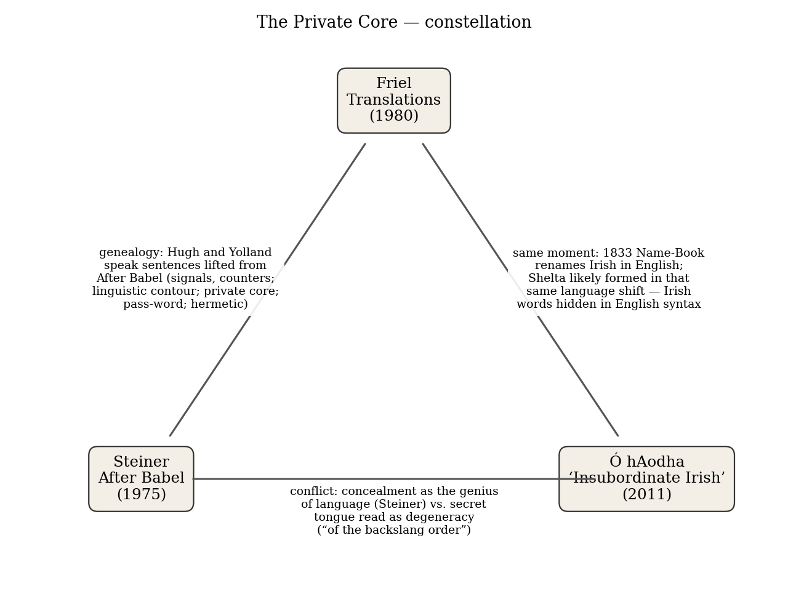
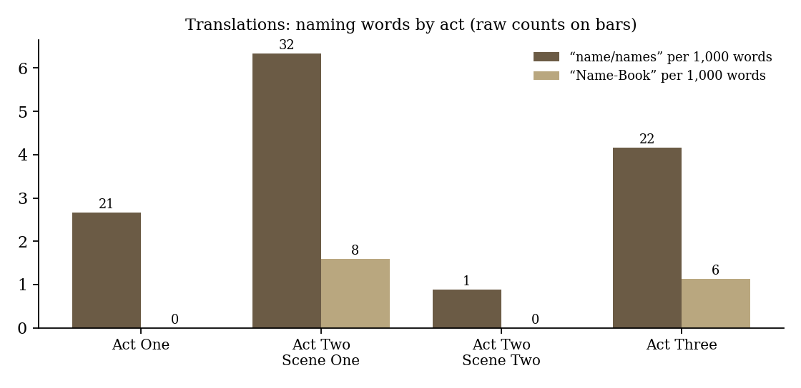
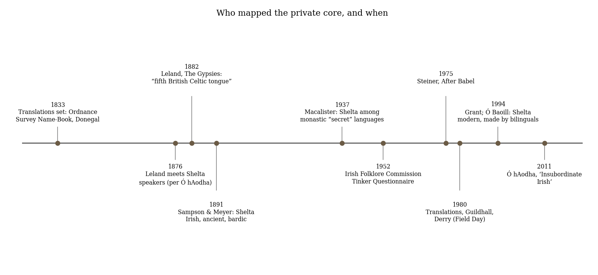

*Triad 25 of 32 · 2026-10-18 · Difficulty 3 · Genealogy/influence, Same subject, Conflict*

## The three books

- [[books/6182-translations|Translations]], [[people/brian-friel|Brian Friel]]; 1980. *Anchor: the scene the other two books theorize (1833 Name-Book; a closed speech-community opened by translation)*
- [[books/2372-after-babel-aspects-of-language-and-translation|After Babel: Aspects of Language and Translation]], [[people/george-steiner|George Steiner]]; 1975. *Source: the theory Friel borrowed close to verbatim (genealogy edge)*
- [[books/13399-insubordinate-irish-travellers-in-the-text|'Insubordinate Irish': Travellers in the Text]], [[people/micheal-o-haodha|Mícheál Ó hAodha]]; 2011. *Oblique edge: Shelta as a living private core, likely formed in the same Irish-to-English shift; its outside 'discoverers' as the philologist's counterpart to the sappers*

---

## The Thread

A hedge-school in Donegal, August 1833. A British lieutenant who loves the place says he may learn “the password but the language of the tribe will always elude me”, and that “The private core will always be … hermetic”. Friel gave him those words. *Translations* (1980) was built partly out of George Steiner’s *After Babel* (1975), and the borrowing is close to verbatim: Steiner’s “signals and conventionalized counters”, his “linguistic contour” that no longer matches “the changing landscape of fact”, his cultures that “expend on their vocabulary and syntax acquisitive energies and ostentations”, his “private core” and “pass-word” all come out of the mouths of Hugh and Yolland. That is the first edge, a genealogy of influence you can check word by word in your own two files.

The third book supplies the edge almost nobody draws. Mícheál Ó hAodha’s *‘Insubordinate Irish’* (2011) reports the current scholarly view that Shelta, the Travellers’ Cant or Gammon, was “formed in the modern period, possibly at that juncture when the language shift from Irish to English was taking place”. That shift is the one Friel’s play stages. While the Name- Book was turning Irish place names into English ones, someone was hiding Irish words inside English grammar, using metathesis, reversed syllables and prefixes, to make a password language. Steiner’s theory says that hiding is the oldest work language does. The Victorian scholars who “discovered” Shelta read it as a symptom (“of the backslang order”). And they valued it only if it was ancient, the same romance of antiquity that has Yolland marvelling at “Termon, from Terminus”. **Connection kinds:** Genealogy/influence (Steiner →Friel); Same subject (the Irish-to-English shift and who gets to name what); Conflict (concealment as the genius of language vs. concealment as degeneracy). **Difficulty: 3.** The Friel–Steiner link is documented; the Shelta link is the part you have to earn.

## 1. Translations — Brian Friel (first performed 1980; published 1981)

EPUB · Calibre ID 6182 · Faber edition → [[books/6182-translations|book page]]

**Selection logic.** The anchor. It is a play about translation in which every line is in English, so the audience has to imagine that most of what it hears is Irish. It also dramatizes the scene the other two books theorize: a closed speech-community and the instrument (the Ordnance Survey Name-Book) that opens it.

**Overview.** Ballybeg, County Donegal, 1833. Hugh, the drunk, Latin-fluent master of a hedge-school, teaches Greek and Latin to Irish speakers. His son Owen returns as interpreter for the Royal Engineers, who are mapping the country at six inches to the mile and Anglicising every place name. Lieutenant Yolland falls for the place and for Maire, who speaks no English. Yolland disappears, the army threatens reprisals, and the play ends with Hugh losing his place in the *Aeneid*’s lines on Carthage.

*Figure 1: Constellation*

**Element: verbatim quotes**

- “Owen – Roland – what the hell. It’s only a name. It’s the same me, isn’t it? Well, isn’t it?” (Act One). In the next act: “My name is not Roland!” (Act Two, Scene One)

- “I may learn the password but the language of the tribe will always elude me, won’t it? The private core will always be … hermetic, won’t it?” (Yolland, Act Two, Scene One)

- “But remember that words are signals, counters. They are not immortal. And it can happen – to use an image you’ll understand – it can happen that a civilisation can be imprisoned in a linguistic contour which no longer matches the landscape of … fact.” (Hugh, Act Two, Scene One)

- “it is not the literal past, the ‘facts’ of history, that shape us, but images of the past embodied in language.” (Hugh, Act Three)

- “I will provide you with the available words and the available grammar. But will that help you to interpret between privacies?” (Hugh, Act Three)

**Element: a derived list — the Name-Book as the play shows it** (all Act Two, Scene One)

| Irish | Gloss given in the play | Entered as |
|---|---|---|
| Bun na hAbhann | where the little stream enters the sea | “Burnfoot it is then.” |
| Lis na Muc | “the Fort of the Pigs” | Swinefort |
| Poll na gCaorach | — | Sheepsrock |
| Cnoc Ban | (stage direction’s example) | “Knockban or – directly translated – Fair Hill” |
| Druim Luachra | — | undecided: “D-r-u-m or D-r-o-m?” |
| Tobair Bhriain | Brian’s well; “Vree” is “a corruption of Brian” | Tobair Vree, kept at Yolland’s insistence |
| Termon | “from Terminus, the god of boundaries” | admired by Yolland; no entry shown |
| — | Owen’s itinerary | “Greencastle and Fair Head and Strandhill and Gort and Whiteplains” |

The list has two methods, sound (Knockban) and sense (Fair Hill), one name left undecided, and one name the outsider insists on keeping. Notice that the only name kept intact is kept by the Englishman, out of piety for a story the parish no longer remembers.

**Element: a translation ledger (Act One)** — Lancey’s speech and Owen’s rendering, verbatim:

Lancey says Owen tells the class

“His Majesty’s government has ordered the “A new map is being made of the whole first ever comprehensive survey of this country.” entire country – a general triangulation which will embrace detailed hydrographic and topographic information and which will be executed to a scale of six inches to the English mile.”

Lancey says Owen tells the class

“This enormous task has been embarked on “The job is being done by soldiers because so that the military authorities will be they are skilled in this work.” equipped with up-to-date and accurate information on every corner of this part of the Empire.” “And also so that the entire basis of land “This new map will take the place of the valuation can be reassessed for purposes estate-agent’s map so that from now on of more equitable taxation.” you will know exactly what is yours in law.”

Owen’s translations are not errors; they are a censor’s work. He removes the military purpose and the tax and adds a promise. The interpreter keeps a private core of his own.

**Element: diagram — naming words by act**

*Figure 2: Naming words in Translations*

Counted on the EPUB text. The Name-Book is never mentioned in Act One. It appears 8 times in Act Two, Scene One, which is also where “name/names” is densest, and returns 6 times in Act Three, where Hugh says “We must learn those new names.” The love scene (Act Two, Scene Two) uses “name” once. In that scene, as the play has it, two people who share no language understand each other through the place names alone.

## 2. After Babel: Aspects of Language and Translation — George Steiner (1975; this file is the second edition, with the 1992 preface)

EPUB · Calibre ID 2372 **Selection logic.** The source. Friel read it while writing; this book is where the play’s theory → [[books/2372-after-babel-aspects-of-language-and-translation|book page]]

of language comes from. It also gives the third book a frame: Steiner says secret language comes first and public language later.

**Overview.** Steiner argues that “Any model of communication is at the same time a model of trans-lation” (chapter 1): we translate between epochs, classes and lovers as much as between languages. He makes the multiplicity of languages after Babel a problem to be explained rather than a fall. His explanation is that speech developed mainly to conceal and to imagine alternatives, not only to inform. The later chapters give a history of translation theory and his four-beat “hermeneutic motion”.

**Element: excerpt** (Ch. 3, “Word against Object”). The passage Yolland is paraphrasing without knowing it:

> If we postulate, as I think we must, that human speech matured principally through its hermetic and creative functions, that the evolution of the full genius of language is inseparable from the impulse to concealment and fiction, then we may at last have an approach to the Babel problem. All developed language has a private core. […]
>
> *(Shortened for the public edition.)*

**Element: a borrowing concordance** (each pair checked against both files)

Friel, *Translations* Steiner, *After Babel*

“words are signals, counters” (Hugh, II.i) “Languages are wholly arbitrary sets of

> signals and conventionalized counters.” (Ch. 1) “A civilization is imprisoned in a linguistic “a civilisation can be imprisoned in a contour which no longer matches, or linguistic contour which no longer matches matches only at certain ritual, arbitrary the landscape of … fact” (Hugh, II.i) points, the changing landscape of fact.” (Ch. 1) “Often, cultures seem to expend on their “certain cultures expend on their vocabulary and syntax acquisitive energies vocabularies and syntax acquisitive

energies and ostentations entirely lacking and ostentations entirely lacking in their in their material lives” (Hugh, II.i) material lives.” (Ch. 2) “the password … The private core will “hermetic and creative functions … All always be … hermetic” (Yolland, II.i) developed language has a private core …

> the word was largely a pass-word” (Ch. 3)

“interpret between privacies” (Hugh, III) “The element of privacy in language makes

> possible a crucial, though little understood, linguistic function.” (Ch. 1)

“And the word exogamein means to marry “ ‘Linguistic exogamy’ comes later, under outside the tribe.” (Jimmy, III) compulsion of hostile or collaborative

> contact with other small groups.” (Ch. 3)

“Something is being eroded.” (Yolland, II.i) “particularities of material substance which — *loose echo only* escape us, which our words erode” (Ch. 3)

Friel kept the content and dropped the qualifications. Steiner’s “or matches only at certain ritual, arbitrary points” is gone, and “seem to” becomes plain assertion. In Hugh’s mouth

Steiner’s hedged observations become statements a drunk can say with total confidence. Steiner continues the “acquisitive energies” sentence: “Linguistic riches seem to act as a compensatory mechanism. Starving bands of Amazonian Indians may lavish on their condition more verb tenses than could Plato.” (Ch. 2). Friel left that out. He did not need it, because Hugh’s whole life demonstrates it.

**Element: verbatim quotes**

- “Obviously, we speak to communicate. But also to conceal, to leave unspoken.” (Ch. 1)

- “Streaming outward it thins, losing energy and pressure as it reaches an alien speaker.” (Ch. 3)

- The hermeneutic motion, as the 1992 preface restates it: “ ‘initiative trust–aggression– incorporation–reciprocity or restitution’ ” (Preface to the Second Edition)

**Element: a misreading worth attempting.** Read the four beats as the plot of *Translations* rather than as a theory of translators. *Trust:* Yolland arrives convinced the place is worth entering. *Aggression:* the Name-Book; Steiner’s word for the translator’s move is unusually violent, and here the violence is literal. *Incorporation:* Swinefort, Sheepsrock, Burnfoot are absorbed into the English map. *Restitution:* nobody makes it. Yolland vanishes, and Hugh’s last speech garbles Virgil. The play is the hermeneutic motion with its fourth beat missing. Is that Friel’s critique of Steiner, or Steiner’s model working as he said it does when it fails?

## 3. ‘Insubordinate Irish’: Travellers in the Text — Mícheál Ó hAodha (2011)

PDF (Manchester University Press, via Project MUSE) · Calibre ID 13399 · page numbers are the printed ones → [[books/13399-insubordinate-irish-travellers-in-the-text|book page]]

**Selection logic.** The oblique edge. In Ó hAodha’s book the private core Steiner theorizes and Yolland cannot enter is a real, living language: Shelta. And the outsiders who “discover” it behave very much like Friel’s sappers.

**Overview.** A study of how Irish Travellers have been represented. It covers the Gypsy Lore Society’s philology (“Gypsiology”), the Celtic Revival’s romance of the wanderer, the new state’s homogenizing nationalism, and above all the responses to the Irish Folklore Commission’s 1952 Tinker Questionnaire. His argument is that the colonial practice of representing the Irish, “The English had ‘translated’ the Irish using self-interested and essentialist representations” (p. 51), was repeated by the independent state against its own internal Other: “the subaltern or ‘Other’ is represented and ‘translated’ through the essentialist language of the dominant culture” (p. 56).

**Element: excerpt** (p. 88). The private core, seen from outside by settled neighbours:

> Relatively little modern research has been undertaken into the functions of Travellers’ spoken language, known in academic parlance as Shelta but referred to by Travellers as Cant or Gammon. Opinions vary as to the exact functions of Shelta, whether it was primarily a ‘secret’ […]
>
> *(Shortened for the public edition.)*

> conscious and deliberate separateness of Travellers, who wished to exclude those who were not able to understand their special tongue.

An IFC respondent, quoted on p. 89: “They break into this when unwilling to be heard at their business.” That is Steiner’s “outright misguidance” at a cattle fair.

**Element: a derived list — the origin myths of Shelta, in the order the book gives them**

1. **Leland (1882):** a thousand-year-old cryptic tongue, possibly Pictish: “the most curious linguistic discovery of the century, the fifth British Celtic tongue!” (p. 17).

2. **Sampson (1891):** Pictish again, via a claimed old name for tinkers, *Creenies*, glossed as *na Cruithne*, “the Irish for ‘the Picts’ ” (p. 17). Then “prehistoric Celtic”, although he admitted the vocabulary had been “rendered unintelligible to non-speakers by the use of various methods of word disguise” (p. 19).

3. **Meyer (1891):** Irish, older than the eleventh century; its “knowledge was once possessed by Irish poets and scholars, who probably were its original framers” (p. 20). The devices: “metathesis, apocope, the reversal of syllables and the use of prefixes” (p. 20).

4. **Leland (1891):** a bardic “Ogam tongue, used by the bards and transferred by them, in all probability, to the bronze workers and jewellers” (p. 22).

5. **Macalister (1937):** one of several monastic “secret” languages “comprising vocabularies formed from the engineered interaction of Irish Gaelic with other languages including Latin, Greek, Hebrew and English” (p. 22).

6. **Grant, Ó Baoill (1994):** English grammar, so modern; made by bilinguals “some time within the last 350 years or so” (p. 18), “possibly at that juncture when the language shift from Irish to English was taking place” (p. 18).

The pattern: every Victorian theory adds antiquity, and only the modern one puts Shelta in the shift itself. Meyer gave the reason in so many words: “I would scarcely have taken much interest in Shelta, if it were nothing but tinkers’ cant, fabricated from Irish in modern times, of a kind not superior to the backslang of costers and cabmen” (p. 21). Sampson’s version: the tinker’s “moral and social code, like his language, is certainly of the backslang order” (p. 21).

**Element: a second list — the other private script, the road-signs** (IFC respondents, pp. 87–88)

- “Broken twigs or marks on trees or crossroads.”

- “I am told that they tie a red cloth or string to the willow or alder bushes that they used, and other gypsies or tinkers who came that way were supposed to not cut any of those bushes.”

- Ó hAodha’s summary of what the markers (“rags, sticks and embers”) carried: another family’s direction on the road, local attitudes to almsgiving, the arrival of a new horse, deaths.

This is a map made by the people the Ordnance Survey maps, and it is written for no one outside the group.

**Element: timeline**

## Where this sends you

## Notebook

1. **The ledger exercise.** Take the three Lancey/Owen pairs above and write a fourth pair for a document from your own present (a terms-of-service clause, a grant notice), with the “Owen” column translating for the people affected. Then ask what Owen’s softening

*Figure 3: Timeline*

> protects: the class, Lancey, or Owen himself? Compare Steiner’s “safeguard of obliqueness”.

2. **Restitution, missing.** Using the misreading above, write the fourth beat that *Translations* withholds, as a single scene or a single page of prose. Who restores what to whom? If you can’t make it work, write down where it breaks. That is a finding about Steiner’s model.

3. **Gammon and the Gesturalist.** Shelta keeps Irish words inside English grammar so that strangers can’t follow (Meyer’s devices, p. 20). Draft a short “cant” for one concept you work with (gesture, utterance) using metathesis and syllable reversal. Then decide whether what you made is a private core in Steiner’s sense or only “backslang”. What is the difference, if there is one?

## Rabbit holes

- F. C. McGrath, “Irish Babel: Brian Friel’s *Translations* and George Steiner’s *After Babel*,” *Comparative Drama* 23.1 (1989): the standard account of the borrowing. https://digitalcommons.usm.maine.edu/english/167

- Charles G. Leland, *The Gypsies* (1882), full text, including the chapter on “Shelta Thari,” the Tinkers’ language, that started the myth-making in list item 1. https://www.gutenberg.org/ebooks/22939

- Logainm, the Placenames Database of Ireland: its sources page names the OS Parish Name Books and John O’Donovan, the real Irish scholar behind Owen’s job. Look up Burnfoot, and any townland you like. https://www.logainm.ie/en/about/sources

- Fiachra Mac Góráin, “Language politics in the *Aeneid* and Friel’s *Translations*,” *Proceedings of the Virgil Society* 30 (2020), on why Hugh’s play ends in Virgil. https://discovery-pp.ucl.ac.uk/10120100/1/Mac%20G%C3%B3r%C3%A1in%2C%20Fiachra.%20PVS%2030%20%282020%29%20The%20politics%20of%20language%20in%20the%20Aeneid%20and%20Friel%27s%20Translations.pdf

- MoLI exhibition, *Don’t anticipate the ending: Creative encounters with the Brian Friel Papers*, on Friel’s use of *After Babel*, with NLI manuscripts. https://exhibitions.moli.ie/brian-friel/m/has-language-failed-these-people

- Peter Bakker’s review of Kirk & Ó Baoill (eds.), *Travellers and Their Language* (2002), *Language in Society* 35.3 (2006). The 2002 volume is the modern linguistics behind list item 6. https://www.cambridge.org/core/journals/language-in-society/article/abs/john-m-kirk-donall-p-o-baoill-eds-travellers-and-their-language/D96B3507D46651401F097C6C688341F3

Search prompts: J. H. Andrews, *A Paper Landscape: The Ordnance Survey in Nineteenth- Century Ireland* (1975), Friel’s other main source; the *Crane Bag* exchange between Friel, Andrews and Kearney (1983); M. A. K. Halliday, “Anti-Languages” (1976), which Ó hAodha cites on p. 88.

## Also in your library

- *Graveyard Clay* (*Cré na Cille*), Máirtín Ó Cadhain, trans. Liam Mac Con Iomaire and Tim Robinson. Calibre ID **6318**. A novel that never left the private core: written in Irish, all dialogue, all dead. Robinson also mapped Connemara’s place names himself.

- *A Dictionary of British Place Names*, A. D. Mills. Calibre ID **14752**. It now covers Irish names, so you can run the Name-Book in reverse.

- *Another Darkness, Another Dawn: A History of Gypsies, Roma and Travellers*, Becky Taylor. Calibre ID **13391**. The wider history behind Ó hAodha’s chapters 1–2.

A note on the library itself: the record titled *The Poor Mouth* (Calibre ID 3421) actually contains Flann O’Brien’s *The Hard Life* (Collopy, Father Fahrt, dedicated to Graham Greene). I had planned to use *The Poor Mouth* today and swapped it out when the text turned out to be the wrong novel. The record needs relabelling or a new file.

## From the Lexicon — Onomastic

**Received:** Of or relating to names and naming, or to onomastics, the branch of lexicology that studies the forms, origins and use of proper names.

**Etymology.** Greek *onomastikos*, “of naming”, from *onomazein*, *onoma* (PIE *no-men-), by way of French *onomastique*; English 1716, *onomastics* by 1930.

**WordNet.** Present (OEWN synset 02781985-a, a pertainym) with the gloss “of or related to onomastics”. The word is defined only by pointing at its discipline, which is roughly what a Name-Book entry does to a hill.

**Lineage.** Lexicology, which no other term in the Lexicon shares yet. There are no typed relations.

**Why today.** The Name-Book is applied onomastics in the service of a survey, and Shelta is onomastics run in reverse: the same knowledge of names and word-forms used to make speech harder for outsiders to follow.

No verified occurrence of the word in today’s three books.

**New in the Lexicon**

- *Reshimu*: in Lurianic Kabbalah, the trace of the infinite light left in the vacated space after *tzimtzum*.

- *Kenosis*: Christ’s “self-emptying” in the Incarnation, from Paul’s *ekenosen* in Philippians 2:7.

## To carry

> “In the beginning the word was largely a pass-word, granting admission to a nucleus of like speakers.” — George Steiner, *After Babel*, Ch. 3, “Word against Object”

## Themes

[[themes/aeneid|Aeneid]] · [[themes/anglicisation|Anglicisation]] · [[themes/anti-language|anti-language]] · [[themes/backslang|backslang]] · [[themes/cant|Cant]] · [[themes/carthage|Carthage]] · [[themes/field-day|Field Day]] · [[themes/friel|Friel]] · [[themes/gammon|Gammon]] · [[themes/gypsiology|Gypsiology]] · [[themes/gypsy-lore-society|Gypsy Lore Society]] · [[themes/hedge-school|hedge-school]] · [[themes/hermeneutic-motion|hermeneutic motion]] · [[themes/hermeticism|hermeticism]] · [[themes/interpreter-as-censor|interpreter as censor]] · [[themes/irish-folklore-commission|Irish Folklore Commission]] · [[themes/irish-language-shift|Irish language shift]] · [[themes/kuno-meyer|Kuno Meyer]] · [[themes/leland|Leland]] · [[themes/linguistic-exogamy|linguistic exogamy]] · [[themes/macalister|Macalister]] · [[themes/name-book|Name-Book]] · [[themes/naming|naming]] · [[themes/onomastics|onomastics]] · [[themes/ordnance-survey|Ordnance Survey]] · [[themes/pass-word|pass-word]] · [[themes/place-names|place names]] · [[themes/privacy-of-language|privacy of language]] · [[themes/private-core|private core]] · [[themes/sampson|Sampson]] · [[themes/secret-languages|secret languages]] · [[themes/shelta|Shelta]] · [[themes/steiner|Steiner]] · [[themes/tinker-questionnaire|Tinker Questionnaire]] · [[themes/translation|translation]] · [[themes/travellers|Travellers]] · [[themes/o-baoill|Ó Baoill]]

---

Previous: [[triads/2026-10-17-nothing-reviewed|Nothing, Reviewed]]  
Next: [[triads/2026-10-19-except-in-sequence-repetition-omission|Except in Sequence, Repetition, Omission]]
