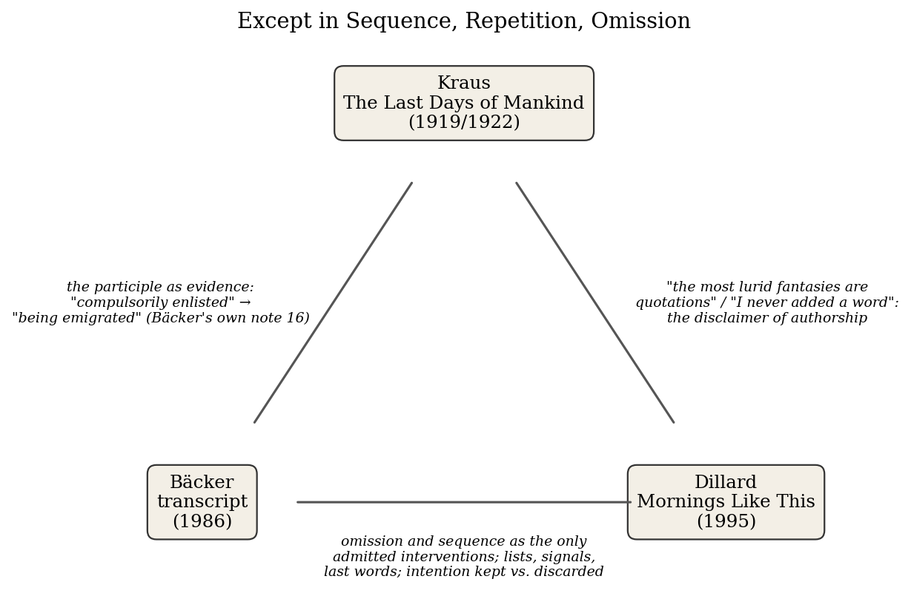
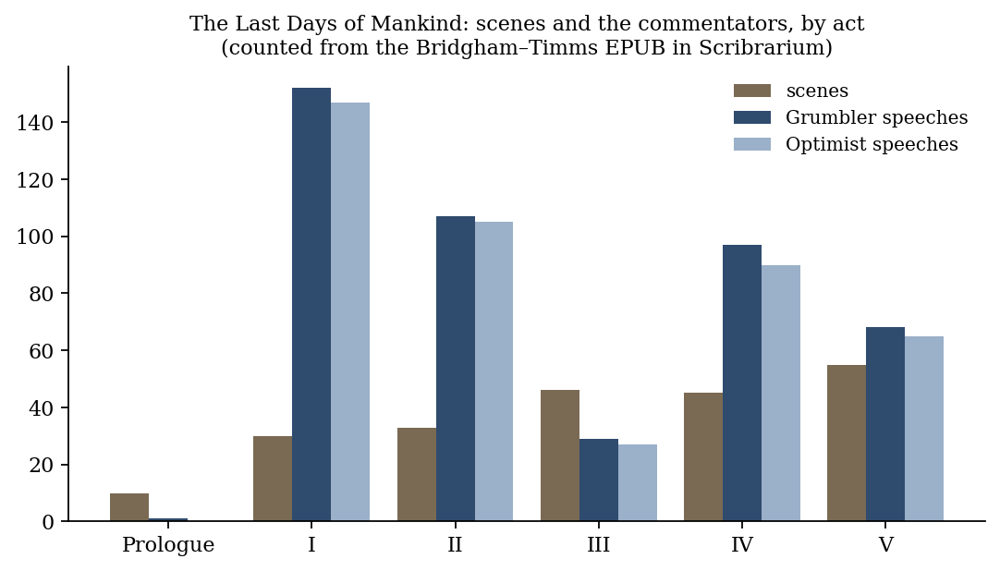
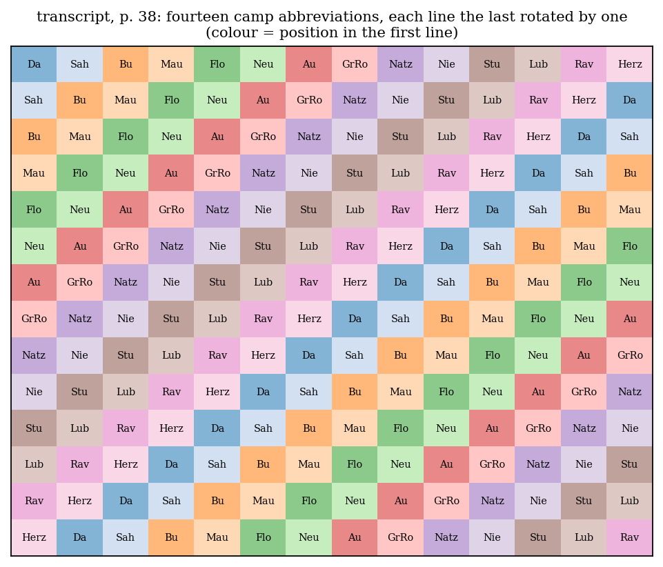
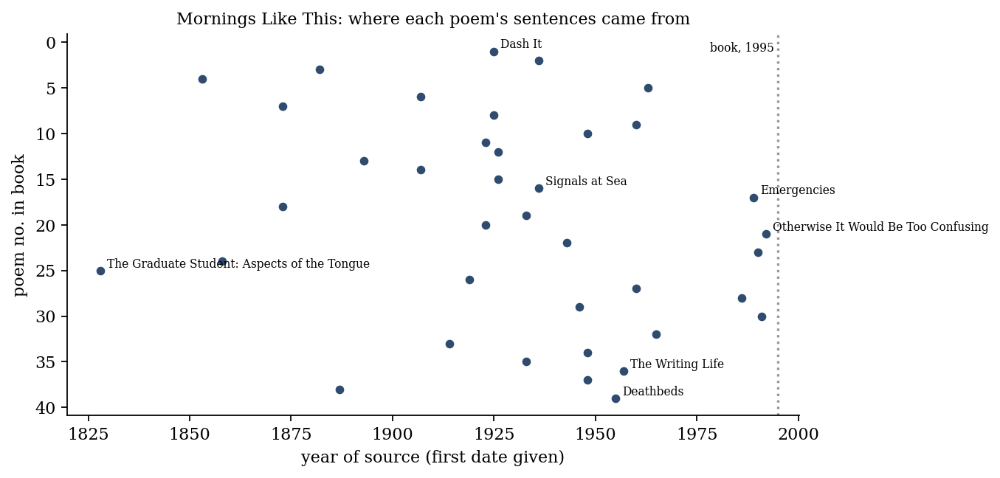

*Triad 26 of 32 · 2026-10-19 · Difficulty 4 · Shared form or method, Genealogy/influence, Conflict*

## The three books

- [[books/6351-the-last-days-of-mankind-the-complete-text|The Last Days of Mankind: The Complete Text]], [[people/karl-kraus|Karl Kraus]], [[people/fred-bridgham|Fred Bridgham]] (translator), [[people/edward-timms|Edward Timms]] (translator); 1922. *Ancestor: the documentary method with a commentator (the Grumbler); source of the participle Bäcker's note cites.*
- [[books/9312-transcript|Transcript]], [[people/heimrad-backer|Heimrad Bäcker]], [[people/patrick-greaney|Patrick Greaney]] (translator), [[people/vincent-kling|Vincent Kling]] (translator), [[people/friedrich-achleitner|Friedrich Achleitner]] (editor); 1986. *Center: the documentary method with no commentator; cites Kraus in its own notes.*
- [[books/580-mornings-like-this|Mornings Like This]], [[people/annie-dillard|Annie Dillard]]; 1995. *Control case: same method (omission, never addition) producing delight instead of indictment.*

---

## The Thread

Each of these three books says, in its own apparatus, that its author wrote none of it. Kraus’s Preface (1919/1922): “The most improbable conversations conducted here were spoken word for word; the most lurid fantasies are quotations.” Bäcker’s notes (1986): “Every part of transcript is a quotation; anything that might seem invented or fantastic is a verifiable document.” Dillard’s Author’s Note (1995): “Excepting only some titles and subtitles, I did not write a word of it.” Each disclaimer then admits an exception, and the exceptions are the same ones. Bäcker, quoted by Achleitner: “When I quote, there is nothing literary about the quotation (except in sequence, repetition, omission; except for the system of transcribing).” Dillard: “Sometimes I dropped extra words; I never added a word.” Kraus broke his own rule most often (his translators note that the documentary technique is blended with comic invention), but his paired Przemysl scenes show him working by order and cut alone. In all three the authorship sits inside that parenthesis.

What the cut does to the original speaker’s intention is where they part. Kraus keeps the intention and turns it on the speaker: that is satire, and he has a raisonneur, the Grumbler, to make sure you get it. Bäcker keeps the intention intact, offers no Grumbler, and lets the isolated sentence convict itself. Dillard throws the intention out (“the original authors’ intentions were usually first to go”) and puts a new one in, along with “the element of delight”. The genealogy is on the record: Bäcker’s own note 16 sets Himmler’s “being emigrated” beside “a participle quoted by Karl Kraus in his play The Last Days of Mankind”, glossed as persons “made enlisted”: most likely the construction the Bridgham–Timms translation renders as “compulsorily enlisted”, which the Grumbler dissects in II, 10. In each case the hinge is a passive form that removes the agent, and the found-text method itself removes an agent, namely the author. Dillard shares the method and not the subject. She is the control case: the same operation produces delight, which is exactly what Bäcker’s use of it has to prevent.

**Connection kinds:** Shared form or method; Genealogy/influence; Conflict. **Difficulty:** 4 of 5.

*Figure 1: Constellation of the three books*

| From | To | What passes between them |
|---|---|---|
|  | Bäcker |  |
| Kraus |  | The participle as evidence: Kraus’s construction (“compulsorily enlisted” in this translation) becomes Bäcker’s “being emigrated” (Bäcker’s own note 16). Also “holding on to the bitter end” (Kraus IV, 29) becomes TOT HET BITTERE EINDE (transcript, p. 36). |
| Kraus | Dillard | The disclaimer of authorship as preface: “the most lurid fantasies are quotations” and “I did not write a word of it”. |
| Bäcker | Dillard | Omission and sequence as the only interventions either admits to. Both use lists, tables and imperatives. Bäcker keeps the source’s intention; Dillard discards it. |

## 1. The Last Days of Mankind — Karl Kraus

*Written 1915–22; first printed in Die Fackel, 1918–19; book edition 1922. Translated by Fred Bridgham and Edward Timms (Yale, 2015). EPUB · Calibre ID 6351* → [[books/6351-the-last-days-of-mankind-the-complete-text|book page]]

**Selection logic.** This is the ancestor of the triad. It is the first large work built on the claim that documents, set in order, accuse their authors. It also introduces the commenting voice (the Grumbler) that Bäcker will refuse to use.

**Overview.** A “tragedy” in a Prologue, five Acts and a verse Epilogue (“The Final Night”), set across Vienna, Berlin and the fronts from June 1914 to the collapse of 1918. The Preface says the play “is intended for a theatre on Mars”, because “Theatregoers on planet earth would find it unendurable” (a performance would run some ten evenings). It is put together from newspaper editorials, communiqués, adverts, sermons and café talk, reshaped as speech. It is broken up by dialogues between the Optimist and the Grumbler, Kraus’s raisonneur. The translators’ introduction describes the general method: “Kraus’s satire is basically a collage of quotations, framed by his own ironic commentaries.”

**Quotes** (Bridgham–Timms translation; locations from the EPUB)

- “The most improbable conversations conducted here were spoken word for word; the most lurid fantasies are quotations.” — Preface

- “The document takes human shape; reports come alive as characters and characters expire as editorials; the newspaper column has acquired a mouth that spouts monologues; platitudes stand on two legs—unlike men left with only one.” — Preface

- “The present participle “enlisting” would indicate that they’re doing it of their own free will, that’s why it has to be a past participle.” — Grumbler, Act II, Scene 10

- “Universal conscription has turned mankind into a passive noun. Once men joined the forces, now they’re forced to join.” — Grumbler, Act II, Scene 10

- “Thanks for the compliment, but don’t you remember? My most lurid fantasies are quotations!” — Grumbler, Act V, Scene 44, just after the Optimist has read aloud an advertisement for a commemorative print, “He died a hero’s death for the Fatherland”.

**Excerpt: the same press release, with its terms reversed.** In Act II, Scene 16 a General Staff Officer telephones the line on the fall of Przemysl: the fortress was worthless, and it fell to hunger, not to force. In Act III, Scene 22, after the fortress has been retaken, he phones the same reporter with the opposite line. Both calls include “My dear fellow, you can make people forget anything!” The two hinges:

> “Not by hunger but by enemy action—damn, what am I saying—not by enemy action but by hunger!” (II, 16)

> “Not by force but by hunger—dammit, what am I saying! Not by hunger but by force!” (III, 22)

This is Kraus’s purest found-text joke. Nothing is added. The same terms are put in the reverse order and the truth flips. Hold it beside Bäcker’s p. 38 (below).

**Diagram: where the commentators speak.** The counts come from the EPUB in Scribrarium: scene headings, and speech prefixes for GRUMBLER and OPTIMIST.

The total is 219 scenes plus the Epilogue. The Grumbler and Optimist crowd into Acts I, II and IV (152, 107 and 97 Grumbler speeches) and thin out in Act III (29 speeches across 46 scenes). Act V, the longest at 55 scenes, has 68. Where the documents carry the load, the raisonneur speaks less. Bäcker turns that tendency into a rule.

**Derived list: the Grumbler’s “ABC”** (Act IV, Scene 29), in his order:

1. “human raw material”

2. “holding on to the bitter end”

*Figure 2: Kraus scenes and commentary by act*

3. “doing one’s bit”

4. “hoarding”

5. “medicals for recruits”

6. “reconscripted veterans”

7. “shirkers”

8. “compulsorily enlisted”

He calls it “the whole ABC of social and medical classifications in all its unfathomable profundity”. Four of the eight (1, 6, 7, 8) name a person by an administrative category. The second has a Dutch echo on p. 36 of Bäcker, and the eighth is the construction Bäcker’s note picks up.

## 2. transcript — Heimrad Bäcker

*Original: nachschrift (Edition Neue Texte, Linz, 1986). English translation by Patrick Greaney and Vincent Kling, edited with an afterword by Friedrich Achleitner (Dalkey Archive, 2010). PDF · Calibre ID 9312* → [[books/9312-transcript|book page]]

*File note: the Scribrarium PDF is an Internet Archive scan (2023) with an OCR text layer. The text is machine-readable but has OCR faults: diacritics are lost (“Backer”, “Goring”), and the handwritten and visual pages do not come through as text. Every quotation below was checked against the OCR layer. Pages are the printed page numbers (printed page = PDF page −2).*

**Selection logic.** The book that does what Kraus’s Preface claims, with no Grumbler. It names Kraus in its own notes. It is also the strongest case against the idea that the Shoah was “unspeakable”.

**Overview.** Mostly blank pages, each carrying a quotation (or a “configuration” of quotations) from the documents of persecution and murder: Reich legal bulletins, Gestapo daily reports, transport schedules, Wannsee minutes, the Gerstein Report, trial interrogations, last letters.

A full set of notes and a bibliography (pp. 131–146) follows, keyed to the pages. Bäcker (1925– 2003) was in the Hitler Youth and joined the Party at eighteen. Greaney’s afterword reads the book as a critique of the notions of “ineffability and immediacy” that Bäcker’s own adolescent writing depended on.

**Quotes on method** (with locations)

- “Every part of transcript is a quotation; anything that might seem invented or fantastic is a verifiable document. Slight changes and omissions (which allow the unaltered contents to stand out in sharper relief) are not explicitly indicated.” — Bäcker, headnote to the notes, p. 131

- “…sometimes to the point of a methodical gibberish that replicates a deadly gibberish.” — same, p. 131

- “Himmler’s language reflects the progressive logic of the system: in 1942 being emigrated meant to be destroyed.” — note to p. 16, p. 132. The text of p. 16 is a single line: “of the jews and jewesses who are being emigrated from germany,”

- “Documents are literature that writes itself and is recognized as literature.” — Bäcker, quoted in Achleitner’s afterword, p. 148

- “transcript emphasizes the fact that the destruction of European Jewry was not unspeakable but a program that was spoken about, extensively, by thousands of people, albeit often in code or euphemistically.” — Greaney, afterword, p. 151

**Derived list: the forms the documents take** (pp. 10–38, the opening movement), with the formal operation named:

1. p. 10: the Vienna parks forbidden to Jews, one unbroken run of place-names. *Operation:* enumeration without punctuation.

2. p. 11: an inventory of luggage items, asterisked “crossed out by the foreign exchange office”. *Operation:* the footnote as the act of confiscation.

3. pp. 12–13: 46 lines that begin “because”, taken from Gestapo daily reports and court sentences. “because of conduct friendly to jews” appears four times running. *Operation:* anaphora.

4. p. 14: the Vienna synagogues burned on Kristallnacht, listed by street. *Operation:* the address list.

5. p. 21: “definition / dismissals / expropriations / concentration…” down to “central killing operations / definition”. *Operation:* a refrain that brackets an escalation.

6. p. 25: phrases from the Göring–Heydrich letters and the Wannsee minutes (“with this final solution”, “with breakfast to follow”), ending “56-58 Greater Wannsee St.” *Operation:* the address as signature.

7. p. 29: “auschwitz telephones” followed by extension numbers. *Operation:* the directory.

8. p. 33: escalating Sobibor totals. The note says “The form of a cross is a direct result of the statistical arrangement.” *Operation:* the visual poem produced by the data itself.

9. p. 34: a table of kinds of air (“air in which candles go out”, and so on). *Operation:* the scientific table, read for what follows it.

10. p. 36: TOT HET BITTERE EINDE. The note: “Inscription in Mauthausen.” *Operation:*

> one line. It is also Kraus’s “holding on to the bitter end”, in Dutch.

11. p. 38: fourteen camp abbreviations in cyclic rotation (see diagram).

**Diagram: p. 38 as a matrix.** The rows were parsed from the OCR text, and each one was checked to be the previous row rotated by one place. The note on p. 133 says only that these were “the abbreviations for the concentration camps Dachau, Sachsenhausen, Buchenwald, etc. commonly used in written communications.”

This is the most “literary” move in the opening section, a strict permutation, and the source material made it possible: the abbreviations are interchangeable tokens in an administrative system. Set it beside Kraus’s Przemysl pair. Both authors take a fixed set of terms and change only their order.

*Figure 3: Bäcker p. 38 permutation*

**Concordance of a closing line.** The book’s last movement keeps returning to the registers themselves: “the card file on the dead was larger by far than the one on the living.” (p. 127). The next page carries “in the death registers” on nine lines. The epigraph (p. 5) is a question: “Is it true, are we really going to die?”

## 3. Mornings Like This — Annie Dillard

*Found Poems (HarperCollins, 1995). EPUB · Calibre ID 580* → [[books/580-mornings-like-this|book page]]

**Selection logic.** The control case. It uses the same method under the same vow (omission, never addition), applied to old manuals, memoirs and textbooks, and it produces the opposite of indictment. It shows what Bäcker had to forbid in order to work.

**Overview.** Thirty-nine poems. Each is built from sentences in a single named source, chosen and rearranged into lines, with titles largely her own. The sources range from an 1828 treatise (Froriep, *Aspects of the Tongue*) to a 1992 grammar manual. Half the poems, she says, aim at “poetry’s oldest and most sincere aims”; “The other half are just jokes.”

**Quotes** (Author’s Note unless marked)

- “By entering a found text as a poem, the poet doubles its context. The original meaning remains intact, but now it swings between two poles.”

- “In the course of composing such found poems, the original authors’ intentions were usually first to go.”

- “Sometimes I dropped extra words; I never added a word.”

- “This is editing at its extreme: writing without composing.”

- “I want to use the world rather than my own invention.” — the Ellsworth Kelly epigraph she sets at the end of the note

**Excerpt: “Signals at Sea”** (poem 16, from *Cugle’s Practical Navigation*, 1936). Here a code table is printed nearly unchanged. Put the following lines next to Bäcker’s directories:

> D — Keep clear of me—I am maneuvering with difficulty. F — I am disabled. Communicate with me. U — You are standing into danger. X — Stop carrying out your intentions.

(The dashes between letter and phrase are added for layout. In the book the letter and phrase are separated by spacing.) Signal X is the instruction Dillard follows with each source author.

**Diagram: the age of her sources.** The first date in each attribution line, for 38 of the 39 poems (“Index of First Lines” has no date).

The median source date is 1933. The poems that read as jokes tend to lean on recent manuals (*Emergencies*, 1989; *Otherwise It Would Be Too Confusing*, 1992). The grave ones lean on older books (*Deathbeds*, from a 1955 dictionary of last words; Prishvin, 1925; Picard, 1948). Age seems to work for her as a solvent of intention: the further the source is from the reader, the more easily its sentences let go of what they meant.

**A misreading worth attempting.** Read “Deathbeds” (poem 39) as a reply to Bäcker’s epigraph. Dillard’s assembled last words include “Is this dying? Is this all? Is this / All that I feared, when I prayed against a hard death?” Bäcker’s single sentence is “Is it true, are we really going to die?” Both are dying words, unaltered. One arrangement consoles, because the deaths are many, separate and in order. The other refuses consolation, because the question stands alone on a page. The misreading is to treat the difference as lying in the words. Test whether it lies only in the sequence.

*Figure 4: Dillard sources by year*

## Where this sends you

## Notebook

1. **The agentless participle.** Starting from the Grumbler in II, 10 (“Universal conscription has turned mankind into a passive noun”) and Bäcker’s p. 16 with its note, collect five present-day administrative sentences in which a person is the grammatical object of a passive or participial construction (“were relocated”, “is being processed”). Set each on its own page in Bäcker’s manner. Then write the Grumbler’s one-line comment for just one of them. Which page indicts more: the one with the comment or the four without?

2. **Omission only.** Take a manual or handbook from your shelves and build a poem by Dillard’s rule (“I dropped extra words; I never added a word”). Then take a single sentence from the same source and isolate it as Bäcker would, with no arranging. Identify the exact cut where delight entered the first version, and decide whether the second version can exclude it at all.

3. **Rotation as the smallest act.** Kraus’s Przemysl pair (II, 16 / III, 22) and Bäcker’s p. 38 both alter only order. Write a short text that appears twice, the second time with its terms rotated or reversed, and no word changed. Then write two sentences on whether that counts as authorship by the standard of Bäcker’s parenthesis (“except in sequence, repetition, omission”).

## Rabbit holes

- Charles Simic, “Death List Poem,” *The New York Review of Books*, Feb. 22, 2010. A poet’s review of the English *transcript*. https://www.nybooks.com/online/2010/02/22/death-list-poem/

- AAC-Fackel, Austrian Academy of Sciences: free facsimile and searchable text of all of *Die Fackel* (1899–1936). The place to find Kraus’s participle in the original German. https://www.oeaw.ac.at/acdh/research/literary-studies/corpora/editions/aac-fackel

- Alexander Gelley, “Epigones in the House of Language: Benjamin on Kraus,” *Partial Answers* 5.1 (2007). Links Kraus’s citation practice to Benjamin’s theory of naming (abstract open; full text via MUSE). https://partialanswers.huji.ac.il/publications/epigones-house-language-benjamin-kraus

- Dan Featherston, “Poetic Representation: Charles Reznikoff’s Holocaust” (Electronic Poetry Center). Reznikoff is the American case Greaney’s afterword sets beside Bäcker: trial testimony, selection as interpretation. https://writing.upenn.edu/epc/authors/reznikoff/danfeatherston.html

- Patrick Greaney, *Quotational Practices: Repeating the Future in Contemporary Art* (Minnesota, 2014). The co-translator’s book on quotation, Benjamin and concrete poetry. https://mitpressbookstore.mit.edu/book/9780816687381

- “Heimrad Bäcker, Documentary Poetry”, a review on Johanna Drucker’s Substack of the newer Bäcker volume *Documentary Poetry* (Winter Editions, 2024). The next book to look for. https://johannadrucker.substack.com/p/heimrad-backer-documentary-poetry

Keep searching for: Kraus, *Dritte Walpurgisnacht* (1933); Helmut Heißenbüttel, “Deutschland 1944” (the collage Bäcker called “groundbreaking”, per Greaney); Victor Klemperer, *LTI*; and Max Picard, whose *The World of Silence* supplies three of Dillard’s poems.

## Also in your library

- **The Arcades Project — Walter Benjamin (Calibre ID 236).** Convolute N, [N1a,8]: “Method of this project: literary montage. I needn’t say anything. Merely show.” This is the Kraus–Bäcker line at its most theoretical, and Benjamin’s index has Kraus in it.

- **Novels in Three Lines — Félix Fénéon (Calibre ID 380).** Anonymous newspaper fillers that became literature by being isolated, as Bäcker’s documents are. Fénéon wrote his, though.

- **Vienna Group: Six Major Austrian Poets — H. C. Artmann, Ernst Jandl et al. (Calibre ID 6428).** The circle Bäcker edited and published, including Achleitner, who wrote the afterword to *transcript*.

## From the Lexicon — Found Language

**Received:** Pre-existing, usually non-literary language (documents, reports, letters, ads) lifted and reframed as poetic material, as in the found poem: prose reshaped by a poet into quasi-metrical lines.

**Etymology.* Found*, the past participle of *find* (late 14c.), plus *language*, formed on the pattern of “found poem” and “found object”.

**WordNet.** WordNet carries the base term (“a systematic means of communicating by the use of sounds or conventional symbols”) but not the sense in play. The compound is yours.

**Lineage.** Found Poetry. No typed relations are recorded yet, and no other term shares the lineage. Today’s books suggest *Eklogē* and *Redaction* as neighbours.

**Why today.** The entry’s boundary note says found language “differs from quotation in that the source is ordinarily non-literary and the reframing is the act”. All three books test this. Kraus and Bäcker take non-literary sources and claim that their reframing is no act at all. Dillard feels she must explain herself in exactly the case where the source was literary (Mayakovsky).

**Verified occurrence.** The phrase itself does not occur in any of the three books. The nearest is Dillard: “By entering a found text as a poem, the poet doubles its context.” (*Mornings Like This*, Author’s Note.)

**New in the Lexicon**

- Sigil — a seal that authenticates, or a mark thought to act: the bureaucratic and the magical in one word.

- Anagnōsis — reading, especially reading aloud; in Greek also “knowing again”.

- Eklogē — selection: the picking-out of passages, and the origin of the eclogue.

- Hypomnēmatismos — the making of a written record: minute, day-book, memorandum.

- Ethopoiesis — the forming of character, which Foucault ascribes to copied reading.

- Paradigm — a pattern shown side by side, from Plato’s model to Kuhn’s framework.

## To carry

> “Universal conscription has turned mankind into a passive noun.” — Karl Kraus, *The Last Days of Mankind*, Act II, Scene 10 (trans. Fred Bridgham and Edward Timms)

## Themes

[[themes/achleitner|Achleitner]] · [[themes/administrative-language|administrative language]] · [[themes/authorship|authorship]] · [[themes/benjamin|Benjamin]] · [[themes/backer|Bäcker]] · [[themes/catalogue|catalogue]] · [[themes/collage|collage]] · [[themes/concrete-poetry|concrete poetry]] · [[themes/die-fackel|Die Fackel]] · [[themes/dillard|Dillard]] · [[themes/documentary-poetry|documentary poetry]] · [[themes/euphemism|euphemism]] · [[themes/found-language|found language]] · [[themes/found-poetry|found poetry]] · [[themes/greaney|Greaney]] · [[themes/grumbler|Grumbler]] · [[themes/heienbuttel|Heißenbüttel]] · [[themes/holocaust|Holocaust]] · [[themes/ineffability|ineffability]] · [[themes/intention|intention]] · [[themes/klemperer|Klemperer]] · [[themes/kraus|Kraus]] · [[themes/last-words|last words]] · [[themes/lists|lists]] · [[themes/montage|montage]] · [[themes/nazi-language|Nazi language]] · [[themes/omission|omission]] · [[themes/optimist|Optimist]] · [[themes/passive-participle|passive participle]] · [[themes/permutation|permutation]] · [[themes/picard|Picard]] · [[themes/quotation|quotation]] · [[themes/reznikoff|Reznikoff]] · [[themes/satire|satire]] · [[themes/sequence|sequence]] · [[themes/signals|signals]] · [[themes/vienna-group|Vienna Group]]

---

Previous: [[triads/2026-10-18-the-private-core|The Private Core]]  
Next: [[triads/2026-10-20-the-chemists-shelf|The Chemist’s Shelf]]
