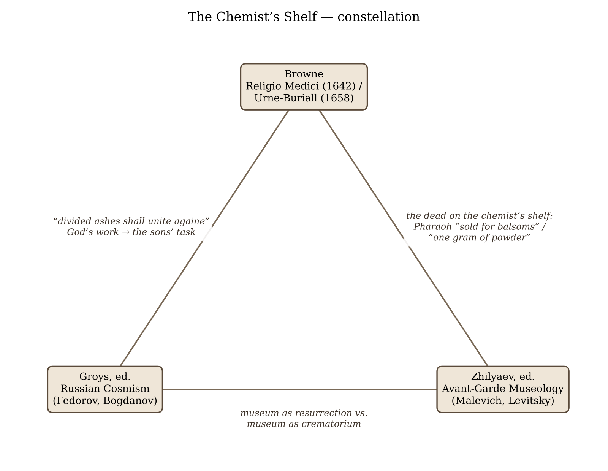
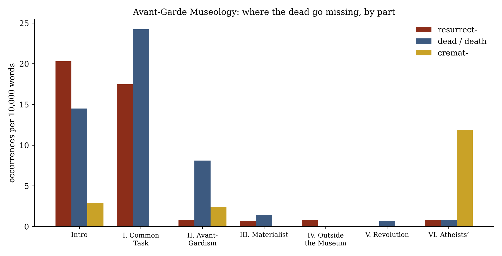

*Triad 27 of 32 · 2026-10-20 · Difficulty 4 · Conflict, Shared figure or motif, Genealogy/influence*

## The three books

- [[books/149-religio-medici-and-urne-buriall|Religio Medici and Urne-Buriall]], [[people/sir-thomas-browne|Sir Thomas Browne]]; 1658. *Hinge: holds both Russian positions at once — faith that scattered ashes reassemble (God's work) and scepticism toward every human preservation; mummy ends on the apothecary's shelf.*
- [[books/80-russian-cosmism|Russian Cosmism]], [[people/boris-groys|Boris Groys]] (editor); 2018. *The resurrection programme: Fedorov removes Browne's deferral to God and gives the work to art/biology; Groys makes the museum the machine of immortality; Bogdanov's 'Immortality Day' ends on a pyre.*
- [[books/14788-avant-garde-museology|Avant-Garde Museology]], [[people/arseny-zhilyaev|Arseny Zhilyaev]] (editor); 2015. *The counter-position and its institutional sequel: Malevich's 'On the Museum' (1919) — the dead as powder on one chemist's shelf — and Levitsky's 1931 review of a crematorium exhibition.*

---

## The Thread

Three books, each holding a position on one physical question: what should be done with the ashes of the dead? Sir Thomas Browne, a physician who handled urns dug out of a Norfolk field, believes that “our estranged and divided ashes shall unite againe”, but only “at the voyce of God”. He calls the human attempts to keep the dead (pyramids, mummies, inscriptions) a “fallacy in duration”, and notes that the mummies have ended up in the apothecary’s stock: “Pharaoh is sold for balsoms.” Nikolai Fedorov, in Boris Groys’s *Russian Cosmism*, takes Browne’s confidence that an “Art of man” can raise a plant from its ashes and turns it into a social programme. Resurrecting the dead becomes the sons’ common task, and the museum becomes its instrument. Kazimir Malevich, in Arseny Zhilyaev’s *Avant-Garde Museology*, answers with the chemist’s shelf: burn the dead and burn past epochs, since “thousands of graveyards could be accommodated on one chemist’s shelf”, and set up “one pharmacy.” Browne’s apothecary jar of Pharaoh and Malevich’s pharmacy of Rubens are the same object seen from opposite ends.

**Connection kinds:** Conflict; Shared figure or motif (ashes and the apothecary/chemist’s shelf); Genealogy/influence (Malevich writes against the museum-as-resurrection thinking that Zhilyaev’s volume prints from Fedorov). **Difficulty: 4.** Browne comes three centuries before the other two, and nothing in the Russian books cites him. The link is not a line of influence. It is a shared object and three opposite valuations of it. Two further details make it worth the effort. Browne holds both Russian positions at once: he could “with patience behold the urne and ashes of the Vatican” library (Malevich), yet he believes the dust reassembles (Fedorov). And the immortality anthology itself ends with its immortal hero choosing the pyre.

## 1. Religio Medici and Urne-Buriall — Sir Thomas Browne (1642/43 and 1658; NYRB edition, ed. Stephen Greenblatt and Ramie Targoff, 2012)

EPUB · Calibre ID 149 → [[books/149-religio-medici-and-urne-buriall|book page]]

**Selection logic.** Browne is the hinge. In *Religio Medici* (Part I, §§47–48) he states the resurrection of scattered dust as an article of faith and supports it with an alchemical experiment, palingenesis. In *Urne-Buriall* he takes the opposite, sceptical view of every human technique for keeping the dead. The Russian books split these two halves of Browne between them.

**Overview.* Religio Medici* is a young physician’s account of his faith, written c. 1635. It was printed without his consent in 1642 and in an authorised text in 1643. *Hydriotaphia, or Urne- Buriall* (1658) began as a report on “between fourty and fifty Urnes” dug up “In a Field of old Walsingham”, which Browne took to be Roman (they were Anglo-Saxon). Its five chapters move from comparative funeral custom (I–II), to the urns themselves and the chemistry of burnt bone (III), to the rites (IV), and then to the meditation on oblivion (V) for which the book is read.

*Figure 1: Constellation of the three books*

**Excerpt: the plant raised from its ashes (Religio Medici I.48).** Fedorov’s whole project is in this passage, with one clause reversed:

> “A plant or vegetable consumed to ashes, to a contemplative and schoole Philosopher seemes utterly destroyed, and the forme to have taken his leave for ever: But to a sensible Artist the formes are not perished, but withdrawne into their incombustible part, where they lie secure from the action of that devouring element. […]
>
> *(Shortened for the public edition.)*

Browne argues from the lesser art to the greater power. Fedorov argues from the lesser art to more art.

**Quotes.**

1. “I beleeve that our estranged and divided ashes shall unite againe; that our separated dust after so many pilgrimages and transformations into the parts of mineralls, Plants, Animals, Elements, shall at the voyce of God returne into their primitive shapes, and joyne againe to make up their primary and predestinated formes.” (*Religio Medici* I.48)

2. “I have heard some with deepe sighs lament the lost lines of Cicero; others with as many groanes deplore the combustion of the Library of Alexandria; for my owne part, I thinke there be too many in the world, and could with patience behold the urne and ashes of the Vatican” (*Religio Medici* I.24)

3. “But who knows the fate of his bones, or how often he is to be buried? who hath the Oracle of his ashes, or whither they are to be scattered?” (*Urne-Buriall*, Epistle Dedicatory)

4. “He that hath the ashes of his friend, hath an everlasting treasure” (*Urne-Buriall* III)

5. “But the iniquity of oblivion blindely scattereth her poppy, and deals with the memory of men without distinction to merit of perpetuity.” (*Urne-Buriall* V)

**Derived list: Browne’s ledger of failed preservations (Urne-Buriall V).** Each technique is listed with what Browne says became of it:

- *Pyramids*: worn away by “that duration, which maketh Pyramids pillars of snow, and all that’s past a moment.”

- *Mummies*: “Mummie is become Merchandise, Miszraim cures wounds, and Pharaoh is sold for balsoms.”

- *Inscriptions*: “to hope for Eternity by Ænigmaticall Epithetes, or first letters of our names, to be studied by Antiquaries” (“cold consolations”).

- *Fame*: “Herostratus lives that burnt the Temple of Diana, he is almost lost that built it”.

- *The urns themselves*: “But to subsist in bones, and be but Pyramidally extant, is a fallacy in duration.”

- *The one exception*, and only by accident: “Time which antiquates Antiquities, and hath an art to make dust of all things, hath yet spared these minor Monuments.”

The list contains its own conclusion. The single successful preservation, the urns, was unplanned, and the planned one, mummy, ended as a drug.

## 2. Russian Cosmism — Boris Groys, ed. (MIT Press / e-flux, 2018; texts c. 1880s–1920s)

EPUB · Calibre ID 80 → [[books/80-russian-cosmism|book page]]

**Selection logic.** This is the book of the resurrection programme. Groys’s introduction makes the museum the model for Fedorov’s technology of immortality. Fedorov’s “Astronomy and Architecture” removes Browne’s deferral to God and gives the work to art and biology. Bogdanov’s story “Immortality Day” then shows the programme’s own exit, which is fire.

**Overview.** An anthology of thirteen texts by Fedorov, the solar-cycle historian Alexander Chizhevsky, the Biocosmists (Alexander Svyatogor), Valerian Muravyev, Konstantin Tsiolkovsky and Alexander Bogdanov, with a foreword and an introduction by Groys. Its common ground is the claim that death is a technical defect, and that the dead, the planets and the social order can all be engineered.

**Excerpt: Groys on the museum as immortality machine (Introduction, “Russian Cosmism and the Technology of Immortality”).** This is what Malevich’s essay is written against, stated by its most sympathetic modern reader:

> “The museum does not punish the obsoleteness of individual items by removing and destroying them. Thus the museum is fundamentally at odds with progress. Progress consists in replacing old things with new things. The museum, by contrast, is a machine for making things last, making them immortal. […]
>
> *(Shortened for the public edition.)*

Browne’s “voyce of God” becomes, in one step, the curator’s decision.

**Quotes.**

1. “Art, if it is the work of a rational being, must consist precisely in the resurrection of everything destroyed by blind force” (Fedorov, “Astronomy and Architecture”)

2. “For the arts (sculpture, painting) offer but to replace those bodies destroyed, with stone, with metal, with figurations not easily effaced” (Fedorov, “Astronomy and Architecture”). Compare Malevich below: “each dead man is more alive than a weakly painted portrait.” The resurrectionist and the incinerator agree that the portrait is worthless.

3. “Being a cemetery, the Earth holds within it as many generations as there are worlds in the universe not ruled by reason” (Fedorov, “Astronomy and Architecture”)

4. “And the state must become the museum of its population.” (Groys, Introduction)

5. “with resurrection being relegated to third place” (Svyatogor, “The Doctrine of the Fathers and Anarchism-Biocosmism”). The Biocosmists keep Fedorov’s immortality for the living and push his duty to the dead down the list. The demotion begins inside the movement.

**A misreading worth attempting: “Immortality Day” as the anthology’s Malevich.** Bogdanov’s story (the volume’s bibliography gives it as “Immortal Fride,” 1912, and also notes a 1914 printing as “Immortality Day”) is set a thousand years after the chemist Fride’s immortality formula. Death has been abolished so thoroughly that it is hard to obtain: “Contemporary medicine was capable of reviving corpses and restoring individual body parts.” Fride turns down radium, which would be instant, and chooses the archaic pyre: ““To burn at the stake! At the very least, it will be beautiful.”” The last line: “Tongues of fire twisted around his body, hissing: “Everything repeats itself!”” Read against Zhilyaev’s volume, the story looks like Malevich arrived at several years early. Once the dead can always be returned, burning is the only act left that cannot be repeated. The misreading lies in making Bogdanov an incinerator: his story is about the boredom of the immortal, not the clutter of the museum. Still, the anthology of resurrection ends on a cremation, and that placement is the editor’s.

## 3. Avant-Garde Museology — Arseny Zhilyaev, ed. (e-flux / University of Minnesota Press, 2015; texts 1880s–1935)

PDF · Calibre ID 14788 · page numbers are the printed ones (PDF page = printed + 1) → [[books/14788-avant-garde-museology|book page]]

**Selection logic.** This is where the argument actually takes place. Zhilyaev prints Fedorov’s “The Museum, its Meaning and Mission” in Part I and Malevich’s “On the Museum” (1919) in

Part II. Part VI includes a 1931 review of a travelling crematorium exhibition. That review is the point where Malevich’s metaphor turned into Soviet exhibition practice.

**Overview.** A documentary anthology of Russian and Soviet writing on the museum, in six parts: “Museum as Common Task” (Fedorov and his followers), “The Museum of Avant- Gardism,” “The Materialistic Museum,” “The Museum Outside of the Museum,” “Museum of the History of the Revolution,” and “The Atheists’ Museum.” Zhilyaev’s introduction (from p. 21) presents the whole as a “pilot experiment.”

**Excerpt: Malevich, “On the Museum” (p. 270).**

> “Contemporary life has invented crematoria for the dead, but each dead man is more alive than a weakly painted portrait. In burning a corpse we obtain one gram of powder: accordingly, thousands of graveyards could be accommodated on one chemist’s shelf. We can make a concession to the conservatives by offering that they burn all past epochs, since they are dead, and set up one pharmacy. […]
>
> *(Shortened for the public edition.)*

“(and take up less room)” is the argument’s real premise, set inside a parenthesis.

**Quotes.**

1. “enough pawning the graveyards of Vagankovo, enough singing requiems—none of this will rise again.” (Malevich, p. 270). The phrase “none of this will rise again” is aimed squarely at Fedorov’s requiem-as-resurrection.

2. “Our job is not to photograph remains—that is what photographs are for.” (Malevich, p. 272)

3. “A museum, we could say, is a cemetery that has been transported and placed in the center of the city, if a museum was not one step above the cemetery, for here we see a kind of protest against death” (Fedorov, “The Museum, its Meaning and Mission,” p. 132)

4. “if brotherhood were not the foal of a museum, then touching the ashes of the dead would be sacrilege.” (Fedorov, p. 132)

**Diagram: where the dead go missing.** Counts of *resurrect-*, *dead/death* and *cremat-* per 10,000 words in each part of the book, taken from the extracted text of the PDF:

*Resurrect-* runs at 17–20 per 10,000 words in the Introduction and Part I, then drops to under 1 in every later part. *Dead/death* goes from 24 in Part I to roughly zero by Part IV. *Cremat-* is absent from Part I and peaks in Part VI, “The Atheists’ Museum” (about 12 per 10,000 words, nearly all in Levitsky’s review). The book’s own arrangement repeats the history it documents: once Fedorov’s section ends, the dead disappear from Soviet museology and return only as cremated remains.

**Derived list: the Kharkov crematorium exhibition, 1931 (A. F. Levitsky, pp. 554–56).**

- *Room one:* “installation materials, historical information on burials, buried remains, cremation machinery, and “testimonials of cremation.””

- *Room two:* “a burial and cremation panorama, cremated remains, projection slides of contemporary crematoriums.”

- *The cremated, shown in photographs:* “Durov, Tsiurupa, Solovyov, Skvortsov-Stepanov, the scholar Bekhterev, and Vladimir Mayakovsky.” Bekhterev’s own 1927 proposal for a Soviet pantheon is printed earlier in the same volume (p. 215).

- *The reviewer’s complaints:* no catalogue, no layout, captions only in Russian, duplicated slides, and one visitor left wondering: “Is cremation at all necessary, or is it better to abide by the age-old custom of burying the dead?”

*Figure 2: Word frequency by part*

- *The worst caption:* ““The enormous work of liberating Earth from rotten plant matter” … “and the corpses of animals and people is performed by bacteria.” The verdict: “This is not just a technical error, but a crude ideological blunder on the part of the exhibition’s organizers.”

The organisers were rebuked for admitting that the earth recycles the dead perfectly well without a crematorium. Browne would have recognised the reasoning, and so would Fedorov, who wanted the bacteria’s work undone.

## Where this sends you

**Notebook**

1. **The reversed clause.** Take Browne’s “What the Art of man can doe in these inferiour pieces, what blasphemy is it to affirme the finger of God cannot doe” (RM I.48) and Fedorov’s “Art, if it is the work of a rational being, must consist precisely in the resurrection of everything destroyed by blind force”. Write one paragraph on what happens to an argument *a fortiori* when the greater term is removed. Is Fedorov a believer who has lost his deferral, or a secularist who has kept the duty?

2. **The pharmacy as genre.** Browne’s mummia and Malevich’s “one pharmacy” both turn the dead into a dose: something measured, stored and taken for use. List three present-day versions of the chemist’s shelf (the digitised archive, the training corpus, the anthology) and test each against Malevich’s parenthesis, “(and take up less room).”

3. **Oblivion as preservative.** Browne: the urns lasted because “to be unknown was the means of their continuation”. Write against Groys’s “machine for making things last”: can a museum preserve anything without exposing it? Use Levitsky’s exhibition, where display itself is the indignity, as your test case.

**Rabbit holes**

- **Browne, *Hydriotaphia*****: the online text** maintained by James Eason, University of Chicago, with the Epistle and all five chapters on separate pages: https://penelope.uchicago.edu/hydrionoframes/hydrion.html

- **Maria Dolan, “The Gruesome History of Eating Corpses as Medicine,”* Smithsonian* (2012), on mummy as an apothecary drug, drawing on Richard Sugg (whose book you own; see below): https://www.smithsonianmag.com/history/the-gruesome-history-of-eating-corpses-as-medicine-82360284/

- **Dan Cunniffe, “Mummy,”** King’s College London Centre for Early Modern Studies, on physicians, “mummy,” and the trade in it, which is the context of Browne’s “Merchandise”: https://kingsearlymodern.co.uk/keythings/mummy

- **e-flux journal 88, “Russian Cosmism”** (Groys, “Genealogy of Humanity”; Trevor Pa-glen, “Fedorov’s Geographies of Time”; Zhilyaev, “Optimists of the Future Past Perfect”; a Cosmism timeline): https://www.e-flux.com/announcements/152543/e-flux-journal-issue-88-russian-cosmism/

- **“Tracing Avant-Garde Museology,”** e-flux Conversations, which quotes the crematorium passage and reads it as the avant-garde’s drive against preservation: https://conversations.e-flux.com/t/tracing-avant-garde-museology/6556

- **“Proposal for a Museum: Nikolai Fedorov,”** SFMOMA Open Space (2012), a short account of the museum-as-cemetery archive meant to enable resurrection: https://openspace.sfmoma.org/2012/12/proposal-for-a-museum-nikolai-fedorov-philosophy-of-the-common-goal-19th-c

**Also in your library**

- **Richard Sugg, *Mummies, Cannibals and Vampires: The History of Corpse Medicine from the Renaissance to the Victorians*** (2011), PDF, Calibre ID 12611. This is the full history behind “Pharaoh is sold for balsoms.”

- **Thomas Seifrid, *Andrei Platonov: Uncertainties of Spirit*** (1992), PDF, Calibre ID

10008. Platonov was the Fedorovian novelist; Zhilyaev prints an excerpt from *Chevengur*, “The Revolution Memorial Reservation.”

- **Kazimir Malevich, *The Non-Objective World*** (1959 English edition), PDF, Calibre ID

5158. The manifesto of the man who wanted a pharmacy instead of a museum.

## From the Lexicon — Ossuary

**Your sense:** “any receptacle for the burial of human bones” (your entry pastes the WordNet gloss and a Wikipedia paragraph; the line given is its first definition). **Received:** A chest, box, urn, building or site that serves as the final resting place of human skeletal remains, typically after a body has first decomposed in a temporary grave; used especially where burial space is scarce.

**Etymology.** Late Latin *ossuarium*, “receptacle for bones,” from *os, ossua*, “bone,” formed on the model of *mortuarium*; in English from the 1650s.

**WordNet.** Present. WordNet files it under noun.artifact as “any receptacle for the burial of human bones,” with hypernym *receptacle*, and that is the sense in play. The lexicon files the ossuary among containers and leaves out what it is for, which is what Malevich proposed.

**Lineage.** Shares a lineage with *Livre* via Charlemagne. That is the lineage as recorded; the row does not say why.

**Why today.** Browne’s 1658 *Urne-Buriall*, which falls in the decade your etymology gives for the word’s arrival in English, calls the Walsingham urns “Ossuaries,” and the triad turns on what such a receptacle is for: storage awaiting resurrection (Fedorov) or a shelf for powder (Malevich).

**Verified occurrence.** “Though the earth had confounded the ashes of these Ossuaries, yet the bones were so smartly burnt, that some thin plates of brasse were found half melted among them” (Browne, *Urne-Buriall* III); also “the persons of these Ossuaries entred the

famous Nations of the dead” (V).

**New in the Lexicon**

- **Sigil**: a sign or seal used to authenticate or close, and by extension an occult device held to carry or concentrate power.

- **Anagnōsis**: reading, especially reading aloud; an older Greek sense is “recognition, knowing again.”

- **Eklogē**: selection, the act of picking out or the thing picked, and so the title of anthologies of excerpts.

- **Hypomnēmatismos**: the making of a written record, and the record made: memorandum, day-book, note-taking, commentary.

- **Ethopoiesis**: the making of *ēthos*; in Foucault’s “Self Writing,” the work by which copied truths become character.

- **Paradigm**: a model or exemplar; in grammar the set of a word’s forms, in Saussure the substitution class, in Kuhn the frame of a science.

- **Ousiometrics**: the quantitative study of the essential meaningful components of an entity (Dodds and colleagues, 2021).

- **Vernacular**: the native, everyday language of a place or people, as against the literary or standard one.

- **Atropos**: the third of the Moirai, “the Inflexible One,” who cuts the thread of life.

- **obelism**: marking a manuscript passage with an obelus to flag it as spurious; by extension, the system of marginal critical signs.

- **Dasein**: Heidegger’s term in *Being and Time* for the entity for which its own being is an issue.

## To carry

> “Herostratus lives that burnt the Temple of Diana, he is almost lost that built it” — Sir Thomas Browne, *Urne-Buriall*, Chapter V

## Themes

[[themes/antiquarianism|antiquarianism]] · [[themes/antireligious-museum|antireligious museum]] · [[themes/apothecary|apothecary]] · [[themes/ashes|ashes]] · [[themes/biocosmism|Biocosmism]] · [[themes/bogdanov|Bogdanov]] · [[themes/browne|Browne]] · [[themes/common-task|common task]] · [[themes/corpse-medicine|corpse medicine]] · [[themes/cremation|cremation]] · [[themes/crematorium|crematorium]] · [[themes/dust|dust]] · [[themes/fedorov|Fedorov]] · [[themes/groys|Groys]] · [[themes/immortality|immortality]] · [[themes/levitsky|Levitsky]] · [[themes/malevich|Malevich]] · [[themes/monuments|monuments]] · [[themes/mummia|mummia]] · [[themes/mummy|mummy]] · [[themes/museum|museum]] · [[themes/museum-as-cemetery|museum as cemetery]] · [[themes/oblivion|oblivion]] · [[themes/ossuary|ossuary]] · [[themes/palingenesis|palingenesis]] · [[themes/pharmacy|pharmacy]] · [[themes/preservation|preservation]] · [[themes/resurrection|resurrection]] · [[themes/russian-cosmism|Russian Cosmism]] · [[themes/soviet-museology|Soviet museology]] · [[themes/urn-burial|urn burial]] · [[themes/zhilyaev|Zhilyaev]]

---

Previous: [[triads/2026-10-19-except-in-sequence-repetition-omission|Except in Sequence, Repetition, Omission]]  
Next: [[triads/2026-10-21-the-ruled-thread|The Ruled Thread]]
