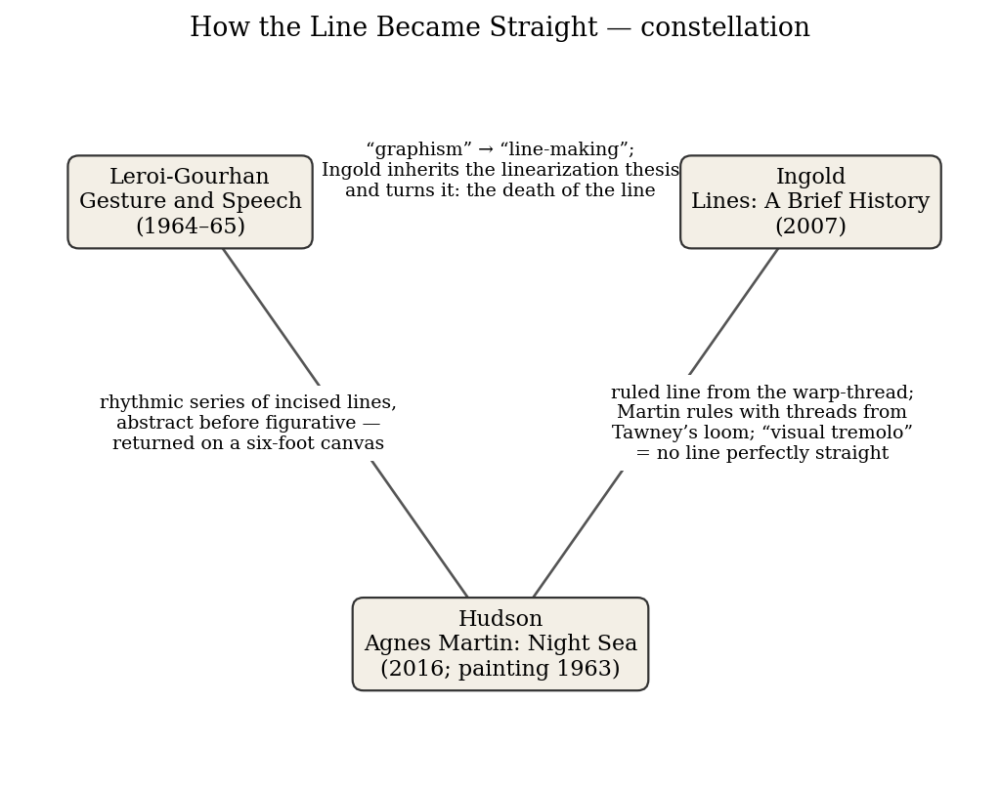
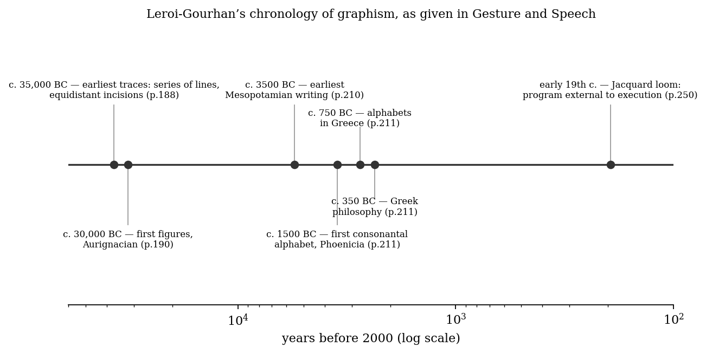
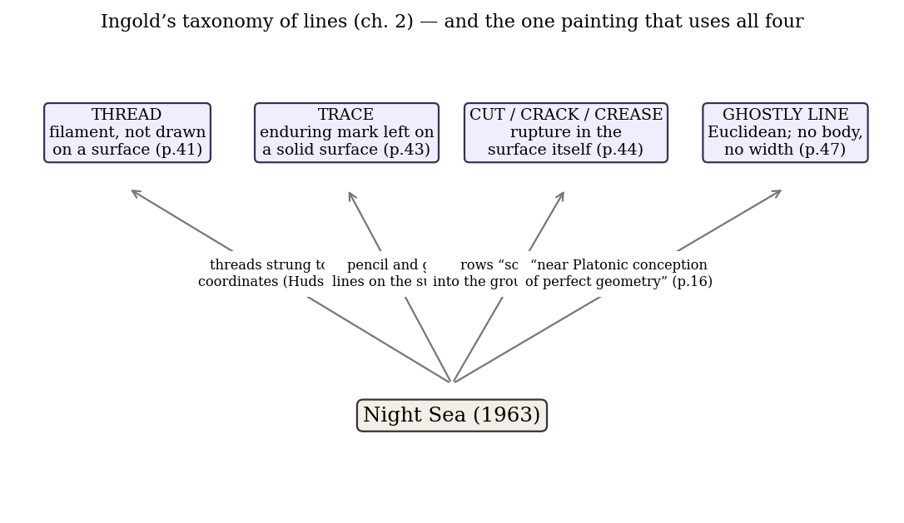

*Triad 28 of 32 · 2026-10-21 · Difficulty 3 · Genealogy/influence, Shared figure or motif, Oblique/structural*

## The three books

- [[books/1003-gesture-and-speech|Gesture and Speech]], [[people/andre-leroi-gourhan|André Leroi-Gourhan]], [[people/anna-bostock-berger|Anna Bostock Berger]] (translator), [[people/randall-white|Randall White]] (contributor); 1964–65 (English 1993). *The source: graphism begins as rhythmic, abstract incision; writing linearizes it into a 'needle-sharp, but also needle-thin' line; the Jacquard loom exteriorizes the program.*
- [[books/10557-lines-a-brief-history|Lines: A Brief History]], [[people/tim-ingold|Tim Ingold]]; 2007. *The hinge: inherits Leroi-Gourhan's linearization thesis, names its paradox, and traces the ruled line back to the warp-thread of the loom.*
- [[books/13363-agnes-martin-night-sea|Agnes Martin: Night Sea]], [[people/suzanne-p-hudson|Suzanne P. Hudson]]; 2016. *The test case: a grid of scored, gilded lines ruled with threads from Tawney's loom; the 'visual tremolo' as Ingold's risk; after 1963 Martin linearizes her own practice.*

---

## The Thread

Three books about one mark: the line a hand drags across a surface. André Leroi-Gourhan argues that the first human graphism was not a picture but a rhythmic series of incised lines, abstract from the start, and that writing later bent this radiant, rhythmic mark into a “needle-sharp, but also needle-thin” line in the service of speech. Tim Ingold takes that thesis, names its paradox (how can a line be non-linear?), and pushes it further: the ruled straight line descends from the taut warp-thread of the loom, and a fully linearized line is “no longer the trace of a gesture.” Suzanne Hudson’s study of Agnes Martin’s *Night Sea* (1963) supplies the case that neither theorist had in front of him: a six-foot grid of rhythmic, scored, gilded lines, ruled with threads borrowed from a weaver’s loom, whose every deviation (the “visual tremolo”) records the arm that drew it.

The link is a genealogy (Leroi-Gourhan →Ingold, explicitly) plus a shared figure (the thread that becomes a ruled line) that reaches Martin by an oblique route: she did not read either man, but her studio practice reenacts Ingold’s history in miniature, and her later decision to plan everything before painting reenacts the linearization both men describe. **Connection kinds:** Genealogy/influence; Shared figure or motif; Oblique/structural. **Difficulty: 3.**

## 1. Gesture and Speech — André Leroi-Gourhan (1964–65; English trans. Anna Bostock Berger, MIT Press 1993)

*PDF · Calibre ID 1003* → [[books/1003-gesture-and-speech|book page]]

**Selection logic.** The source. Ingold calls it “extraordinary” and closes his chapter on writing with its account of graphism. It also gives the triad its deepest claim: abstraction, rhythm and the incised line come first, not last, in the history of the human mark. It has sat on your priority_tbr tag for a while; this is a reason to open it.

**Overview.** A prehistorian’s theory of the human species in two parts, *Technics and Language* and *Memory and Rhythms*. Leroi-Gourhan pairs hand with tool and face with language, and reads human evolution as a progressive exteriorization: of the tool, of memory (into writing, then machines), of rhythm (into social and mechanical cadences). The chapters on “Language Symbols” set out a history of graphism, from Upper Paleolithic incisions to the linear alphabet, in which writing gains precision by narrowing what a graphic sign can hold.

**Quotes (verbatim, PDF of the MIT edition; printed page numbers):**

- “They take the form of tight curves or series of lines engraved in bone or stone, small equidistant incisions that provide evidence of figurative representation moving away from the concretely figurative and proof of the earliest rhythmic manifestations.” (p. 188)

- “If there is one point of which we may be absolutely sure, it is that graphism did not begin with naive representations of reality but with abstraction.” (p. 188)

*Figure 1: Constellation*

- “Four thousand years of linear writing have accustomed us to separating art from writing” (p. 192)

- “… a cosmos whose center they occupy without trying to pierce it by an intellectual process which letters have strung out in a needle-sharp, but also needle-thin, line.” (p. 200)

- “The gesture interprets the word, and the word comments upon graphic expression.” (p. 210)

- “Written language, phoneticized and linear in space, becomes completely subordinated to spoken language, which is phonetic and linear in time.” (p. 210)

- “The program of the Jacquard loom is external to the organs of execution” (p. 250)

**Diagram: the book’s own chronology of graphism.** Every date below is the one Leroi- Gourhan gives, with his page.

*Figure 2: Leroi-Gourhan timeline*

**Glossary of his terms (as used in these chapters).**

- *Graphism*: any graphic sign as the trace of a rhythmic movement of the hand; Ingold adopts it as the equivalent of his “line-making.”

- *Picto-ideography*: his coinage (p. 192) for the figurative-symbolic art of peoples outside phonetic writing, to avoid reading it as primitive writing.

- *Mythogram*: a radial, multi-dimensional arrangement of symbols that holds a narrative without stringing it in sequence; the opposite pole to the linear script.

- *Linearization*: the process by which graphism is aligned in one direction and subordinated to the sounds of speech; brought to its limit by the alphabet.

- *Exteriorization*: the movement of a bodily function (gripping, remembering, programming) out into tools, writing and machines; the Jacquard loom is his example of a program held outside the hands.

## 2. Lines: A Brief History — Tim Ingold (2007)

*PDF · Calibre ID 10557* → [[books/10557-lines-a-brief-history|book page]]

**Selection logic.** The hinge. Ingold reads Leroi-Gourhan closely and names the paradox in his argument; he also supplies the material history that reaches Martin: the ruled line as a descendant of the warp-thread, the ruler as sovereign, the impossibility of a perfectly straight

drawn line.

**Overview.** An anthropologist’s history of the line in six chapters: language, music and notation; traces, threads and surfaces; “up, across and along” (wayfaring against transport); the genealogical line; drawing, writing and calligraphy; and “How the line became straight.” Ingold’s argument is that modernity converted the line from the trail of a movement into a chain of fixed points, and that this conversion changed how we walk, write, draw and think about descent.

**Excerpt (ch. 5, “Drawing, writing and calligraphy,” p. 151).** Ingold, having summarized Leroi-Gourhan, turns on him:

> Surely every trace left by a dextrous movement of the hand is itself a line. How, then, can the lines of prehistoric graphism be non-linear? How could it be that the storytellers of old, as they traced their lines, followed a non-linear trail? And how, conversely, can graphism be linear when, as in a sequence of printed letters, it leaves no trail to follow at all? In short, how can the line be non-linear and the non-line linear?

His answer, a few lines later: “Fully linearized, the line is no longer the trace of a gesture but a chain of point-to-point connections. In these connections there is neither life nor movement. Linearization, in short, marks not the birth but the death of the line.” (p. 151)

**Quotes:**

- “For Semper the prototypical line was a thread; for Riegl it was a trace” (ch. 2, p. 42)

- Klee’s hurried line, as Ingold quotes it: “more like a series of appointments than a walk” (ch. 3, p. 73)

- “the straight lines of the ruled manuscript, which guided the writer’s hand in weaving the letter-line, can be traced back to the parallel warp-threads of the loom. The threads were straight because they were taut.” (ch. 6, p. 157)

- “A ruler is a sovereign who controls and governs a territory. It is also an instrument for drawing straight lines.” (p. 160)

- “Only when the architect ceased to be a master-builder and retreated to the drawing-board were templates replaced by the ruler, and taut threads by the ruled traces of the diagram.” (p. 161)

- “so no line that is ever drawn – even with a ruler – can ever be perfectly straight. An element of risk is always involved.” (p. 162)

**Diagram: his taxonomy of lines, with *Night Sea* placed in it.** Ingold’s four classes come from chapter 2. The painting’s lines fall under all four at once, which is the point of putting it here.

## 3. Agnes Martin: Night Sea — Suzanne P. Hudson (2016, Afterall “One Work”; edition year)

*PDF · Calibre ID 13363* → [[books/13363-agnes-martin-night-sea|book page]]

**Selection logic.** The test case. Hudson’s close description of one painting gives material evidence for both theories: rhythmic abstract lines scored into a ground (Leroi-Gourhan’s first graphism), ruled with threads taken from a loom (Ingold’s warp), wavering wherever the arm’s reach ran out (Ingold’s “element of risk”). Hudson’s thesis, that *Night Sea* is the last painting in which Martin let the process show, also gives the triad its turn: after 1963 Martin linearized her own practice.

*Figure 3: Ingold taxonomy*

**Overview.** A short monograph in Afterall’s series on single works. Hudson reconstructs the making of *Night Sea* (1963), a six-by-six-foot oil on canvas gridded in gold over blue, its place in Martin’s Coenties Slip years beside the weaver Lenore Tawney, and its reception, arguing that the painting’s “flaws” are its subject and that Martin’s later rhetoric of classicism and pre-formed vision was, among other things, a way of keeping the struggle out of the work.

**Quotes:**

- The rows are “scored and sometimes gilded, they generate pattern in and as surface.” (p. 13)

- “the six-foot span – Martin’s standard canvas size as of 1960 – measures the reach of her own arms.” (p. 16)

- “Near the top right corner, the main lines veer off track to the right, and the horizontal bands dip ever so slightly. The slopes show how her implementation of markings was keyed to her movement.” (p. 16)

- “Accident betrays her.” (p. 17)

- “these marks positively evidence what Annette Michelson once characterised as a distinctively human ‘visual tremolo’, which is to say, that they are aleatory and minutely flawed.” (p. 17)

- On her drawings: “she could not conceal the journey of her hand across the page, or the systems she put in place to attempt regulation.” (p. 18)

- Quoting Sid Sachs: “in addition to a T-square and ruler, Martin used threads to track vertical and horizontal coordinates, a trick assimilated from watching Tawney dress her loom” (p. 36)

- Martin, on her first grid: “Well, when I first made a grid I happened to be thinking of the innocence of trees” (p. 45)

**Derived list: the catalogue of *Night Sea*****’s imperfections, as Hudson records them (pp. 16–17).**

1. The main lines near the top right veer off to the right.

2. The horizontal bands dip slightly.

3. The rectangles are not uniform; some passages are compressed or distorted (visible with the painting turned on its side).

4. Brush threads are stranded in the oil; striations show direction and pressure.

5. Paint has crept under the tape beyond the borders; there is a bleed-stain near the top.

6. Something appears to have been painted out near the bottom.

7. The edges were scraped or sanded to clean up those seepages.

8. A first, more brilliant blue sits beneath opaque blue-green daubs, leaving “halos” near the scored lines.

**A misreading worth attempting.** Read *Night Sea* not as a painting but as a ruled page. Ingold’s Hebrew scribes pressed parchment onto cords strung on a frame (the *masara*) to raise guidelines for writing (p. 157). Martin strung threads to find her coordinates, scored the lines, and then wrote nothing on them. A ruled manuscript with the text withheld is a fair description of a grid; it also makes Martin’s “innocence” a matter of the page before writing, which is Leroi-Gourhan’s period, not Mondrian’s.

## Where this sends you

## Notebook

1. **The obituary.** Put Ingold’s “Linearization, in short, marks not the birth but the death of the line” (p. 151) beside Hudson’s claim that after *Night Sea* Martin painted “what was already known” from a pre-formed vision (pp. 17–18). Was Martin’s mature method a deliberate linearization, Pye’s “workmanship of certainty” adopted by a painter? If so, *Night Sea* is the last breath of the line in her work. Write the obituary from inside her studio.

2. **Abstraction first.** Leroi-Gourhan: “graphism did not begin with naive representations of reality but with abstraction” (p. 188). Martin: the grid came “thinking of the innocence of trees” (p. 45). If the oldest marks are rhythmic, abstract incisions, the modernist grid is not a terminus but a return. Test this against Leroi-Gourhan’s own caution, on the same page, that “No meaning can be attached” to the earliest series of lines.

3. **Who rules the line.** Three threads: the warp that becomes the ruled guideline (Ingold, p. 157), the threads Martin strung from Tawney’s loom (Hudson, p. 36), the punched program of the Jacquard loom “external to the organs of execution” (Leroi-Gourhan, p. 250). In each, a thread governs a hand. Write a short piece on the difference between a guide and a program, using Ingold’s pun on the ruler as sovereign (p. 160).

## Rabbit holes

- **Tate Modern, “Agnes Martin and Lenore Tawney”** (display, 2022–23): on Coenties Slip, the grid of weaving, and their shared practice. https://www.tate.org.uk/visit/tate-modern/display/in-the-studio/agnes-martin-and-lenore-tawney

- **John Ruskin, *The Elements of Drawing*** (Project Gutenberg): the source of “draw every line but a straight one,” which Ingold quotes on p. 161. https://www.gutenberg.org/ebooks/30325

- **Rosalind Krauss, “Grids” (1979)**, the “anti-developmental” grid Hudson leans on; excerpted and discussed by Thomas Brett. https://brettworks.com/2017/11/20/theory-as-poetry-rosalind-krausss-grids-1979/

- **Monoskop on *Gesture and Speech***: editions in French, Spanish, Italian and English, with publication history. https://monoskop.org/log/?p=5540

- **Stephanie Guyet, review of Hudson’s *Night Sea*** (*The Brooklyn Rail*, June 2017). https://brooklynrail.org/2017/06/art_books/Agnes-Martin-Night-Sea

- **Andrew Cochrane, review of Ingold’s *Lines*** (*Cambridge Archaeological Journal* 18:3, 2008): an archaeologist’s reception. https://www.cambridge.org/core/journals/cambridge-archaeological-journal/article/abs/lines-a-brief-history-by-tim-ingold-2007-london-routledge-isbn13-9780415424271-paperback-1999-us30-xii186-pp-63-figs/96B4EB16AC9224C9304B9C27639BC0D2

## Also in your library

- Paul Klee, *Pedagogical Sketchbook* (Calibre ID 723): the “walk” and the “series of appointments” Ingold quotes, in Klee’s own diagrams.

- David Maclagan, *Line Let Loose* (Calibre ID 4771): the line released from representation, the other side of Ingold’s straightening.

- Tim Gaze and Michael Jacobson (eds.), *An Anthology of Asemic Handwriting* (Calibre ID 5061): Leroi-Gourhan’s graphism without speech, practiced now.

## From the Lexicon — Gesture

**Received:** A movement of the body or a part of it that expresses a thought or feeling; figuratively, an act performed to signal intention or goodwill rather than for its practical effect.

**Etymology.** From Latin *gestus* (carriage, posture), from *gerere*, to carry on or perform; cognate with *gest* (deed) and *jest*.

**WordNet.** Present: WordNet gives “motion of hands or body to emphasize or help to express a thought or feeling” (oewn-00335335-n); the sense at work today is narrower, the movement whose remainder is a line, which the expressive gloss does not reach.

**Lineage.** Shares a lineage with *Semantic Meaning (Shapes)* via Semiology.

**Why today.** It is the first word of Leroi-Gourhan’s title, and Ingold’s whole argument turns on whether a line is still “the trace of a gesture.”

**Verified occurrence.** “Fully linearized, the line is no longer the trace of a gesture but a chain of point-to-point connections.” (Ingold, *Lines*, p. 151)

**New in the Lexicon**

- Ousiometrics — the quantitative study of the essential meaningful components of an entity (Dodds et al., 2021).

- Vernacular — the native, everyday language or idiom of a place or people, as against a learned or standard one.

- Atropos — the third of the Fates, who cuts the thread spun by Clotho and measured by Lachesis.

- Ossuary — a chest, building or site that holds skeletal remains after a first burial.

- obelism — marking a doubtful or spurious passage with an obelus; by extension, the system of marginal critical signs.

- Dasein — Heidegger’s term for the being for whom its own being is an issue.

- paratactic — placing clauses or images side by side without subordinating connectives.

- armature — a supporting framework around which a soft medium is built; by extension, the underlying structure of a work.

- Sinthome — Lacan’s fourth ring, a subject’s singular knot that holds Real, Symbolic and Imaginary together.

- chthonic — of or dwelling in or under the earth; said of underworld deities and their rites.

## To carry

> “Linearization, in short, marks not the birth but the death of the line.” — Tim Ingold, *Lines: A Brief History*, p. 151

*All quotations above were substring-checked against text extracted from your own copies (PDF line-break hyphens and ligatures normalized). Atropos, today, has a quiet claim on this thread.*

## Themes

[[themes/abstraction|abstraction]] · [[themes/agnes-martin|Agnes Martin]] · [[themes/coenties-slip|Coenties Slip]] · [[themes/exteriorization|exteriorization]] · [[themes/gesture|gesture]] · [[themes/graphism|graphism]] · [[themes/grid|grid]] · [[themes/incision|incision]] · [[themes/jacquard-loom|Jacquard loom]] · [[themes/klee|Klee]] · [[themes/kraus|Kraus]] · [[themes/lenore-tawney|Lenore Tawney]] · [[themes/line|line]] · [[themes/linearization|linearization]] · [[themes/loom|loom]] · [[themes/masara|masara]] · [[themes/mythogram|mythogram]] · [[themes/night-sea|Night Sea]] · [[themes/pye|Pye]] · [[themes/rhythm|rhythm]] · [[themes/riegl|Riegl]] · [[themes/ruled-line|ruled line]] · [[themes/ruler|ruler]] · [[themes/ruskin|Ruskin]] · [[themes/semper|Semper]] · [[themes/thread-vs-trace|thread vs trace]] · [[themes/visual-tremolo|visual tremolo]] · [[themes/warp-thread|warp-thread]] · [[themes/workmanship-of-risk|workmanship of risk]] · [[themes/writing-vs-drawing|writing vs drawing]]

---

Previous: [[triads/2026-10-20-the-chemists-shelf|The Chemist’s Shelf]]  
Next: [[triads/2026-10-22-the-day-after-his-arrival|The Day After His Arrival]]
