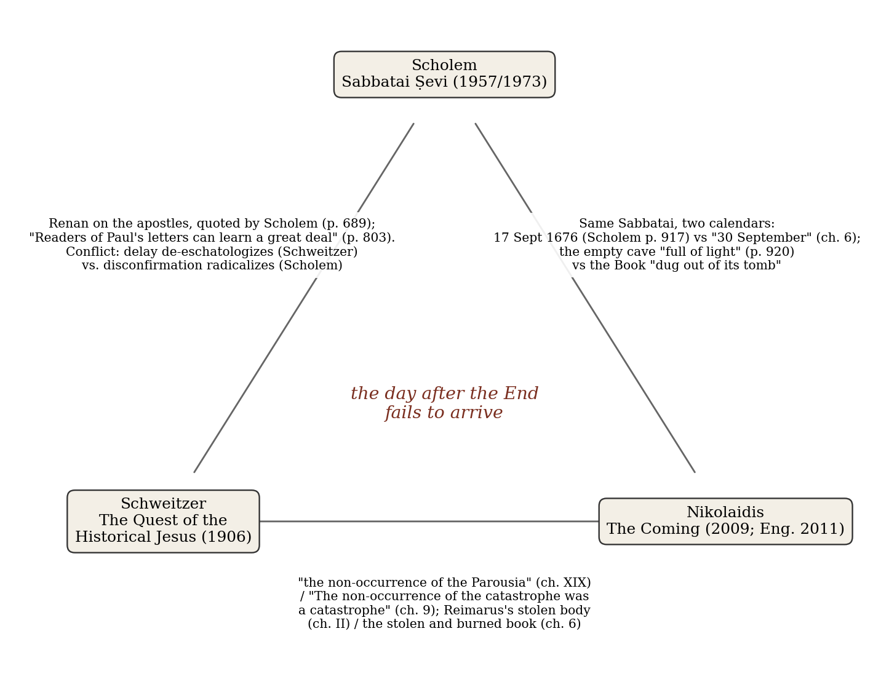
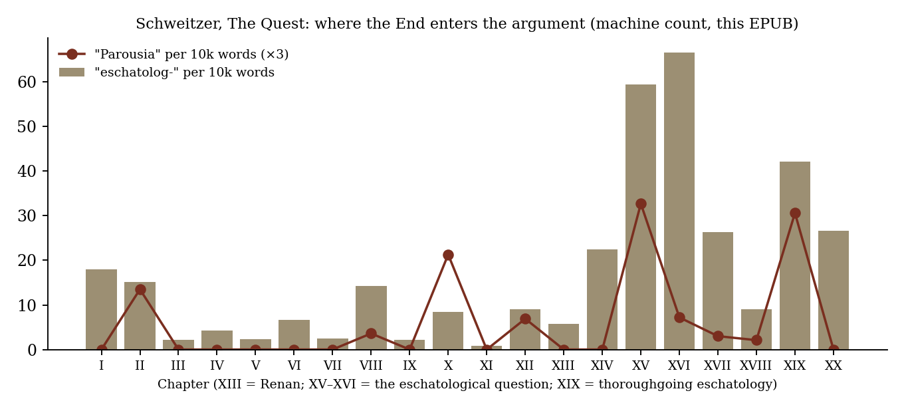
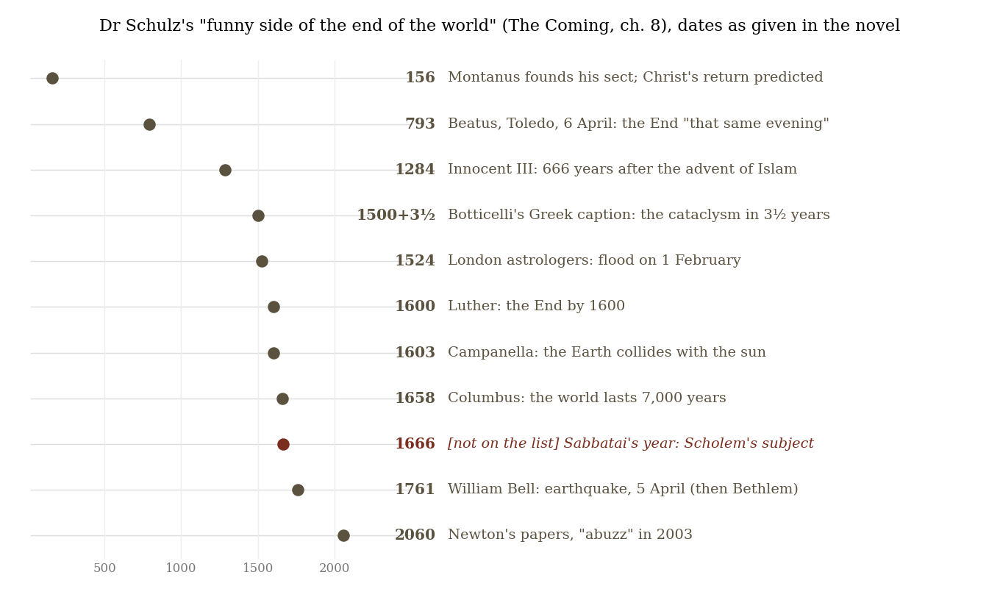

*Triad 29 of 32 · 2026-10-22 · Difficulty 3 · Same subject, Conflict, Genealogy/influence, Shared figure or motif*

## The three books

- [[books/7651-sabbatai-sevi-the-mystical-messiah-1626-1676|Sabbatai Ṣevi: The Mystical Messiah, 1626-1676]], [[people/gershom-scholem|Gershom Scholem]], [[people/r-j-zwi-werblowsky|R. J. Zwi Werblowsky]] (translator); 1957. *The anchor and the historian's case: three disconfirmations (imprisonment, apostasy, death) each turned into doctrine; explicit parallel with Paul and early Christianity.*
- [[books/2643-the-quest-of-the-historical-jesus|The Quest of the Historical Jesus]], [[people/albert-schweitzer|Albert Schweitzer]], [[people/w-montgomery|W. Montgomery]] (translator); 1906. *The theologian's case and genealogical middle term: Christianity as the history of the delay of the Parousia; Reimarus's stolen body; Renan's novelistic Life.*
- [[books/7415-the-coming|The Coming]], [[people/andrej-nikolaidis|Andrej Nikolaidis]], [[people/will-firth|Will Firth]] (translator); 2009. *The novelist's case: a noir in Ulcinj where Sabbatai's followers burn books so he can return; the non-occurrence of the End as the catastrophe.*

---

## The Thread

Three books about what a movement does the morning after the End fails to arrive. Gershom Scholem’s *Sabbatai Ṣevi* follows the messiah of 1665–66 through three disconfirmations (imprisonment, apostasy to Islam, death) and shows each one producing a new doctrine rather than ending the faith. Albert Schweitzer’s *Quest of the Historical Jesus* argues that early Christianity itself was built on a disconfirmation: “The whole history of “ Christianity” down to the present day, that is to say, the real inner history of it, is based on the delay of the Parousia, the non-occurrence of the Parousia” (ch. XIX). Andrej Nikolaidis’s *The Coming* is a Montenegrin noir in which Sabbatai’s followers burn a library in Ulcinj, the town where he died, so that he can come again. Its last chapter gives the thesis in a single sentence: “The non-occurrence of the catastrophe was a catastrophe which ultimately made the world impossible to live in.” The novel opens with Kafka’s line that the Messiah “will come only on the day after his arrival.”

The books are linked by evidence on the page, not only by subject. Scholem reaches for Renan’s account of the apostles to describe the Sabbatians (p. 689) and writes that “Readers of Paul’s letters can learn a great deal from these later Jewish writings” (p. 803). Schweitzer has a full chapter on that same Renan. All three are built around an empty place: Reimarus’s disciples who “stole the body of Jesus and hid it” (Schweitzer, ch. II), the Sabbatian cave found “full of light” (Scholem, p. 920), and the Book of the Coming “dug out of its tomb” (Nikolaidis, ch. 6). They disagree about what disconfirmation does. For Schweitzer it slowly de-eschatologizes a religion. For Scholem it radicalizes one into paradox, a faith in “a saint who sins.” For Nikolaidis the non-arrival is the catastrophe itself. **Connection kinds:** same subject, conflict, genealogy/influence, shared motif (the empty tomb). **Difficulty:** 3.

## 1. Sabbatai Ṣevi: The Mystical Messiah, 1626–1676 — Gershom Scholem (Hebrew 1957; revised and augmented English translation by R. J. Zwi Werblowsky, 1973)

EPUB, Princeton Classics edition (2016, intro. Yaacob Dweck) · Calibre ID 7651 (a duplicate record exists as 5724) · page numbers are the print pages embedded in the EPUB → [[books/7651-sabbatai-sevi-the-mystical-messiah-1626-1676|book page]]

**Selection logic.** This is the anchor and the historian’s case. Scholem documents in detail how a faith survives the refutation of its own central claim, and he keeps comparing it to early Christianity. That comparison lets Schweitzer into the room.

**Overview.** Scholem’s magnum opus reconstructs the movement around Sabbatai Ṣevi of Smyrna, proclaimed messiah in 1665 by Nathan of Gaza, his prophet and theologian. The movement spread through the whole Diaspora. On September 16, 1666 Sabbatai converted to Islam before the sultan’s council. He died in exile at Dulcigno (Ulcinj) in 1676. Scholem’s

*Figure 1: The constellation: what passes between the three books*

thesis is that Lurianic kabbalah had already prepared believers to live inside an inner, “realized” redemption, so the apostasy split the inner reality from the outer one instead of simply ending the movement.

**Quotes.**

- “To believe in an apostate messiah was to build one’s hope on foundations of paradox and absurdity, which could only lead to more paradoxes.” (ch. 7 §I, p. 690)

- “The Sabbatian paradox, however, was not that of a saint who suffers and whose suffering is a mystery hidden with God, but of a saint who sins.” (ch. 7 §I, p. 691)

- Nathan’s spy parable: the messiah must “adopt the dress of the people through whose land he passes, and to behave as they do, lest they notice that he is a spy” (ch. 7 §VIII, p. 802)

- “Readers of Paul’s letters can learn a great deal from these later Jewish writings, composed in a very similar psychological situation.” (ch. 7 §IX, p. 803)

- Nathan’s messianic theology already contains Jesus: “the soul of the messianic qelippah (that is, Jesus), appeared first in this world” and “And finally he [that is, the messiah] will restore [to holiness] his qelippah which is Jesus Christ.” (ch. 3, p. 285)

**Derived list: three disconfirmations, three doctrines** (assembled from the book).

1. *Imprisonment* (1666). The fortress at Gallipoli became a court: “his prison was soon known as Migdal ʿOz, the “Tower of Strength,”” (p. 460). Scholem notes that “Paradox-cial explanations of the messiah’s fate had already been offered” at this stage (p. 803; the typo is the EPUB’s).

2. *Apostasy* (September 16, 1666). This produced the doctrine of the descent into the qelippah, or “holy ruse”, “compared to the action of a worm in a tree that appears healthy from outside” (p. 802), with a typology of biblical figures who hid themselves among strangers: Abraham in Egypt, Moses at Pharaoh’s court, David at Achish’s, Esther, and the Suffering Servant, whose meḥolal (“wounded”) “can also be rendered as “profaned.”” (p. 804).

3. *Death* (Day of Atonement, 1676). This produced the doctrine of occultation. Believers first asked whether “perhaps this was no “real death” at all” (p. 920). The legend ends with the brother entering the tomb-cave: “Neither Our Lord nor anything else was in the cave, but it was full of light.” (p. 920). Then Nathan’s maggidim: “AMIRAH was exalted and hidden, body and soul, on the Day of Atonement” (p. 923).

**Short glossary** (as the book uses the terms).

- *qelippah / qelippoth* — the “shell”: demonic powers that imprison the holy sparks; also the messiah’s shell (p. 285).

- *tiqqun* — the restoration of the broken cosmic order; the believers’ “world of tiqqun” had become an inner reality before the apostasy (p. 689).

- *AMIRAH* — the believers’ title for Sabbatai, used throughout the sources.

- *occultation* — the doctrine that the messiah did not die but was hidden, introduced (probably by Nathan) after 1676 (pp. 922–23).

- *neʿilah* — the closing prayer of the Day of Atonement, the hour Sabbatian tradition assigns to his death (p. 918).

## 2. The Quest of the Historical Jesus — Albert Schweitzer (German 1906, Von Reimarus zu Wrede; English trans. W. Montgomery, 1910)

EPUB, Dover edition · Calibre ID 2643 · no print pagination in this file; locations are by chapter → [[books/2643-the-quest-of-the-historical-jesus|book page]]

**Selection logic.** This is the theologian’s case and the genealogical middle term. Schweitzer’s “thoroughgoing eschatology” puts the failed prophecy at the origin of Christianity, the very structure Scholem saw re-enacted in 1666. His chapter on Renan also shows the danger Nikolaidis takes on knowingly: the life of a messiah written as a novel.

**Overview.** Schweitzer surveys the lives of Jesus from Reimarus (1778) to Wrede (1901) and concludes that the historical Jesus was an apocalyptic prophet who expected the immediate end of the world. When the end did not come, Jesus went to his death to force it. Everything after that, in Schweitzer’s account, is the history of the delay.

**Excerpt** (ch. XIX). Schweitzer’s own picture of a messiah who tries to bring the End by force:

> There is silence all around. The Baptist appears, and cries: “ Repent, for the Kingdom of Heaven is at hand.” Soon after that comes Jesus, and in the knowledge that He is the coming Son of Man lays hold of the wheel of the world to set it moving on that last revolution which is to bring all ordinary history […]
>
> *(Shortened for the public edition.)*

**Quotes.**

- Reimarus’s fraud thesis, as reported by Schweitzer: “So they stole the body of Jesus and hid it, and proclaimed to all the world that He would soon return.” (ch. II)

- “Accordingly, the main problem of primitive dogmatics was the delay of the Parousia.” (ch. II)

- On 2 Peter: “the sophism of the thousand years which are in the sight of God as one day” (ch. II)

- “There is no historical task which so reveals a man’s true self as the writing of a Life of Jesus.” (ch. I)

- On Renan: “He planned the work at Gaza” (ch. XIII). This is the town of Nathan, Sabbatai’s prophet. It’s probably nothing. Schweitzer also calls Renan’s book “the art of the wax image” (ch. XIII).

**Diagram: where the End enters the argument.** A machine count of this EPUB: occurrences of “eschatolog-” and “Parousia” per 10,000 words in each chapter. The book’s argument runs low through the rationalists and Renan (XIII), then rises sharply in XV–XVI and XIX. The structure of the book enacts its thesis: the end-expectation, edited out by a century of biographers, comes back at the end.

*Figure 2: Schweitzer, chapter by chapter*

## 3. The Coming — Andrej Nikolaidis (Montenegrin original Dolazak, 2009; trans. Will Firth, © 2011)

EPUB, Dzanc Books · Calibre ID 7415 · locations are by chapter → [[books/7415-the-coming|book page]]

**Selection logic.** This is the novelist’s case and the outside element. It is a noir in which the detective-narrator sells clients the story they want, set in Sabbatai’s own exile town. Its account of Sabbatai can be checked against Scholem line by line. The discrepancies say exactly what fiction does to a messiah.

**Overview.** In Ulcinj, snow falls in midsummer. A family is murdered and the town library burns. The narrator, a detective who doesn’t believe in truth, receives emails from his abandoned son Emmanuel, confined in a Viennese asylum. Emmanuel tells him about Fra Dolcino’s hidden manuscript and Sabbatai Zevi’s two books: a fake one, *The Glory of the Return*, and the real *Book of the Coming*. The descendants of his followers must destroy both before he can return. The apocalypse appears on television, and then “the End which has not come” (ch. 9 heading).

**Quotes.**

- “Truth always appears as a fiction and takes the form of a story. I am a storyteller.” (ch. 1)

- “As stories have a way of finding those who want to hear them, the story about Fra Dolcino and his hidden manuscript made it all the way to Smyrna.” (ch. 6)

- “The third was now dug out of its tomb: the Messiah could come again.” (ch. 6)

- Dr Schulz on the Apocalypse as detective plot: “When a good sleuth and God are finished, no further interpretation is possible, there’s only applause” (ch. 8)

- “The Apocalypse had been a kind of solution, after all.” (ch. 9)

**Derived list and timeline: Dr Schulz’s catalogue of failed Ends** (ch. 8). The asylum psychiatrist gives a comic roll of failed predictions. The dates below are the novel’s and have not been checked against sources. Sabbatai’s 1666, the subject of the other two books, is missing from the list, which is the novel’s own joke on itself.

*Figure 3: Dr Schulz’s catalogue, evenly spaced; dots show actual year*

**Two calendars: Nikolaidis against Scholem** (a misreading worth attempting).

| Point | The Coming, ch. 6 | Scholem |
|---|---|---|
| Birth | “born in Smyrna, now Izmir, on 9 August. That was a Sabbath.” | “born in Smyrna on the Ninth of Ab” 1626, which “did, in fact, fall on a Sabbath” (p. 104) |
| Exile | “the Sultan asked: Where do you wish to be exiled? Sabbatai Zevi replied: To Ulcinj.” | “Perhaps the Turkish authorities meant to keep the place of his exile a secret” (p. 882) |
| Death date | “He died in Ulcinj on 30 September 1676. That was Yom Kippur.” | “died in Dulcigno on the Day of Atonement, 5437 (September 17, 1676)” (p. 917) |
| Last words | A miracle: “ ‘O Lord, send back this child and take me instead!’ ” | On the beach: “Return every man to his house. How long will you hold fast to me?” (p. 917), which Scholem calls “a very melancholic utterance” |

The birth row is the instructive one. The Ninth of Av, a Hebrew date for the destruction of the Temple, turns into a Gregorian 9 August. The Sabbath survives the conversion and the Temple doesn’t. The death row works the same way, with the Day of Atonement kept and the calendar day moved. The novel keeps the holy day and drops the date, which is roughly what occultation does to a death.

## Where this sends you

**Notebook.**

1. *The suffering saint and the sinning saint.* Set Scholem’s distinction (“not that of a saint who suffers … but of a saint who sins”, p. 691) against Schweitzer’s wheel (“That is His victory and His reign”, ch. XIX). Schweitzer’s Jesus is the suffering kind, made great by being crushed. Sabbatai on the beach (“How long will you hold fast to me?” p. 917) is a third kind that neither book has a word for: the messiah who tells his followers to go home. Write that third figure’s theology in ten sentences.

2. *Writing the Life.* Schweitzer: “There is no historical task which so reveals a man’s true self as the writing of a Life of Jesus” (ch. I). Nikolaidis’s narrator: “I am a storyteller” (ch. 1). Nathan, per Scholem, rules that whoever busies himself with the messiah “even by telling stories only, is considered like one who studies the mysteries of the merkabah” (p. 925). Write a 500-word life of a failed prophet, real or invented, then list what of yourself got into it. (The Emmanuel chapters are a son writing the life of the father who abandoned him.)

3. *Three empty places.* Reimarus’s stolen body (Schweitzer ch. II) means fraud. The cave “full of light” (Scholem p. 920) means occultation. The Book “dug out of its tomb” (Nikolaidis ch. 6) means a resurrection that has to be produced by theft. Write the fourth reading, Kafka’s in the novel’s epigraph: “he will come only on the day after his arrival”. What is in the tomb on that day?

**Rabbit holes.**

- Leon Festinger, Henry Riecken & Stanley Schachter, *When Prophecy Fails* (1956), the cognitive-dissonance account of a group whose End didn’t come, at the Internet Archive: https://archive.org/details/when.prophecy.fails/page/n5/mode/1up. Read it against Scholem ch. 7 §I: is “life-feeling” just dissonance with better theology?

- *Fragments from Reimarus* (1879 English edition), the source of Schweitzer’s ch. II: https://archive.org/details/cu31924031784279

- Ernest Renan, *The Life of Jesus* (Project Gutenberg), the book planned at Gaza that Scholem quotes and Schweitzer dissects: https://gutenberg.org/ebooks/16581

- Schweitzer’s ch. II on Reimarus, online at Early Christian Writings: https://earlychristianwritings.com/schweitzer/chapter2.html

- Howard Caygill, “The Apostate Messiah: Scholem, Taubes and the Occlusions of Sabbatai Zevi,” *Journal for Cultural Research* 13.3–4 (2009): https://eprints.kingston.ac.uk/21377/. Taubes is the next name to find; he read Paul and Sabbatai together.

- Marc David Baer, *The Dönme: Jewish Converts, Muslim Revolutionaries, and Secular Turks* (Stanford, 2009), on the sect Nikolaidis’s arsonists belong to: https://researchonline.lse.ac.uk/id/eprint/53133

**Also in your library.**

- Gershom Scholem, *The Messianic Idea in Judaism* (Calibre ID 12851, PDF). It contains “Redemption Through Sin,” the essay-length version of the saint who sins.

- Thomas Flanagan, *Louis ‘David’ Riel: Prophet of the New World* (Calibre ID 6111, PDF), a nineteenth-century messianic claimant in the Canadian Northwest, a case for testing the triad outside Judaism and Christianity proper.

- Peter Fenves, *The Messianic Reduction* (Calibre ID 6545, PDF), on Benjamin, which is the route from Scholem’s friendship to Kafka’s epigraph.

## From the Lexicon — Kenosis

**Your sense:** kenosis (kɪˈnəʊsɪs) n (Ecclesiastical Terms) Christianity Christ’s voluntary renunciation of certain divine attributes, in order to identify himself with mankind (Philippians 2:6–7) [C19: from Greek: an emptying, from kenoun to empty from kenos empty] kenotic adj, n

**Received:** In Christian theology, Christ’s ‘self-emptying’ in the Incarnation, from Paul’s ekenosen (‘he emptied himself’) in Philippians 2:7, where he takes ‘the form of a servant’. Kenotic Christology, first expounded by name by Gottfried Thomasius and later associated with Charles Gore, disputes how far this emptying went: renunciation of all divine attributes, only relative ones, or only their exercise. In mystical and Orthodox usage it extends to the believer’s emptying of self-will to receive God (John of the Cross).

**Etymology.** Greek *kenōsis*, “an emptying,” from *kenos*, “empty”; Paul’s *ekenosen* (Phil. 2:7); an English theological term from 1873.

**WordNet.** Present: the nearest synset (oewn-05951056-n) glosses it as “the concept of emptying one’s own will and receive God’s will, in Catholicism.” That is the believer’s emptying. The sense at work today is the other one, Christ’s: a redeemer who takes “the form of a servant.”

**Lineage.** No typed edge yet. Shares a lineage with Anathema via Christian Theology. The pairing fits a messiah whom the rabbis put under the ban.

**Why today.** Nathan’s spy parable, in which the messiah must “adopt the dress of the people through whose land he passes” (Scholem p. 802), reads Philippians 2:7 as apostasy. Scholem says as much when he sends readers of Paul to the Sabbatian letters (p. 803).

**Verified occurrence.** None. A whole-word search for “kenosis” in all three texts came back empty. Scholem describes the structure without using Paul’s word.

**New in the Lexicon.**

- *paratactic* — placing clauses or images side by side without subordinating connectives, leaving their relation to the reader.

- *armature* — the supporting framework under a composition, above all the internal skeleton of a sculpture in soft material.

- *Sinthome* — Lacan’s fourth ring that holds the Borromean knot together where one register fails; his paradigm is Joyce.

- *chthonic* — of or dwelling under the earth; in Greek cult, the underworld powers and their night rites, as against the Olympian.

## To carry

> “Enthusiasm and love know of no hopeless situations. They play with the impossible, and rather than despair, they violate reality.” — Ernest Renan on the first apostles, quoted in Scholem, *Sabbatai Ṣevi*, ch. 7 §I, p. 689

## Themes

[[themes/apocalypse-as-solution|Apocalypse as solution]] · [[themes/apostasy|apostasy]] · [[themes/apostate-messiah|apostate messiah]] · [[themes/book-burning|book burning]] · [[themes/buried-book|buried book]] · [[themes/cave-full-of-light|cave full of light]] · [[themes/cognitive-dissonance|cognitive dissonance]] · [[themes/de-eschatologizing|de-eschatologizing]] · [[themes/delay-of-the-parousia|delay of the Parousia]] · [[themes/detective-as-storyteller|detective as storyteller]] · [[themes/disconfirmation|disconfirmation]] · [[themes/donme|Dönme]] · [[themes/empty-tomb|empty tomb]] · [[themes/failed-end-dates|failed end-dates]] · [[themes/failed-prophecy|failed prophecy]] · [[themes/festinger|Festinger]] · [[themes/fra-dolcino|Fra Dolcino]] · [[themes/holy-ruse|holy ruse]] · [[themes/kafka-s-messiah-aphorism|Kafka's Messiah aphorism]] · [[themes/kenosis|kenosis]] · [[themes/messianism|messianism]] · [[themes/nathan-of-gaza|Nathan of Gaza]] · [[themes/occultation|occultation]] · [[themes/parousia|Parousia]] · [[themes/paul|Paul]] · [[themes/qelippah|qelippah]] · [[themes/redemption-through-sin|redemption through sin]] · [[themes/reimarus|Reimarus]] · [[themes/renan|Renan]] · [[themes/sabbatai-sevi|Sabbatai Ṣevi]] · [[themes/saint-who-sins|saint who sins]] · [[themes/stolen-body|stolen body]] · [[themes/thoroughgoing-eschatology|thoroughgoing eschatology]] · [[themes/tiqqun|tiqqun]] · [[themes/ulcinj-dulcigno|Ulcinj/Dulcigno]]

---

Previous: [[triads/2026-10-21-the-ruled-thread|The Ruled Thread]]  
Next: [[triads/2026-10-23-the-person-who-waits|The Person Who Waits]]
