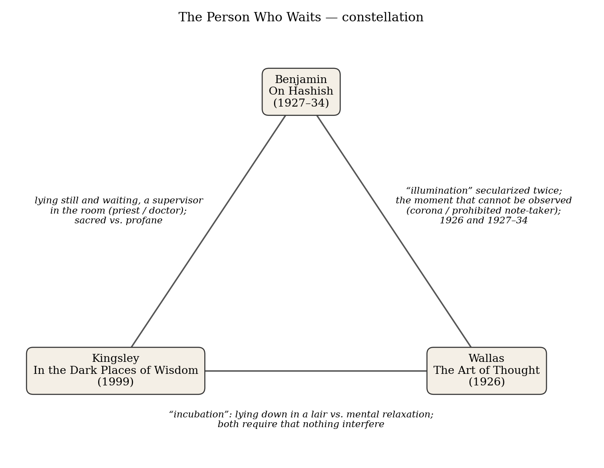
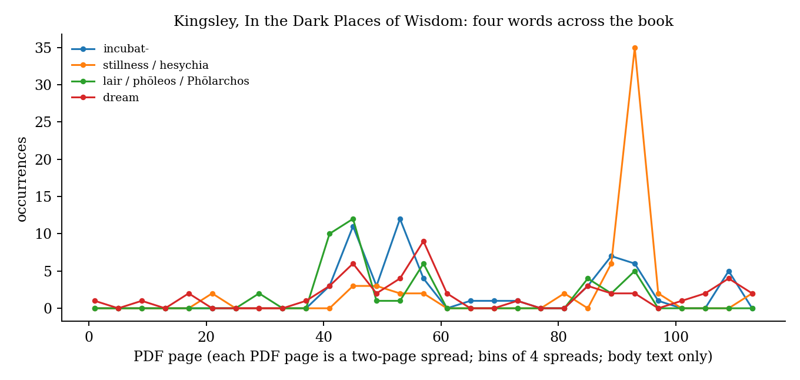

*Triad 30 of 32 · 2026-10-23 · Difficulty 4 · Shared figure or motif, Same period, Conflict*

## The three books

- [[books/11256-in-the-dark-places-of-wisdom|In the Dark Places of Wisdom]], [[people/peter-kingsley|Peter Kingsley]]; 1999. *Anchor: the sacred, literal sense of incubation and the supervisor figure*
- [[books/13262-the-art-of-thought|The Art of Thought]], [[people/graham-wallas|Graham Wallas]]; 1926. *Hinge: secularizes incubation and illumination as stages of thought; states the observation problem (corona/eclipse)*
- [[books/12603-on-hashish|On Hashish]], [[people/walter-benjamin|Walter Benjamin]], [[people/howard-eiland|Howard Eiland]] (translator), [[people/marcus-boon|Marcus Boon]] (contributor); 1972. *Counter-voice: keeps the posture and the word illumination, makes it profane; the protocol with a hole in it*

---

## The Thread

Three books about the interval in which someone lies still and waits for something they cannot make arrive. Peter Kingsley reconstructs incubation as an ancient practice: healer-priests at Velia called *Phōlarchos*, “lords of the lair,” who lay down in caves in *hesychia* (stillness) until a dream or vision came. He reads Parmenides’ poem as the record of such a descent. Graham Wallas, in 1926, uses the same word for the second of his four stages of thought (Preparation, Incubation, Illumination, Verification) and makes it a matter of mental hygiene: relaxation, a walk up wooded hills, a ship’s berth during fever. Walter Benjamin, between 1927 and 1934, lies on a hotel bed in Marseilles or on a sofa in Berlin while a physician friend keeps the protocol, and calls what he is after a “profane illumination.” Two of Wallas’s four stage-names come out of religious vocabulary: Latin *incubatio* was temple sleep, and “illumination” is the middle stage of the mystics’ way. Kingsley gives the first back its sacred sense. Benjamin keeps the second and takes the sacred out of it.

The less obvious link is a problem all three run into: the person it happens to cannot observe the decisive moment. Wallas says the “fringe” of consciousness before an idea arrives is as hard to see as the sun’s corona without an eclipse. In Fritz Fränkel’s protocol of April 18, 1931, the note-taker is forbidden to write at the deepest point, and the “second secret” is lost. Kingsley’s incubant does not interpret the dream alone; there are “people in charge of the place.” Each book needs a second party or a second stage (Verification, the protocol-keeper, the priest) to bring back what the first could not hold, and each pays a price for it.

**Connection kinds:** Shared figure or motif (the one who lies down undisturbed and waits) · Same period (Wallas 1926; Benjamin’s protocols 1927–34 and “Surrealism,” 1929) · Conflict (gods, the unconscious, or the material everyday as the source of what arrives). **Difficulty: 4 of 5.**

| From | To | What passes between them |
|---|---|---|
| Kingsley | Wallas | The word *incubation*. Kingsley: lie down “where you wouldn’t be disturbed.” Wallas: arrange the interval so “nothing should interfere.” The same precaution, pointed in opposite directions: toward the divine, toward the unconscious. |
| Wallas | Benjamin | *Illumination* made secular twice, in the same years (1926; 1927–34). Both hit the moment that can’t be recorded: Wallas’s corona visible only in eclipse; Fränkel forbidden to take notes. |
| Benjamin | Kingsley | Lying still and waiting, with a supervisor in the room (priest; physician). Benjamin counts “the person who waits” among the illuminati; Kingsley says stillness belongs to the gods. Benjamin concedes: “the religious lesson is stricter.” |

*Figure 1: Constellation of the three books*

## 1. In the Dark Places of Wisdom — Peter Kingsley (1999)

PDF · Calibre ID 11256 · Golden Sufi Center edition. The file is a scan with an OCR text layer; some passages carry OCR damage (Greek letters substituted for Latin ones), so I quoted only passages that read cleanly, with printed page numbers. → [[books/11256-in-the-dark-places-of-wisdom|book page]]

**Selection logic.** The anchor. It supplies the older, literal sense of “incubation” (lying down in a lair, waiting without effort) and the figure of the supervisor who stands by. Without it, Wallas’s word looks like a neutral metaphor.

**Overview.** Kingsley starts from inscriptions found at Velia (Elea), the Phocaean colony in southern Italy, which name Parmenides alongside a line of men bearing the titles *Ouliadēs* (“son of Oulios,” that is, of the healing Apollo), *iatromantis* and *phōlarchos*. He argues that Parmenides belonged to a line of healer-prophets who practised incubation in caves, and that the journey to the goddess in Parmenides’ poem describes that practice rather than an allegory of reason. The second half turns to *hesychia*: the report that the Pythagorean Ameinias “led” Parmenides to stillness. The book is written for general readers, is openly polemical against academic philosophy, and its central thesis is contested by classicists. Read it as an argument, not a consensus.

**Quotes**

- “What’s important is that you would do absolutely nothing. The point came when you wouldn’t struggle or make an effort. You’d just have to surrender to your condition.” (p. 80)

- “It’s all tied up with that clumsy word: incubation.” (p. 101)

- “Usually you’d lie down in a special place where you wouldn’t be disturbed.” (p. 101)

- “It used to mean giving a voice to what doesn’t have a voice, meant acting as a mouthpiece for the divine.” (p. 108, on what prophecy once meant)

- “Really it was already the end itself, the ultimate paradox of the end that’s present at the beginning.” (p. 186, on the stillness of incubation)

**Diagram: four words across the book.** Counts of *incubat-*, *stillness/hesychia*, *lair/phōleos/Phōlarchos* and *dream* in the body text, taken from the OCR layer (so approximate; garbled tokens are missed). The vocabulary of place (lair, incubation) clusters in the chapters on Velia and the *iatromantis* (PDF 41–60, printed pp. ~72–112). Stillness spikes much later (PDF 93–96, pp. ~180–187, the chapter “Like the Wind at Night”). The book moves from where you lie down to the state you lie down into.

**Glossary (Kingsley’s terms, paraphrased with page references)**

- *phōleos*: a lair or den where animals withdraw and lie motionless; often a cave (pp. 78– 79).

- *phōleia / phōleuein*: being or lying in a lair; by extension, suspended animation (p. 79).

- *Phōlarchos*: “lord of the lair”; *archos* is lord, chief, the person in charge (pp. 78, 109).

- *hesychia*: stillness, which for the Pythagoreans also meant silence (pp. 82, 184–187).

- *iatromantis*: a healer who heals through prophecy (p. 108).

- *Charonium / Plutonium*: a cave treated as an entrance to the underworld, as in Strabo’s account of Acharaca in Caria (pp. 81–82).

- *Pholeuterios*: a title of Apollo as god of lairs and incubation (p. 169).

## 2. The Art of Thought — Graham Wallas (1926)

PDF · Calibre ID 13262 · Solis Press reprint (2014). The file is page images with no text layer. I ran OCR (tesseract) on chapter IV, “Stages of Control” (PDF pp. 92–122). Quotes come from → [[books/13262-the-art-of-thought|book page]]

*Figure 2: Kingsley word frequencies*

that OCR and were checked against it. The edition prints no page numbers, so locations are PDF pages.

**Selection logic.** The hinge. Wallas is where “incubation” and “illumination” enter the modern vocabulary of creativity, as the second and third of four stages, without the cult behind them. He also states the observation problem most precisely.

**Overview.** Wallas (1858–1932), a political scientist at London University, tries to write an “art” of thought from the psychology of his day. Chapter IV takes Helmholtz’s 1891 birthday speech and Poincaré’s *Science and Method* and splits the arrival of a new idea into Preparation, Incubation, Illumination and Verification. He adds “Intimation,” the felt sense that an association is about to arrive. The rest of the book turns this into advice on habit, energy and education. His sources include William James on the “fringe” and Julien Varendonck on day-dreams.

**Excerpt.** Wallas on what the interval requires (ch. IV, PDF p. 103):

> “it is desirable not only that there should be an interval free from conscious thought on the particular problem concerned, but also that that interval should be so spent that nothing should interfere with the free working of the unconscious or partially conscious processes of the mind. In those cases, the stage of Incubation should include a large amount of actual mental relaxation.”

Set this beside Kingsley’s “where you wouldn’t be disturbed.” The precaution is identical. The theory of what arrives is not.

**Quotes**

- “Even in exploring the same problem, the mind may be unconsciously incubating on one aspect of it, while it is consciously employed in preparing for or verifying another aspect.” (PDF p. 97)

- “And yet a thinker of good health and naturally fertile mind may have to be told that mere industry is for him, as it was for Trollope in his later years, the worst temptation of the devil.” (PDF p. 104)

- “in that periphery or ‘fringe’ of consciousness which surrounds our ‘focal’ consciousness as the sun’s ‘corona’ surrounds the disk of full luminosity.” (PDF p. 111) He goes on: “just as it is very difficult to see the sun’s corona unless the disk is hidden by a total eclipse” (PDF p. 112).

- “Each was followed by a period of Verification, in which both the validity of the idea was tested, and the idea itself was reduced to exact form.” (PDF p. 96, on Poincaré)

**Derived list: Wallas’s register of where incubation happened** (ch. IV, PDF pp. 95–121)

1. Helmholtz: the ascent of wooded hills on a sunny day.

2. Poincaré: military service as a reservist; a journey.

3. A. R. Wallace: “in his berth during an attack of malarial fever at sea.”

4. Darwin: physical and mental relaxation forced by ill-health.

5. Trollope: boyhood day-dreaming, which Wallas reads as a craving rather than idleness.

6. Cardinal Manning: an illness in 1847 that suspended his industry.

7. A. Carrel: walking during the summer vacation in Brittany.

8. Goethe on a mule over the Gemmi Pass; Wordsworth walking over the Simplon.

9. Carlyle’s advice to Trollope: a traveller “should not read, but sit still and label his thoughts.” (PDF p. 107)

10. Hobbes, per Aubrey, taking out his note-book “as soon as a thought darted.” (PDF p. 111) 11. Varendonck, mid-reading: “I ought to stop reading for a little while, and let it come to

> the surface.” (PDF p. 121)

12. Vincent d’Indy: a musical effect glimpsed on waking.

Most entries are illness, travel, walking, or the edge of sleep. None is a cave. Two (Hobbes, Varendonck) are about writing it down or stopping reading, which is Benjamin’s problem.

## 3. On Hashish — Walter Benjamin (written 1927–34; first collected 1972)

PDF · Calibre ID 12603 · ed. and trans. Howard Eiland (Belknap/Harvard, 2006), intro. Mar-cus Boon. Scan with an OCR layer; italic passages in the protocols have some fused words. Locations are printed pages with PDF pages. → [[books/12603-on-hashish|book page]]

**Selection logic.** The counter-voice. Benjamin keeps the posture (lying down, waiting, someone recording) and the word *illumination*, and argues that its source is profane. He also leaves the best evidence for the observation problem: a protocol with a hole in it.

**Overview.** The volume collects the “protocols” of drug experiments Benjamin took part in between 1927 and 1934 in Berlin, Marseilles and Ibiza, with the physicians Ernst Joël and Fritz Fränkel, Egon Wissing, Ernst Bloch, Jean Selz and others. Some were written by Benjamin, some by whoever kept the record. Hashish predominates; there are opium (“crock”) notes and a mescaline session. It also includes finished pieces (“Hashish in Marseilles,” “Myslovice— Braunschweig—Marseilles”) and addenda, among them the passage on “profane illumination” from the 1929 “Surrealism” essay. Benjamin planned a book on hashish and never wrote it.

**Derived list: the protocols** (from the volume’s table of contents and chapter heads)

| # | Date | Recorder / subject | Printed page |
|---|---|---|---|
| 1 | Dec. 18, 1927 | Benjamin, “first impression of hashish” | 19 |
| 2 | Jan. 15, 1928 | Benjamin, “second impression” | 23 |
| 3 | May 11, 1928 | hashish; test subject Joël | 36 |
| 4 | Sept. 29, 1928 | Benjamin alone, Marseilles | 47 |
| 5 | March 1930 | hashish | 57 |
| 6 | June 7–8, 1930 | hashish | 62 |
| 7 | March 7, 1931 | protocol by Egon Wissing | 65 |
| 8 | April 12, 1931 | protocol by Fritz Fränkel (fragment) | 71 |
| 9 | April 18, 1931 | protocol by Fritz Fränkel | 73 |
| 10 | ca. June 1933 | “Crock Notes” (opium) | 81 |
| 11 | May 22, 1934 | Fränkel, mescaline | 86 |
| 12 | undated | notes | 98 |

At least five (3, 7, 8, 9, 11) were written by someone other than the person intoxicated. That is Kingsley’s arrangement: one lies down, another keeps watch.

**Excerpt.** From Fränkel’s protocol of April 18, 1931 (p. 77):

> “the second of these secrets cannot be recovered, since at this point the compiler of the protocol was very energetically prohibited from taking notes.”

The protocol goes on to read the prohibition as a sign of how deep the intoxication was: at shallower stages, it says, the subject enjoys having his words written down. The record is complete only where the experience is shallow. Wallas’s corona again.

**Quotes**

- “I lay on my bed, read, and smoked.” (“Myslovice—Braunschweig—Marseilles,” p. 110). He goes on: “I could surrender to my dreams quite undisturbed in this city of hundreds of thousands in which not a single soul knew of my existence. But the expected effects failed to appear.”

- “LYING DOWN, with eyes closed most of the time, completely calm.” (Wissing’s protocol, March 7, 1931, p. 65)

- “But the true, creative overcoming of religious illumination certainly does not lie in nar-cotics. It resides in a profane illumination, a materialistic, anthropological inspiration” (from “Surrealism,” p. 132)

- “Just as waiting seems to be the proper state of the impassive thinker, doubt appears to be that of the flaneur.” (from *The Arcades Project*, M2,4, p. 139)

- Eiland, in the translator’s foreword: “In the ”dialectics of intoxication,” the threshold between waking and sleeping is worn away.” Compare Kingsley’s state “neither sleep nor waking” (p. 80).

## Where this sends you

**Notebook**

1. Kingsley says you would “do absolutely nothing” (p. 80). Wallas warns that for some thinkers industry is “the worst temptation of the devil” (PDF p. 104), yet fills his chapter with walks and climbs. Write the rules for an incubation you would actually keep: where you lie down, how long, who is in charge of the place, and what may not be written down.

2. Put Wallas’s corona (PDF pp. 111–112) beside the gap in Fränkel’s protocol (p. 77). Describe a thought whose arrival you cannot reconstruct. What eclipse would let you see its fringe? Then ask whether Verification, “reduced to exact form” (PDF p. 96), is a rescue or a loss.

3. Benjamin: “The reader, the thinker, the person who waits, the flaneur, are types of illuminati” (p. 134). Kingsley: stillness was “already the end itself” (p. 186). Write a short taxonomy of people who wait (reader, incubant, patient, test subject, flâneur, insomniac) and mark, for each, whether waiting is a means or an end.

**Rabbit holes**

- Graham Wallas, *The Art of Thought* (1926), full text at the Internet Archive, to read past chapter IV, which I OCR’d: https://archive.org/stream/theartofthought/The%20art%20of%20thought_djvu.txt

- Henri Poincaré, *The Foundations of Science* (includes *Science and Method* and its chapter on mathematical discovery, Wallas’s main case), Project Gutenberg: https://gutenberg.org/ebooks/39713

- William James, *Principles of Psychology*, ch. IX, “The Stream of Thought,” source of Wallas’s “fringe” (“steeped and dyed in the free water”): https://www.yorku.ca/pclassic/James/Principles/prin9.htm

- Julien Varendonck, *The Psychology of Day-Dreams* (1921, introduction by Freud), Wallas’s chief witness; Wellcome Collection record with digitized copy: https://wellcomecollection.org/works/bc9ucv55

- Gil H. Renberg, *Where Dreams May Come: Incubation Sanctuaries in the Greco-Roman World* (Brill, 2017), the scholarly corpus Kingsley’s argument should be tested against (not open access): https://www.degruyterbrill.com/document/isbn/9789004330238/html

- *Bryn Mawr Classical Review* 2004.07.43, a review of Kingsley’s sequel *Reality*, which extends this book’s argument; a classicist’s view of the method: https://bmcr.brynmawr.edu/?p=23840

**Also in your library**

- Mircea Eliade, *Rites and Symbols of Initiation* (1958), Calibre ID 9139: initiation as ritual death and rebirth, for Kingsley’s “lie down as if you were dead.”

- Daniel Collerton et al. (eds.), *The Neuroscience of Visual Hallucinations* (2014), Calibre ID 12384: the mechanism question that Kingsley and Benjamin both decline to ask, including hallucinations around sleep.

- Marie Darrieussecq, *Sleepless*, Calibre ID 13800: the inverse case, the person who cannot get into the interval.

## From the Lexicon — Abductive Friction

**Your sense:** The internal tension of complex, friction-retaining ideas before they are pre-structured into cleaner, more broadly acceptable, both socio-culturally and ideologically.

**Received:** (field empty; status *Working*).

**Etymology.** The row’s Etymology field is empty. For the record: Latin *abducere*, “to lead away” (Peirce’s name for inference to a hypothesis), and *fricare*, “to rub.”

**WordNet.** WordNet carries the head word but not the sense in play: *friction* has three senses, the relevant one being “the resistance encountered when one body is moved in contact with another.” Its *abduction* knows only kidnapping and anatomy, not Peirce’s inference. The compound is yours.

**Relations or lineages.** None recorded yet. Your notes place it near network theory, archival friction and “epistemic generation” through resistance.

**Why today.** Wallas’s Incubation is the stage in which an idea is still friction-retaining, and his Verification is the moment it is “reduced to exact form” (PDF p. 96). Your term names what Verification removes.

**Verified occurrence.** None; the phrase does not occur in any of the three books.

**New in the Lexicon**

- chiliasm — the doctrine, read from Revelation 20, of a thousand-year earthly reign of Christ with the saints before the Last Judgment.

- Taborites — the radical, millenarian, egalitarian wing of the Hussites, centred on Tábor in 15th-century Bohemia.

- Joachites — followers of Joachim of Fiore, chiefly Franciscan Spirituals, who radicalized his three ages of Father, Son and Holy Spirit.

- apostasy — formal renunciation of one’s religion; by extension, abandonment of a cause once professed.

## To carry

> “The reader, the thinker, the person who waits, the flaneur, are types of illuminati— just as much as the opium eater, the dreamer, the ecstatic. And more profane.” — Walter Benjamin, from “Surrealism” (1929), in *On Hashish*, trans. Edmund Jephcott, p. 134

## Themes

[[themes/ameinias|Ameinias]] · [[themes/apollo-oulios|Apollo Oulios]] · [[themes/charonium|Charonium]] · [[themes/corona|corona]] · [[themes/drug-experiments|drug experiments]] · [[themes/eclipse|eclipse]] · [[themes/flaneur|flaneur]] · [[themes/fringe-consciousness|fringe consciousness]] · [[themes/frankel|Fränkel]] · [[themes/hashish|hashish]] · [[themes/helmholtz|Helmholtz]] · [[themes/hesychia|hesychia]] · [[themes/iatromantis|iatromantis]] · [[themes/illumination|illumination]] · [[themes/incubation|incubation]] · [[themes/industry|industry]] · [[themes/intimation|Intimation]] · [[themes/joel|Joël]] · [[themes/lair|lair]] · [[themes/mental-relaxation|mental relaxation]] · [[themes/note-taking|note-taking]] · [[themes/observer|observer]] · [[themes/parmenides|Parmenides]] · [[themes/pholarchos|Phōlarchos]] · [[themes/pholeos|phōleos]] · [[themes/plutonium|Plutonium]] · [[themes/poincare|Poincaré]] · [[themes/preparation-incubation-illumination-verification|Preparation/Incubation/Illumination/Verification]] · [[themes/profane-illumination|profane illumination]] · [[themes/protocols|protocols]] · [[themes/stillness|stillness]] · [[themes/supervisor|supervisor]] · [[themes/temple-sleep|temple sleep]] · [[themes/the-person-who-waits|the person who waits]] · [[themes/varendonck|Varendonck]] · [[themes/velia|Velia]] · [[themes/waking-and-sleeping|waking and sleeping]] · [[themes/william-james|William James]] · [[themes/wissing|Wissing]]

---

Previous: [[triads/2026-10-22-the-day-after-his-arrival|The Day After His Arrival]]  
Next: [[triads/2026-10-24-remember-your-oath|Remember Your Oath]]
