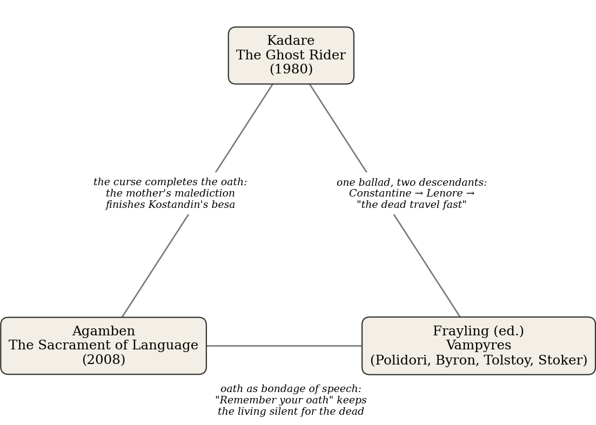
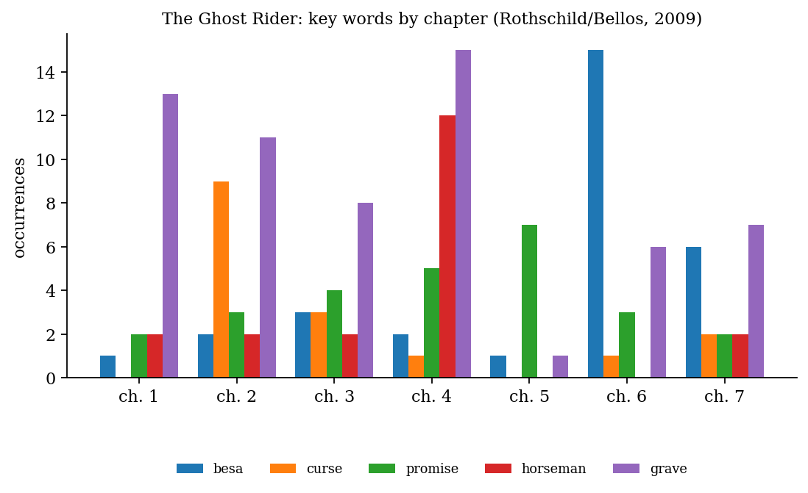
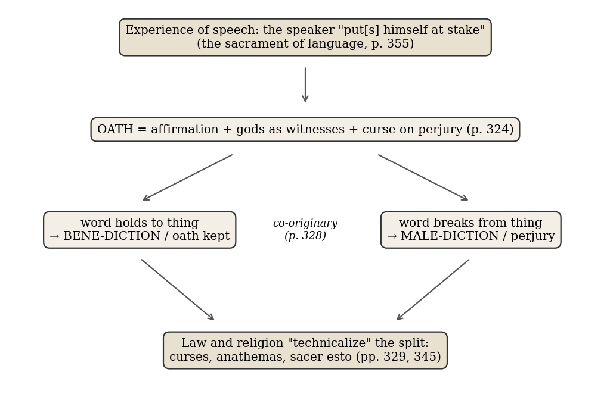
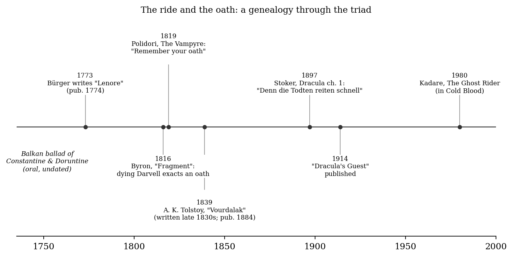

*Triad 31 of 32 · 2026-10-24 · Difficulty 3 · Oblique/structural, Genealogy/influence, Shared figure or motif*

## The three books

- [[books/14272-the-ghost-rider|The Ghost Rider]], [[people/ismail-kadare|Ismail Kadare]], [[people/jon-rothschild|Jon Rothschild]] (translator), [[people/david-bellos|David Bellos]] (translator); 1980. *Anchor: the oath as a social institution; a besa kept by a dead man, raised by his mother's curse*
- [[books/306-the-omnibus-homo-sacer-the-sacrament-of-language-a|The Omnibus Homo Sacer ('The Sacrament of Language: An Archaeology of the Oath')]], [[people/giorgio-agamben|Giorgio Agamben]], [[people/adam-kotsko|Adam Kotsko]] (translator); 2008. *Theory and hinge: oath = affirmation + witness + curse; blessing and curse co-originary; magic born from perjury*
- [[books/4593-vampyres-genesis-and-resurrection-from-count-dracu|Vampyres: Genesis and Resurrection, from Count Dracula to Vampirella]], [[people/christopher-frayling|Christopher Frayling]] (editor); 1978 (rev. 1991; edition 2016). *Genealogy and inversion: Lenore → 'the dead travel fast'; the vampire tale opens with an extracted oath that silences the living*

---

## The Thread

Three books about a promise that outlives the person who made it. In Kadare’s *The Ghost Rider*, Kostandin has given his mother his *besa* (his sworn word) that he will bring his sister Doruntine home whenever their mother wants her. He dies in battle. His mother curses him at his grave, and three weeks later Doruntine arrives on horseback, saying her brother brought her. Agamben’s *The Sacrament of Language* argues that the curse is not something added to an oath from outside. Blessing and curse are “co-originary” in it, two outcomes of one act in which a speaker stakes himself on his word. Frayling’s *Vampyres* anthology carries the literary offspring of Kadare’s ballad: Bürger’s “Lenore” and its line “the dead travel fast,” which Stoker moved into the first chapter of *Dracula*. It also shows that the English vampire tale begins with a dying man extracting an oath. Byron’s “Fragment” (1816) and Polidori’s *The Vampyre* (1819) both open their plots this way.

The less obvious part is that the oath runs in opposite directions in the two fictions. In Kadare it brings a dead man back to *deliver* someone. In Polidori, “Remember your oath” keeps the living man silent while the dead man returns to *take* someone. In both, the curse half of the oath does the work. In Kadare it is the mother’s malediction. In Tolstoy’s “Vourdalak” (in Frayling) a ballad’s self-curse, “If I should break my oath, come to me after your death,” calls up the revenant. Agamben supplies the theory both fictions act out: “It is from the oath—or, better, from perjury—that magic and spells are born.” **Connection kinds:** Oblique/structural; Genealogy/influence; Shared figure or motif. **Difficulty:** 3.

## 1. The Ghost Rider — Ismail Kadare (1980; first published in the collection Cold Blood)

EPUB · Calibre ID 14272 · trans. Jon Rothschild (from Jusuf Vrioni’s French), revised by David Bellos, Canongate 2009. The library also holds the 1988 translation as *Doruntine* (ID 5496). → [[books/14272-the-ghost-rider|book page]]

**Selection logic.** This is the anchor and the only fiction among the three that treats the oath as a social institution rather than a plot device. The *besa* is argued over in chapter 6 like a constitution, and chapter 7 hands it a resurrection. Captain Stres, a policeman who spends most of the book looking for a living impostor, gives the triad its rationalist resistance.

**Overview.** Medieval Albania. Doruntine, married off to a distant country, appears at her mother’s house at night and says Kostandin brought her. Kostandin and his eight brothers have been in their graves for three years. Both women take to their beds and die, the daughter first. Stres investigates a lover, an impostor seeking a reward, and an itinerant icon seller who is arrested and confesses. Meanwhile mourners sing the legend and the archbishop takes an interest. The novel ends with Stres addressing a great assembly in the courtyard of the Old Monastery, before guests from distant principalities. He gives the legend a political reading:

*Figure 1: Constellation of the three books*

the *besa* as a native institution that could be “capable of bending the laws of death.” Bellos’s introduction places the novel in Kadare’s position under Hoxha and in the Lenore question.

**Quotes**

- “So who did Bürger steal it from?” the young woman asks. *(Introduction, David Bellos, quoting Kadare’s* Twilight of the Gods of the Steppes*)*

- ‘Now I am left alone in the world, for you have broken your promise. May the earth never receive you!’ *(ch. 2, the mother’s curse as the cemetery watchman reports it)*

- A curse be on thee, Kostandin! Do you recall the solemn promise you made? Or has your besa rotted with you in the grave? *(ch. 3, a mourners’ song)*

- It was still very rare: delicate, like a wild flower needing tender care, its shape as yet undefined. *(ch. 6, Kostandin’s friends on the besa)*

- Except for one thing, Captain Stres: there was no default. He kept his promise in the end. *(ch. 6)*

- Therefore, to be more exact I would have to say that it was all of us – you, me, our dead lying there in the graveyard close by the church – who, through Kostandin, brought Doruntine back. *(ch. 7, Stres’s speech)*

**Derived list: who brought Doruntine back? (the explanations the novel tries)**

1. An unknown horseman who knew of “Kostandin’s besa,” perhaps after money: “Had he hoped for some reward?” (ch. 2).

2. Kostandin himself, “in accordance with his oath, his besa” (ch. 7, Stres’s official answer).

3. “All of us”: the community in which the besa “germinated” (ch. 7).

4. The besa faction: the ride as proof of the promise (ch. 7).

5. The repentance faction: “a resurrection intended to make good a fault” (ch. 7).

6. A third group: the ride as an attempt to reconcile distance and proximity, the local marriage and the foreign one (ch. 7).

**Diagram: the vocabulary of the oath across the chapters.** The English word *oath* appears exactly once in the novel, in ch. 7, where Stres glosses *besa* for the foreign guests. *Besa* peaks in ch. 6, where it is debated as an institution. *Curse* peaks in ch. 2, where it is reported as an event. (Counts include inflected and compound forms: *cursed*, *graveyard*, *promised*.)

*Figure 2: Kadare word frequency*

## 2. The Sacrament of Language: An Archaeology of the Oath — Giorgio Agamben (2008; Homo Sacer II, 3)

PDF · Calibre ID 306 (in *The Omnibus Homo Sacer*, Stanford UP 2017; trans. Adam Kotsko) · Gestext. Page refs give the printed page, then the PDF page. → [[books/306-the-omnibus-homo-sacer-the-sacrament-of-language-a|book page]]

**Selection logic.** Agamben is the hinge. Without him the other two books are a folk motif and its descendants. With him they become two dramatizations of one structure: an oath is a word that binds the speaker’s life, and its curse is the form that binding takes when the word fails. He also explains why a curse can do what Kostandin’s mother’s curse does. It is the oath’s own force turned against the broken word.

**Overview.** Starting from Paolo Prodi’s history of the oath as the “sacrament of power,” Agamben turns down the usual account, in which a magico-religious stage comes first and the oath borrows its force from the gods. He puts the oath first. It is the anthropogenic event in which speech commits the speaker to the truth of his word. Religion and law come later, as attempts to “technicalize” that commitment by dividing it into oath and perjury, blessing and curse, true formula and false. The book moves through Greek *horkos*, Roman *fides* and *sacramentum*, blasphemy, and Benveniste and Usener on divine names. It ends with philosophy as the practice that keeps speech exposed to truth instead of codifying it.

**Excerpt (p. 328 / PDF 337).** Agamben strips the gods out of the curse and finds a relation between words and things:

> According to the common opinion, the gods (or, to be more precise, their names) are mentioned in the oath twice: once as witnesses of the oath and a second time, in the curse, as punishers of perjury. […]
>
> *(Shortened for the public edition.)*

(A line-break hyphen in “pos- sibility” is silently closed.)

**Diagram: the argument in brief**

*Figure 3: Agamben argument map*

**Quotes Glossary of the book’s working terms** (definitions drawn from Agamben’s own usage in

- “The oath does not in any way constitute a remedy against the “Indo-European scourge”; instead, the scourge itself is contained within it in the form of perjury.” (p. 306 / PDF 315)

- “The oath seems, then, to result from the conjunction of three elements: an affirmation, the invocation of the gods as witnesses, and a curse directed at perjury.” (p. 324 / PDF 333)

- “The oath is not a conditional curse: on the contrary, the curse and its symmetrical pendant, the blessing, are born as specific institutions from the division of the experience of speech that was in question in the oath.” (p. 333 / PDF 342)

- “It is from the oath—or, better, from perjury—that magic and spells are born: the formula of truth, when broken, is transformed into an efficacious curse” (p. 333 / PDF 342)

- “Precisely because, unlike other living things, in order to speak, the human being must put himself at stake in his speech, he can, for this reason, bless and curse, swear and perjure.” (p. 355 / PDF 364)

pp. 306–355)

- *horkos*: the Greek oath. Following Benveniste, an act of self-consecration in anticipation, handing oneself to an avenging power if the word is broken (p. 323).

- *epiorkos*: perjury. One reading Agamben develops is “an oath added to the oath,” the curse that strikes whoever betrays *fides* (p. 334).

- *ara* / *imprecatio*: the curse. Both words also mean “prayer” or “augury,” and that ambivalence marks the whole vocabulary of *sacratio* (p. 327).

- *pistis* / *fides*: trust placed in a given word, one of the two elements the oath joins (p. 324).

- *sacratio* / *devotio*: consecration to the gods below. The second element, which makes the perjurer *sacer* (pp. 323–24, 329).

- *politikē ara*: the “political curse” that accompanies the proclamation of law (pp. 328–29, 351).

- *bene-diction / male-diction*: good saying and evil saying, the two outcomes of every naming (p. 353).

## 3. Vampyres: Genesis and Resurrection, from Count Dracula to Vampirella — Christopher Frayling, ed. (1978; rev. 1991; this edition Thames & Hudson 2016)

EPUB · Calibre ID 4593. Section labels follow the book’s own: Part One “A Literary History,” Part Two “An Anthology,” §1–6. → [[books/4593-vampyres-genesis-and-resurrection-from-count-dracu|book page]]

**Selection logic.** Frayling supplies both the genealogy (Bürger’s “Lenore” passing into *Dracula* through the line “the dead travel fast”) and the primary texts in which the oath is the vampire’s first tool. Read next to Kadare, Polidori’s Aubrey is Kostandin inverted: a living man bound by a promise to a dead one, whose keeping of it costs his sister her life.

**Overview.** A long literary-historical essay, “Lord Byron to Count Dracula,” followed by an anthology in six sections. The anthology runs from Enlightenment reports (Tournefort, Calmet), through Polidori’s *The Vampyre*, Byron’s “Fragment of a Story,” Dumas at the theatre, *Var-ney*, Raupach’s “Wake Not the Dead,” Hoffmann, A. K. Tolstoy’s “The Family of the Vourdalak,” Stoker’s working and research papers, “Dracula’s Guest” and *Dracula*, to modernist vampires and Angela Carter. The 2016 preface dates the literary vampire to June 1816 at the Villa Dio-dati.

**Quotes**

- ‘Swear by all your soul reveres, by all your nature fears, swear that for a year and a day you will not impart your knowledge of my crimes or death to any living being in any way, whatever may happen, or whatever you may see.’ *(Polidori,* The Vampyre*, Part Two §2)*

- ‘Remember your oath, and know, if not my bride today, your sister is dishonoured. Women are frail!’ *(Polidori,* The Vampyre*, Part Two §2)*

- ‘Swear it, by all that –’ He here dictated an oath of great solemnity. *(Byron, “Fragment of a Story,” dated 17 June 1816; Part Two §2)*

- ‘I swear to be faithful to you and never to forget you. If I should break my oath, come to me after your death and drink all my heart’s blood!’ *(A. K. Tolstoy, “The Family of the Vourdalak”: Sdenka’s Serbian ballad; Part Two §4)*

- One of my companions whispered to another the line from Burger’s ‘Lenore’: – Denn die Todten reiten schnell – (For the dead travel fast.) *(Stoker,* Dracula *ch. 1; Part Two §6)*

- The quotation ‘the dead travel fast’ (from Bürger’s poem Lenore ) was at some stage removed from the Munich section of the novel *(Frayling’s headnote to §6)*

**Diagram: the ride and the oath as a genealogy**

*Figure 4: Timeline*

**Derived list: the oaths in Frayling’s anthology, and what each binds**

1. Byron, “Fragment” (1816): the dying Darvell binds the narrator to conceal his death. The fragment breaks off before the oath has any consequence.

2. Polidori, *The Vampyre* (1819): Ruthven binds Aubrey for “a year and a day.” The oath works as a gag, and Ruthven’s whisper “Remember your oath” comes back three times.

3. Dumas at the theatre (Part Two §2): the stage Ruthven’s “Think of thy oath!” draws applause and a whistle from the boxes.

4. Raupach, “Wake Not the Dead” (1822): Walter swears over his wife’s corpse never to recall her with love, an oath that tries to undo a resurrection.

5. Tolstoy, “Vourdalak”: the lady of the ballad swears faithfulness with the curse built in, and the revenant is her own forfeit.

6. Frayling’s summary of Polidori (Part One): “the narrator, bound by oath, is unable to tell anyone about Ruthven’s guilty secret.”

## Where this sends you

## Notebook

1. Kostandin’s friends call the *besa* “delicate, like a wild flower needing tender care” (Kadare, ch. 6) and hope it will let “external laws” be shed “as a snake sloughs off its old skin.” Agamben says law is *born* from technicalizing the oath through “curses and anathemas” (p. 345). Write on whether an oath can be internal, kept with no curse attached, or whether the mother’s curse in ch. 2 shows that even Kostandin’s *besa* needed one.

2. Polidori’s refrain “Remember your oath” and Stres’s “it was all of us … who, through Kostandin, brought Doruntine back” (ch. 7) give two answers to one question: once the swearer is dead, who holds the oath? Write a page in which the oath is the only surviving party, and it speaks.

3. Sdenka’s ballad (“If I should break my oath, come to me after your death and drink all my heart’s blood!”) is a self-curse sung as entertainment. Set it next to Agamben’s “It is from the oath—or, better, from perjury—that magic and spells are born” (p. 333). Draft a ballad stanza in which the conditional clause is the spell, and notice where the grammar does the summoning.

## Rabbit holes

- *Constantin and Doruntinë*, the Albanian ballad and its variants, with the *besa* at its center: [Wikipedia.](https://en.wikipedia.org/wiki/Constantin_and_Doruntin%C3%AB) Follow its references to Robert Elsie’s translations.

- Bürger’s “Lenore” (written 1773, published 1774): history, translations, and Stoker’s use of the line: [Wikipedia, “Lenore (ballad)”.](https://en.wikipedia.org/wiki/Lenore_(ballad)) Read it in French in [*Lénore et autres ballades*, Project Gutenberg.](https://www.gutenberg.org/ebooks/14912)

- Polidori, *The Vampyre; a Tale*, complete: [Project Gutenberg.](https://www.gutenberg.org/ebooks/6087)

- Agamben, *The Sacrament of Language* as a standalone volume (trans. Kotsko, 2010): [Stanford University Press.](https://sup.org/books/theory-and-philosophy/sacrament-language) The bibliography on pp. 357–360 of the omnibus (Hirzel, Glotz, Loraux’s “Oath, Son of Discord,” Faraone on curses and blessings) is a reading list in itself.

- How painters handled the ride: [“The Dead Travel Fast: The Gothic Ballad of Lenore in Paint,” The Eclectic Light Company.](https://eclecticlight.co/2018/09/30/the-dead-travel-fast-the-gothic-ballad-of-lenore-in-paint/)

## Also in your library

- *Twilight of the Eastern Gods*, Ismail Kadare (ID 5492): the novel Bellos cites as *Twilight of the Gods of the Steppes*, in which the narrator asks, “Have you ever read Bürger’s Lenore?” Bellos opens his introduction to *The Ghost Rider* with that question.

- *Dracula’s Guest and Other Weird Tales*, Bram Stoker (ID 3022): the cut chapter, with “The dead travel fast” carved on a tomb.

- *The Axe and the Oath: Ordinary Life in the Middle Ages*, Robert Fossier (ID 4060): the oath in daily life rather than in sacrament.

## From the Lexicon — Anathema

**Received:** A formal ecclesiastical curse, with excommunication; by extension, a thing or person detested or wholly shunned (“X is anathema to Y”).

**Etymology.** Classical Greek *anathēma* (*ana* “up” + *tithenai* “to put”), a votive offering, a thing set up for the god, became in ecclesiastical Greek “a thing accursed.” It is in English from the 1520s.

**WordNet.** WordNet gives two senses. The one at work here is the second, “a formal ecclesiastical curse accompanied by excommunication,” filed under *execration*. The first sense, “a detested person,” is what is left once the rite drops away.

**Lineage.** Shares a lineage with Hypostasis, Kenosis, chiliasm and apostasy, through Christian Theology.

**Why today.** Agamben finds the same double valence across the whole vocabulary of *sacratio*. *Devoveo* means both “to consecrate” and “to curse” (p. 327). *Anathema* is that inversion inside one word: the offering set up for the god becomes the thing devoted to destruction.

**Verified occurrence.** Agamben, *The Sacrament of Language*, p. 345 / PDF 354: “law and religion are born, both of which seek to tie speech to things and to bind, by means of curses and anathemas, speaking subjects to the veritative power of their speech”.

**New in the Lexicon**

- chiliasm: the doctrine, read from Revelation 20, of a visible thousand-year reign of Christ on earth before the Last Judgment.

- Taborites: the radical, millenarian and egalitarian wing of the Hussites, centered on Tábor in Bohemia (founded 1420).

- Joachites: followers of Joachim of Fiore who expected an imminent Age of the Spirit and an “Eternal Gospel,” with 1260 as the hinge year.

- apostasy: formal renunciation of one’s religion, or by extension of a cause once professed.

## To carry

> “Every naming is, in fact, double: it is a blessing or a curse.” — Giorgio Agamben, *The Sacrament of Language*, p. 353 (Omnibus PDF 362)

## Themes

[[themes/agamben|Agamben]] · [[themes/albanian-ballad|Albanian ballad]] · [[themes/anathema|anathema]] · [[themes/aubrey|Aubrey]] · [[themes/benediction|benediction]] · [[themes/benveniste|Benveniste]] · [[themes/besa|besa]] · [[themes/byron-s-fragment|Byron's Fragment]] · [[themes/captain-stres|Captain Stres]] · [[themes/constantine-and-doruntine|Constantine and Doruntine]] · [[themes/curse|curse]] · [[themes/darvell|Darvell]] · [[themes/dead-rider|dead rider]] · [[themes/devotio|devotio]] · [[themes/dracula-s-guest|Dracula's Guest]] · [[themes/epiorkos|epiorkos]] · [[themes/horkos|horkos]] · [[themes/kadare|Kadare]] · [[themes/kanun|kanun]] · [[themes/lenore|Lenore]] · [[themes/malediction|malediction]] · [[themes/oath|oath]] · [[themes/perjury|perjury]] · [[themes/polidori|Polidori]] · [[themes/politike-ara|politike ara]] · [[themes/prodi|Prodi]] · [[themes/promise-beyond-death|promise beyond death]] · [[themes/revenant|revenant]] · [[themes/ruthven|Ruthven]] · [[themes/sacrament-of-language|sacrament of language]] · [[themes/sacrament-of-power|sacrament of power]] · [[themes/sacratio|sacratio]] · [[themes/sdenka|Sdenka]] · [[themes/silence|silence]] · [[themes/spell|spell]] · [[themes/stoker|Stoker]] · [[themes/the-dead-travel-fast|the dead travel fast]] · [[themes/vampire-genealogy|vampire genealogy]] · [[themes/vourdalak|Vourdalak]]

---

Previous: [[triads/2026-10-23-the-person-who-waits|The Person Who Waits]]  
Next: [[triads/2026-10-25-the-pattern-determines-the-parts|The Pattern Determines the Parts]]
