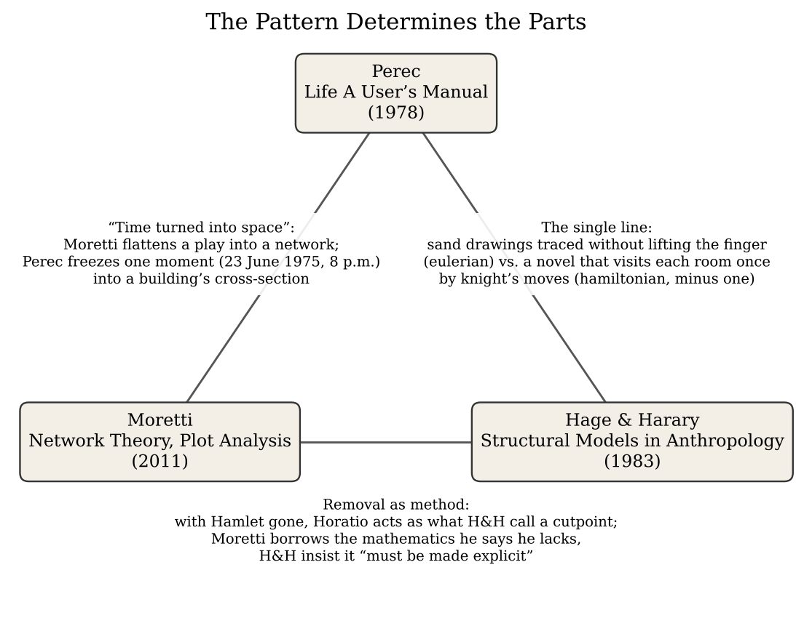
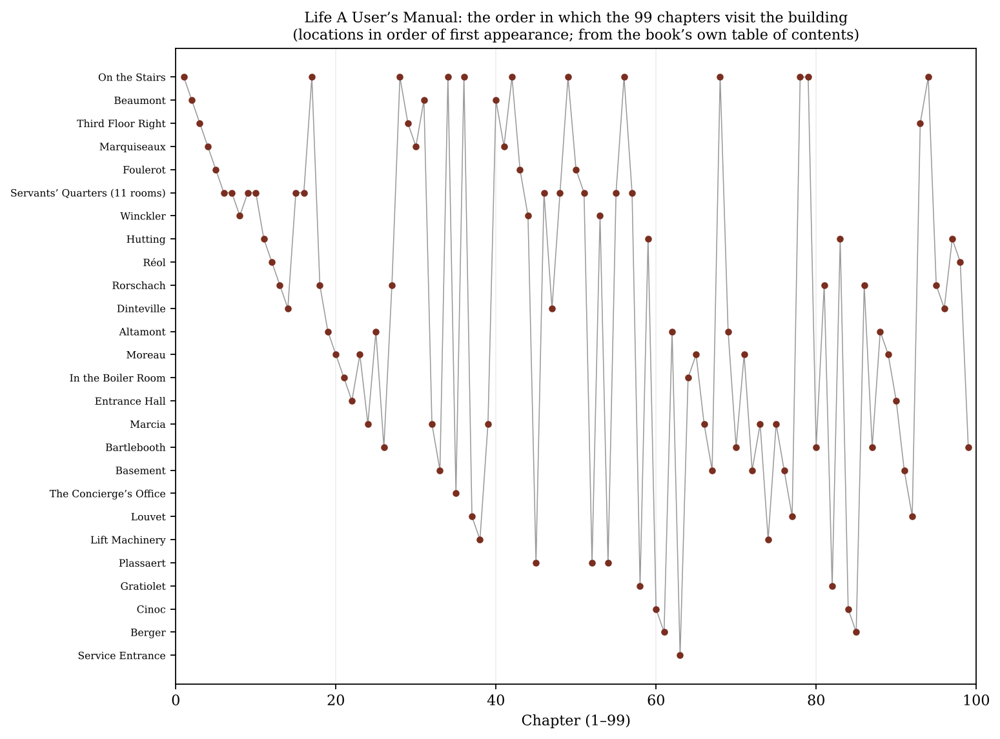
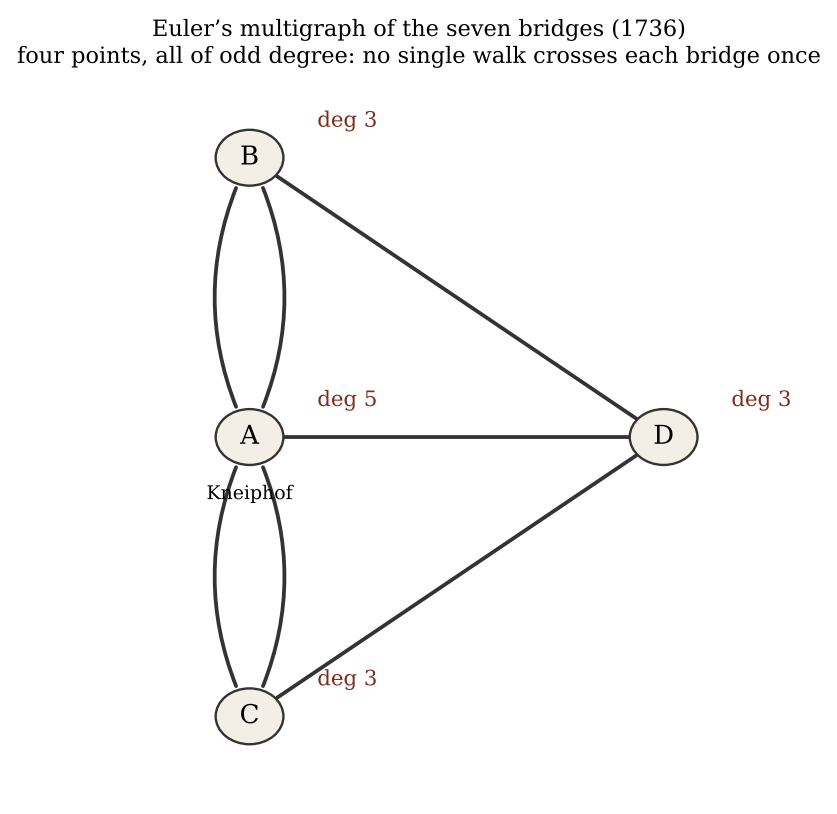

*Triad 32 of 32 · 2026-10-25 · Difficulty 3 · Shared form or method, Same subject, Conflict*

## The three books

- [[books/773-life-a-user-s-manual|Life: A User's Manual]], [[people/georges-perec|Georges Perec]], [[people/david-bellos|David Bellos]] (translator); 1978 (trans. 1987; Vintage ebook). *Anchor: the graph narrated from inside — a building walked one room per chapter; the Preamble states the relational premise.*
- [[books/5420-network-theory-plot-analysis-literary-lab-pamphlet|Network Theory, Plot Analysis (Literary Lab Pamphlet 2)]], [[people/franco-moretti|Franco Moretti]]; 2011. *Experiment: turns Hamlet into a network and removes vertices; position, not essence, makes Horatio indispensable.*
- [[books/9870-structural-models-in-anthropology|Structural Models in Anthropology]], [[people/per-hage|Per Hage]], [[people/frank-harary|Frank Harary]]; 1983 (Calibre lists 1984; 2007 reissue). *Formal ground: exact definitions (cutpoint, bridge, hamiltonian, eulerian) and the claim that graph theory is already in anthropology.*

---

## The Thread

Three books that take the relation, not the thing, as what carries meaning, and then test the claim by taking a piece out. Perec opens *Life A User’s Manual* with a jigsaw-puzzle preamble: “the parts do not determine the pattern, but the pattern determines the parts”. He then builds a novel as a walk through a building’s cross-section, one room per chapter, 99 chapters for 100 squares, and ends it with a man dead over a puzzle holding a W-shaped piece above an X-shaped hole. Moretti turns *Hamlet* into a graph (characters as vertices, speech as edges) and deletes characters to see what holds the play together. With Hamlet removed, Horatio, who is flat and without motive, turns out to be the one character whose loss severs the Ghost from Fortinbras. Hage and Harary supply the formal vocabulary both of them lean on: cutpoint, bridge, hamiltonian cycle, eulerian graph. They find that vocabulary already at work in anthropology: in the rule for New Hebrides sand drawings (one continuous line, finger never lifted, no line traced twice), which is Euler’s theorem in practice.

Connection kinds: **Shared form or method**, **Same subject**, **Conflict**. The conflict is about mathematics. Moretti says the theory “requires a level of mathematical intelligence which I unfortunately lack” and works by hand. Hage and Harary allow that metaphor is often enough, but hold that in other contexts “the mathematics really must be made explicit.” Perec makes it explicit and then hides it: the novel never names its knight’s tour. **Difficulty: 3.** The two scholarly books are plainly about the same subject. The work is in seeing that Perec’s novel is the third term: a graph narrated from the inside, whose structure you can recover from its own table of contents (see the diagram below).

## Constellation

From To What passes between them

Perec Moretti “Time turned into space”:

> Moretti flattens four hours of a play into one network; Perec freezes one moment (23 June 1975, 8 p.m.) into a building’s cross-section.

From To What passes between them

Perec Hage & Harary The single line: sand

> drawings traced without lifting the finger (an eulerian circuit, every line once) vs. a novel that visits each room once by knight’s moves (a hamiltonian walk, every point once, minus one).

Moretti Hage & Harary Removal as method: with

> Hamlet gone, Horatio behaves as what H&H define as a cutpoint. Moretti borrows mathematics he says he lacks; H&H insist it must be made explicit.

## 1. Life A User’s Manual — Georges Perec (1978; trans. David Bellos, 1987)

EPUB · Calibre ID 773 · Vintage ebook edition → [[books/773-life-a-user-s-manual|book page]]

**Selection logic.** The anchor. Perec’s Preamble states the structuralist premise in plain words through the jigsaw puzzle, and the rest of the book stages it: residents connected by stairs, objects, rumours and stories, with Bartlebooth’s fifty-year puzzle project as the plot’s spine. It is also the only one of the three where the graph is the reader’s experience rather than the analyst’s tool.

**Overview.** One apartment block at 11 rue Simon-Crubellier, Paris XVII, observed at a single instant just before 8 p.m. on 23 June 1975. Each chapter describes one room and the lives that pass through it. The central story concerns Percival Bartlebooth, who spends ten years learning watercolour, twenty years painting 500 seaports, and twenty more reassembling them as jigsaw puzzles cut by Gaspard Winckler. Each finished puzzle is to be returned to the place it was painted and dissolved. Valène, the old painter on the top floor, plans to paint the whole building. According to the Oulipo record (see Rabbit holes), the chapter order follows a knight’s tour of a 10 × 10 grid laid over the building’s elevation, and one basement square is skipped. The novel itself never says so.

**Excerpt** (Preamble; repeated nearly verbatim at the start of Ch. 44). This is the theory in the voice of a puzzle-maker:

> the perceived object – we may be dealing with a perceptual act, the acquisition of a skill, a physiological system, or, as in the present case, a wooden jigsaw puzzle – is not a sum of elements to be distinguished from each other and analysed discretely, but a pattern, that is to say a form, a structure: […]
>
> *(Shortened for the public edition.)*

*Figure 1: The three books and what passes between them*

> of go. The pieces are readable, take on a sense, only when assembled; in isolation, a puzzle piece means nothing – just an impossible question, an opaque challenge. But as soon as you have succeeded, after minutes of trial and error, or after a prodigious half-second flash of inspiration, in fitting it into one of its neighbours, the piece disappears, ceases to exist as a piece.

**Quotes.**

- “The eye follows the paths that have been laid down for it in the work (Paul Klee, Päd-agogisches Skizzenbuch )”. This is the epigraph to the Preamble, and it reads as a description of the knight’s tour that the book never mentions.

- “a vertical cross-section of the building giving a diagrammatic picture of the layout of the flats” (Ch. 1, *On the Stairs, 1*).

- “an arbitrarily constrained programme with no purpose outside its own completion” (Ch. 26, *Bartlebooth, 1*).

- “the black hole of the sole piece not yet filled in has the almost perfect shape of an X. But the ironical thing, which could have been foreseen long ago, is that the piece the dead man holds between his fingers is shaped like a W.” (Ch. 99, *Bartlebooth, 5*).

- “dividing it up into regular square boxes, the sketch of a cross-section of a block of flats which no figure, now, would ever come to inhabit.” (Epilogue). Valène’s canvas ends up as a grid with no figures in it: the structure with every element removed.

**Diagram: the walk through the building, read off the table of contents.** Each dot is a chapter. The rows are the locations named in its title, listed in order of first appearance, with the eleven servants’ rooms grouped into one row. The line is the order in which the reader visits them.

**Derived list: the high-degree vertices.** Counted from the book’s own contents (99 chapters, 36 named locations):

1. On the Stairs: 12 chapters (*On the Stairs, 1* to *12*). The stairwell is the building’s hub. It is the only space every resident passes through.

2. Rorschach and Marcia: 6 each.

3. Altamont, Moreau, Bartlebooth, Basement: 5 each.

4. Hutting: 4.

5. Beaumont, Third Floor Right, Marquiseaux, Foulerot, Winckler, Dinteville, Louvet, Plas-saert: 3 each.

6. Servants’ Quarters: 11 separate rooms, one chapter each (numbered 1–11 in parentheses). Many vertices of degree one: Moretti’s “periphery” in architectural form.

## 2. Network Theory, Plot Analysis — Franco Moretti (Stanford Literary Lab Pamphlet 2, May 1, 2011)

PDF · Calibre ID 5420 · catalogued as “Literary Lab #2”; an abbreviated version appeared in *New Left Review* 68 (2011) → [[books/5420-network-theory-plot-analysis-literary-lab-pamphlet|book page]]

**Selection logic.** Moretti applies the Perec premise to an existing masterpiece and then runs experiments on it. His Horatio argument is the clearest demonstration in the triad that a node’s meaning is its position. It also sets up the conflict with Hage and Harary: Moretti works by hand, with no weights and no direction, and says so.

**Overview.** Moretti builds character networks by hand for *Hamlet*: two characters are linked if they speak to each other. He reads the network for features invisible in performance: the past stays visible, regions emerge (a “region of death”), and centrality is measured. Then he deletes vertices. Deleting Hamlet almost splits the play in two. Deleting Claudius changes little, because the Court is densely clustered. Deleting Hamlet and then Horatio cuts the Ghost and Fortinbras off from everything. From this he argues that Horatio, the flat “weak

*Figure 2: Chapter path*

tie”, foreshadows the impersonal State. Later sections extend the method to *The Story of the Stone* and *Our Mutual Friend*.

**Quotes.**

- “A network is made of vertices and edges; a plot, of characters and actions: characters will be the vertices of the network, interactions the edges” (p. 3).

- “two characters are linked if some words have passed between them: an interaction, is a speech act.” (p. 3).

- “Anyway. Four hours of action, that become this. Time turned into space” (p. 3).

- “what is truly deadly, is the characters’ position in the network, chained to the warring poles of king and prince. Outside of that red region, no one dies in Hamlet. The tragedy, is all there.” (p. 4).

- “Not for what is “in” it; not for its essence, but for its function in the stability of the network.” (p. 5).

- “Horatio has a function in the play, but not a motivation.” (p. 7).

**Derived list: the removal experiments** (pp. 4–5; the figures are Moretti’s).

1. *Hamlet* intact: Hamlet is “One degree of separation from 16 of the characters” (p. 4); average distance 1.45.

2. Remove Hamlet: the network almost splits in half. All that joins the Court to the Ghost– Fortinbras region is the three edges from Horatio to Claudius, Gertrude and Osric.

3. Remove Claudius (average distance 1.62, almost as central as Hamlet): a handful of peripheral characters are affected; the whole barely changes.

4. Remove Hamlet, then Claudius: little further effect.

5. Remove Hamlet, then Horatio (average distance 1.69, *less* central than Claudius): “the Ghost and Fortinbras – which is to say, the beginning and the ending of the play – are completely severed from each other and from the rest of the plot. Hamlet no longer exists.” (p. 5).

6. The explanation: clustering. The Court hexagon (Hamlet, Claudius, Gertrude, Polonius, Ophelia, Laertes) is at 100%, so it survives any single loss. Horatio sits where clustering is low.

**Glossary: Moretti’s working terms** (paraphrased from pp. 2–7 except where quoted).

- *Vertex / edge*: character / speech act (p. 3).

- *Weight*: how much was said along an edge. Moretti leaves it out and admits that eight words and four thousand words count the same.

- *Direction*: who addressed whom. Also left out (the Ghost speaks only to Hamlet).

- *Clustering*: from Mark Newman: “the friend of your friend is likely also to be your friend.” (p. 6).

- *Weak tie*: Horatio’s kind of link, “less intense, but with a wider radius” (p. 7).

- *Power law*: the degree distribution, with “no “typical” vertex in the network, and no typical character in the plays” (p. 4).

## 3. Structural Models in Anthropology — Per Hage & Frank Harary (1983)

PDF · Calibre ID 9870 · Cambridge Studies in Social Anthropology 46; Calibre lists 1984, the book’s copyright page says 1983; 2007 digital reissue. Page numbers are the printed ones (PDF page = printed + 15). → [[books/9870-structural-models-in-anthropology|book page]]

**Selection logic.** This is the technical ground under the other two. Hage, an anthropologist, and Harary, one of the founders of modern graph theory, argue that graph theory is “already in anthropology”. The book gives exact definitions for the operations Moretti performs by

eye (removal, disconnection, centrality). It also shows, in the Melanesian sand drawings, a culture that practised Euler’s theorem without writing it down: the best parallel in the library for a novel built on an unstated knight’s tour.

**Overview.** The book introduces graphs, signed graphs, digraphs, matrices, duality, networks and groups, and opens each chapter with an anthropological use of the concept that was there before anyone formalised it. Examples include structural balance, kinship terminolo-gies, exchange systems such as the Kula ring, Lévi-Strauss’s Klein-group analyses of myth, and Hymes’s Chinook myths arranged on a cube graph. The epigraph is from Peirce. The foreword, by J. A. Barnes, begins: “Of the making of”structures” there is no end.” (p. ix).

**Excerpt** (pp. 10–12). Hage and Harary quote A. Bernard Deacon’s 1934 account of New Hebrides (now Vanuatu) geometrical drawings: “In theory the whole should be done in a single continuous line which ends where it began; the finger should never be lifted from the ground, nor should any part of the line be traversed twice” (p. 10). They then set Euler’s Königsberg solution beside it and conclude:

> The operation of this same theorem can be seen in the New Hebrides geometric figures, which can be drawn in the way specified by Deacon precisely because each point has even degree. (p. 12)

and characterise the art form by saying “whatever the particular configurations may look like or represent, they are eulerian; that is, they are connected and all points have even degree.” (p. 12).

**Diagram: Euler’s multigraph.** As H&H describe it, “Euler replaced each land area by a point and each bridge by a line joining the corresponding points, thereby producing the first published graph theoretic model.” (p. 12). All four points have odd degree, so the walk is impossible.

**Glossary: four definitions the triad runs on** (verbatim).

- *Eulerian* (Euler’s criterion): a connected graph in which “either every point has even degree (the number of lines that emanate from a point is even) or there are exactly two points of odd degree.” (p. 12). Every line traversed once.

- *Hamiltonian*: “If a graph G has a spanning cycle Z, then G is called a hamiltonian graph and Z is a hamiltonian cycle.” (p. 26). Every point visited once. Perec’s knight’s tour is a hamiltonian path that skips one point on purpose.

- *Cutpoint*: “A cutpoint of a connected graph is one whose removal (together with its incident lines) disconnects it” (p. 19). This is Horatio in Hamlet’s absence.

- *Bridge*: “A bridge of G is a line whose removal disconnects a graph” (p. 29). On these: “the individuals and relations represented by cutpoints and bridges would presumably be of fundamental importance in the group.” (p. 29).

**Quotes.**

- “But classification according to structure is generally more important. And it is the same with ideas.” (epigraph, Peirce, letter to Calderoni).

- “graphical models are in some sense iconic; they look like what they represent” (p. 9).

- “In many contexts it is sufficiently illuminating to proceed strictly at the level of metaphor and analogy.” (p. 13), followed by “But in other contexts the mathematics really must be made explicit.” (p. 13; a line-break hyphen in “explicit” is closed up).

- “graph theory is such a congenial mode of anthropological thought that if Euler had not discovered it, some anthropologist might very well have.” (p. 13).

*Figure 3: Königsberg multigraph*

## Where this sends you

## Notebook

1. **The W in the X-shaped hole.** Put Perec’s last image (Ch. 99) beside Moretti’s Horatio (p. 7: “a function in the play, but not a motivation”). Bartlebooth’s last piece is the reverse case: an element with total motivation and no possible function, a vertex that can take no edge. Write the page in which a piece exists but has nowhere to go. Is it a node or a remainder?

2. **Write under Deacon’s rule.** Take the sand-drawing constraint (H&H p. 10: one line, ends where it began, nothing traced twice) as a poetics. Draft a short text whose transi-tions never repeat and which returns to its first sentence. Then look at the chapter-path diagram: Perec revisits the Stairs twelve times. Which of your recurring figures plays the stairwell, the vertex that has to be passed through again and again?

3. **What counts as an edge in your own corpus?** Moretti decides that “an interaction, is a speech act” (p. 3) and admits the decision is contestable. Choose an edge rule for your commonplace book or the Lexicon: co-quotation, citation, adjacency on the page, shared lineage. Then run his experiment: remove your most central entry. If one term turns out to be the only link between two clusters, that term is your Horatio. Perec’s Preamble already says the only thing that counts is “the ability to link this piece to other pieces”.

## Rabbit holes

- Moretti, *Network Theory, Plot Analysis* (the pamphlet, free from the Lab, with all the figures): https://litlab.stanford.edu/LiteraryLabPamphlet2.pdf

- M. E. J. Newman, “The Structure and Function of Complex Networks” (2003), Moretti’s source for clustering: https://arxiv.org/abs/cond-mat/0303516

- Teo Paoletti, “Leonard Euler’s Solution to the Königsberg Bridge Problem,” MAA *Convergence*, a guided reading of Euler’s 1736/1741 paper: https://old.maa.org/node/116597

- Alban Da Silva, “An Ancient Art Form Topples Assumptions about Mathematics,” *Scientific American* (from *Pour la Science*), Vanuatu sand drawings as eulerian graphs, building on Marcia Ascher: https://www.scientificamerican.com/article/an-ancient-art-form-topples-assumptions-about-mathematics

- UNESCO, Vanuatu sand drawings (Intangible Cultural Heritage list): https://ich.unesco.org/en/RL/vanuatu-sand-drawings-00073

- *Life: A User’s Manual*, structure section (knight’s tour, 10 × 10 grid, the skipped basement, Graeco-Latin bi-squares): https://en.wikipedia.org/wiki/Life:_A_User%27s_Manual. From there, look for Perec’s *Cahier des charges de La Vie mode d’emploi* (1993 facsimile edition) and David Bellos, *Georges Perec: A Life in Words*.

## Also in your library

- *Island Networks: Communication, Kinship, and Classification Structures in Oceania*, Hage & Harary (1996), Calibre ID 9889. The sequel, where the graph theory meets a single region.

- *Graphs, Maps, Trees: Abstract Models for a Literary History*, Moretti (2005), Calibre ID

471. The book-length version of the move he makes in the pamphlet.

- *OuLiPo and the Mathematics of Literature*, Natalie Berkman (2022), Calibre ID 10147. For the mathematics Perec kept off the page.

## From the Lexicon — Relational Meaning

**Received:** The principle that individual data points derive significance from their position relative to others in a network.

**Etymology.* Relation*, from Latin *relatio*, a carrying back.

**WordNet.** WordNet carries the head word, *meaning* (“the message that is intended or expressed or signified”), but not the sense in play: the compound is yours. Notice that Word- Net’s gloss puts meaning in the message, which is exactly the assumption all three books set aside.

**Lineage.** Shares a lineage with *Paradigm* via Saussurean Linguistics. The term’s other lineage, Structuralism, is the word Hage and Harary put in their title.

**Why today.** This is the triad’s thesis stated as a term: Horatio’s importance and the puzzle piece’s legibility both come from position alone.

**Verified occurrence.** None. The phrase does not appear in any of the three extracted texts. The nearest is Perec’s “The pieces are readable, take on a sense, only when assembled” (Preamble).

## New in the Lexicon

- Samekh: the fifteenth letter of the Hebrew alphabet, value 60, continuing Phoenician *sāmek*.

- portmanteau: a word blended from the sounds and senses of two others, a sense coined by Humpty Dumpty in *Through the Looking-Glass*.

- dandiprat: a small early-Tudor silver coin worth about two pence; by transfer, a small or insignificant person.

- emphyteusis: in Roman and civil law, a long-term, heritable right to use another’s land as one’s own, on condition of improving it and paying a fixed rent.

- Cognates: words in different languages descended from the same ancestral word (*night*, *Nacht*, *nox*).

## To carry

> “in isolation, a puzzle piece means nothing – just an impossible question, an opaque challenge.” — Georges Perec, *Life A User’s Manual*, Preamble (trans. David Bellos)

## Themes

[[themes/bartlebooth|Bartlebooth]] · [[themes/bridge|bridge]] · [[themes/centrality|centrality]] · [[themes/clustering|clustering]] · [[themes/cross-section|cross-section]] · [[themes/cutpoint|cutpoint]] · [[themes/deacon|Deacon]] · [[themes/distant-reading|distant reading]] · [[themes/edge|edge]] · [[themes/euler|Euler]] · [[themes/eulerian-circuit|eulerian circuit]] · [[themes/gestalt|Gestalt]] · [[themes/graph-theory|graph theory]] · [[themes/hage|Hage]] · [[themes/hamiltonian-path|hamiltonian path]] · [[themes/hamlet|Hamlet]] · [[themes/harary|Harary]] · [[themes/horatio|Horatio]] · [[themes/jigsaw-puzzle|jigsaw puzzle]] · [[themes/knight-s-tour|knight's tour]] · [[themes/konigsberg-bridges|Königsberg bridges]] · [[themes/model|model]] · [[themes/moretti|Moretti]] · [[themes/network|network]] · [[themes/new-hebrides|New Hebrides]] · [[themes/oulipo|Oulipo]] · [[themes/peirce|Peirce]] · [[themes/perec|Perec]] · [[themes/power-law|power law]] · [[themes/relation-over-element|relation over element]] · [[themes/removal-experiment|removal experiment]] · [[themes/sand-drawings|sand drawings]] · [[themes/structuralism|structuralism]] · [[themes/structure|structure]] · [[themes/time-into-space|time into space]] · [[themes/valene|Valène]] · [[themes/vanuatu|Vanuatu]] · [[themes/vertex|vertex]] · [[themes/weak-tie|weak tie]]

---

Previous: [[triads/2026-10-24-remember-your-oath|Remember Your Oath]]  
Next: [[shadows/2026-10-26-shadow-elias-canetti-day-1-the-only-man|Shadow — Elias Canetti, day 1: The Only Man]]
